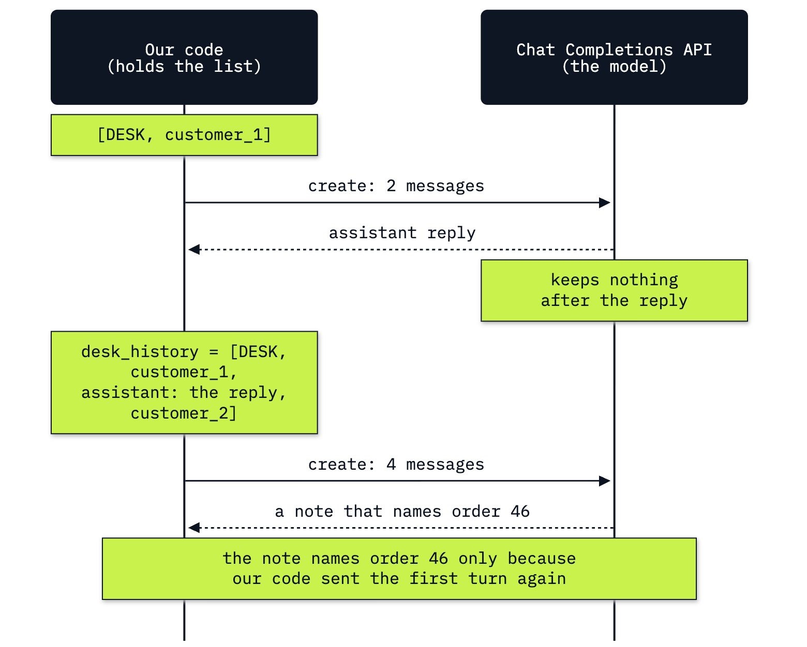

# Lab 01: How to call a model and read the response

**CPU | API key: `OPENAI_API_KEY` | Practises: how an agent works from the inside (the model writes text; our code holds the conversation), and what each call costs**

## Goal

Send one list of messages to a model, read the reply as an object, and work out what the call cost. The notebook
starts in a playground: a recipe for mansaf, a football fan called Sami and a joke about knafeh. Two things happen
there that every program built on a model has to handle. A reply is cut off in the middle of a sentence and the
call raises no error. And a second call includes nothing from the first one, until our code sends the history
itself. Then the same call goes to work at a support desk, where a customer was charged twice, and we price the
conversation.

## What you will learn

- How to build a message list with `system` and `user` roles and send it with `client.chat.completions.create`.
- How to read a `ChatCompletion` field by field: the reply's text, `finish_reason` and `usage`.
- How to notice a reply that was cut off, when the call raises no error.
- What a token is, seen as the pieces of a streamed reply.
- Why a new call includes nothing from the last one, and how sending the history makes a conversation.
- How to price a conversation from its usage and the prices in `models.env`.
- How the same call looks on the Responses API.

## What you will do

One notebook, `01_model_call.ipynb`. Parts A to D are the playground; Parts E and F are the support desk; Part G repeats
Part A's call on a second API.

**Part A: Send a message list and read the reply as an object.** A two-message list that asks a home cook for a
mansaf recipe, one call, the whole `ChatCompletion` printed and read field by field, and where to make the same
call with no code (the Chat Playground).
**Part B: Notice a reply that was cut off without an error.** The same call with a ceiling of 20 tokens, and the
check on `finish_reason` that tells a finished reply from a cut one.
**Part C: See tokens as the pieces of a streamed reply.** A one-line joke streamed with a bar between the pieces,
and the usage on the stream's last chunk.
**Part D: Keep a conversation by sending the history.** Sami tells the model his team. A new call with
only the question cannot name it; the same question sent with the history can.
**Part E: Answer a customer across two turns at a support desk.** A customer charged twice for order 46, then a
request for a note to the billing team, which the second call can write only from the first turn.
**Part F: Price the conversation from its usage.** The input and output prices in `models.env`, the two calls'
tokens added up, the formula with this run's numbers, and 100,000 such conversations.
**Part G: Make the same call on the Responses API.** Part A's call with `client.responses.create`, and the field
names of the two APIs side by side.
**Challenge.** Stream the note for the billing team and price that call; keep the two-turn conversation within a
budget of 190 tokens.
**Going further.** What reasoning effort does to a small ceiling, two requests the API refuses, cached input and
cache writes, and history kept on OpenAI's side with the Responses API.

## Checkpoints

| After | You should see |
|---|---|
| Part A | a three-step recipe; a `ChatCompletion` with `finish_reason` `stop`; 39 prompt tokens and around 100 completion tokens (ours: 118) |
| Part B | with a ceiling of 20 tokens: `length`, 20 completion tokens and a text that stops inside step 1; one pass line and one fail line from the check |
| Part C | the joke in pieces with a bar between them, `knafeh` in more than one piece (ours: four); a last chunk with `choices` `[]` and the usage (ours: 24 completion tokens for 21 pieces) |
| Part D | the call with only the question cannot name the team (12 prompt tokens); with the history it answers Al-Faisaly (ours: 66 prompt tokens) |
| Part E | a first reply that mentions order 46 (43 prompt tokens); a note for the billing team that names order 46, from a prompt more than twice as long (ours: 106) |
| Part F | prices 0.1 and 0.5; the conversation's input tokens are the two prompts added together (ours: 149, with 67 output tokens); one conversation costs a small fraction of a cent (ours: $0.0000484) and 100,000 of them $4.84 |
| Part G | a three-step recipe from `output_text`; `status` `completed`; 39 input tokens, as many as Part A's prompt tokens |
| Challenge | task 1: a streamed note that names order 46, with the same prompt tokens as Part E's second call; task 2: Part E's system message does not fit 190 tokens (ours: 224), a system message that asks for less does (ours: 182), and a ceiling of 15 tokens fails on `finish_reason` |
| Going further | at effort `low`, an empty reply with 20 reasoning tokens; two 400s that name `max_tokens` and `temperature`; 1,418 prompt tokens with 1,415 written to the cache on the first call and 1,415 read from it on the second; a follow-up with `previous_response_id` billed about as many input tokens as Part D's history (ours: 60 against 66); both stored responses deleted |

**About the saved outputs.** They come from `gpt-6-luna` at reasoning effort `none`, the model and setting in
`models.env`. The model writes a new reply on every run, so the wording and the completion tokens will differ
on yours; the prompt tokens of a fixed question will not. Check the shape of each result (`stop` or `length`, the
team named or not, order 46 in the note, which call has the longer prompt), not the words. The cut-off reply, the
call that cannot name the team and the note that names order 46 came out the same in every run we made on this
model (six or more each).

## Before you start

- **Lab 00 first.** It checks the environment and that your key reaches the model.
- **Run it locally:** in the repository folder, `uv sync` (or `pip install -r requirements.txt`), put
  `OPENAI_API_KEY` in `.env` (copied from `.env.example`), then open `01_model_call.ipynb` in VS Code or JupyterLab
  (`uv run jupyter lab`) with the `.venv` kernel. Run the setup cell first.
- **Data:** none. Every question is written in the notebook.
- **Stored on OpenAI's side:** Going further makes two calls on the Responses API that store their responses in
  your OpenAI account, and its last cell deletes both. Part G's call is sent with `store=False`, so the parts
  before Going further leave nothing stored.
- **The Chat Playground** (Part A) needs a sign-in to the OpenAI platform. It is optional: the notebook does not
  depend on it.
- **Cost:** fewer than twenty short calls, well under one US cent at the prices in `models.env`.

## Folder contents

| Path | What it is |
|---|---|
| `01_model_call.ipynb` | the guided notebook, with saved outputs |
| `resources/lab01_message_list.mmd`, `.png` | the picture of the two calls at the support desk: its mermaid source and the exported image |
| `solved/01_model_call_solution.ipynb` | the challenge solved, run with its outputs |

## Resources

- [OpenAI: Chat Completions API reference](https://developers.openai.com/api/reference/resources/chat/subresources/completions/methods/create): every argument of `create`, including `max_completion_tokens`, `reasoning_effort` and `stream_options`
- [OpenAI: text generation](https://developers.openai.com/api/docs/guides/text): messages, roles and instructions
- [OpenAI: conversation state](https://developers.openai.com/api/docs/guides/conversation-state): sending the history yourself, `previous_response_id`, and how long responses are stored
- [OpenAI: streaming](https://developers.openai.com/api/docs/guides/streaming-responses): receiving a reply piece by piece
- [OpenAI: pricing](https://developers.openai.com/api/docs/pricing): the prices `models.env` copies
- [OpenAI: reasoning models](https://developers.openai.com/api/docs/guides/reasoning): reasoning effort and reasoning tokens
- [OpenAI: prompt caching](https://developers.openai.com/api/docs/guides/prompt-caching): the 1,024-token minimum, cached input and cache writes
- [OpenAI: migrate to the Responses API](https://developers.openai.com/api/docs/guides/migrate-to-responses): the Chat Completions and Responses fields side by side
- [OpenAI: tokenizer](https://platform.openai.com/tokenizer): paste a text and see the tokens it becomes
- [OpenAI: Chat Playground](https://platform.openai.com/chat): the same call from a web page

Next: [Lab 02: How a model asks for a tool](../02_Tool_Calling/README.md). Back to [the lab list](../README.md).
