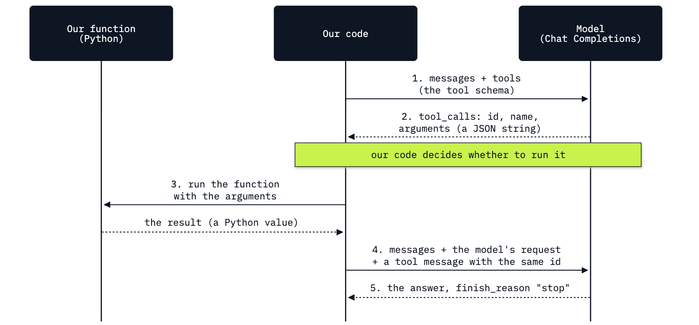

# Lab 02: How a model asks for a tool

**CPU | API key: `OPENAI_API_KEY` | Practises: how an agent works from the inside (the model asks, our code runs the tool)**

## Goal

See what a tool call is by carrying one through by hand, first on an everyday question and then at the Chinook
support desk. The lab has two notebooks.

**Notebook 1** is a playground. We ask a model to roll two dice, and it writes two numbers although nothing was
rolled. We write `roll_dice()` in plain Python, describe it to the model, and watch the model **ask** for it while
nothing runs. Our code runs the function and sends the result back, and the model answers from that result. Then
we send back a result the function could never return, and read what the model does with it.

**Notebook 2** takes the same round trip to the desk. A rep asks about a customer of the Chinook music shop, the
model asks for a database lookup, and our code runs it. Then we change the result on its way back, so that it no
longer matches the database, and compare the model's answer with what the database says.

## What you will learn

- How to describe a Python function to the model as a tool schema: its name, its description and its arguments.
- How to read a tool call: `finish_reason` `tool_calls`, no text, and an `id`, a function name and `arguments` as a
  JSON string.
- How to run the function in our own code and send its result back in a `tool` message with the same id.
- How a tool call carries a value the model wrote from the question, and how to pass it to a function.
- How to write a read-only database lookup and connect it to a model in one round trip.
- Why the answer depends on the tool result, and why the tool result is the part to test and log.
- Why a question that needs several lookups needs more than one round trip.

## What you will do

### Notebook 1: meet tool calling on an everyday question (`02a_meet_tool_calling.ipynb`)

**Part A: Ask the model to roll two dice.** One model call with no tools, then `roll_dice()`, a plain Python
function with a `TOOL CALLED` print, called by hand.
**Part B: Describe the function to the model as a tool.** The tool schema beside the function it describes, field
by field.
**Part C: The model asks for the tool, and nothing runs.** The same question with `tools=`, the reply's
`finish_reason` and empty `content`, and the whole tool call printed as JSON.
**Part D: Our code runs the function and sends the result back.** `json.loads`, the function call, the `tool`
message with the call's id, the answer, and the round trip as a picture.
**Part E: Send back a result that cannot be true.** A 9 on a six-sided die in the `tool` message, and the model's
reply.
**Part F: A tool with an argument, and the value the model writes for it.** `days_until(date)` for *How many days
until my birthday?*, two tools on offer, and `arguments` carrying a date.
**Challenge.** Dice with any number of sides, and a question that needs no tool.

### Notebook 2: tool calling at the Chinook desk (`02b_tool_calling_at_the_desk.ipynb`)

**Part A: Meet the shop, read one customer's row, and ask the model about her.** The shop in two sentences, `data/chinook.db` opened
read-only, one row of the `customers` table, and the rep's question asked with no tool.
**Part B: Write the lookup as a plain function, then describe it as a tool.** `find_customer(name)` called by hand,
then its schema beside it.
**Part C: Run one round trip at the desk.** The model asks for `find_customer`, our code runs it against the
database and sends the row back, the model answers.
**Part D: What the model does with a wrong tool result.** `get_invoices(customer_id)`, a round trip with the true
result, and the same round trip with a wrong count.
**A question with several lookups needs a loop.** A question that needs two lookups, one after the other, described
and not run: it is where the next lab starts.
**Challenge.** A third lookup, `get_support_rep`, and an empty result.

## Checkpoints

| After | You should see |
|---|---|
| Notebook 1, Part A | without a tool, a reply with two numbers (ours: a 3 and a 5) and no `TOOL CALLED` line; `roll_dice()` prints `TOOL CALLED: roll_dice()` and returns two numbers from 1 to 6 |
| Notebook 1, Part B | a schema named `roll_dice` with empty `properties` |
| Notebook 1, Part C | `finish_reason` `tool_calls`, `content` `None`, one call to `roll_dice` with `"arguments": "{}"`, and still no `TOOL CALLED` line |
| Notebook 1, Part D | `arguments` is a `str`, `args` a `dict`; one `TOOL CALLED` line; a reply with `finish_reason` `stop` that names the two numbers the function returned (ours: 4 and 2) |
| Notebook 1, Part E | a reply that reports a 9 and a 4, with no `TOOL CALLED` line |
| Notebook 1, Part F | a call to `days_until` with `{"date":"YYYY-MM-DD"}` (ours: `2027-03-14`); `TOOL CALLED: days_until(...)` with the same date; a reply with the number of days the function returned (ours: 123) |
| Notebook 2, Part A | `customers: 59`; the row `(6, 'Helena', 'Holý', 'Czech Republic')`; without a tool the model says it cannot tell from what it was given |
| Notebook 2, Part B | `find_customer("Helena Holý")` returns `[{'customer_id': 6, 'name': 'Helena Holý', 'country': 'Czech Republic'}]` |
| Notebook 2, Part C | `finish_reason` `tool_calls`; a call to `find_customer` with `{"name":"Helena Holý"}`; after the result is sent back, a reply that says the Czech Republic |
| Notebook 2, Part D | `get_invoices(6)` returns 7 invoices and 49.62; the model asks for `get_invoices` with `{"customer_id":6}` and says 7 invoices, \$49.62; with the changed `tool` message it says 2 invoices, `finish_reason` `stop` |
| Challenges | notebook 1: `{"sides":20,"count":3}`, one `TOOL CALLED` line and three numbers in the reply; `stop`, a text answer and `tool_calls` `None` for the capital question. Notebook 2: `get_support_rep` with `{"customer_id":6}` and Steve Johnson; with `"[]"` sent back, a reply that finds no customer named Helena Holý |

**About the saved outputs.** They come from `gpt-6-luna` at reasoning effort `none`, the model `models.env` names.
The dice are random, the days count from the day of the run, and the model writes its replies and its call ids anew
on every run: check the shape of each step (which tool, which arguments, which `finish_reason`), not the words.
What did not vary when we repeated these steps on this model: asked to roll dice with no tool, it wrote two numbers
every time (9 of 9 runs, and only three different pairs among them); it reported the 9 every time (11 of 11), and
in 8 of those it added a remark that a six-sided die cannot show a 9; it repeated the wrong invoice count every
time (12 of 12) with no remark.

## Before you start

- **Lab 00 first.** It checks the environment and that your key reaches the model.
- **Run it locally:** in the repository folder, `uv sync` (or `pip install -r requirements.txt`), put
  `OPENAI_API_KEY` in `.env` (copied from `.env.example`), then open a notebook in VS Code or JupyterLab
  (`uv run jupyter lab`) with the `.venv` kernel. Run the setup cell first. Each notebook runs on its own.
- **What you need to know:** some Python (functions, dictionaries, lists), and that a model call sends a list of
  messages and returns one message. A little SQL helps in notebook 2; each query is explained where it appears.
- **Data:** notebook 2 reads `data/chinook.db`, the Chinook sample music shop, opened read-only. Notebook 1 needs
  no data. Nothing is downloaded.
- **Cost:** about 25 short requests for the two notebooks, a few thousand tokens in all: well under one US cent
  at the prices in `models.env`.
- Each notebook ends with a troubleshooting table and a Going further section: strict schemas, the library's
  schema helper and several tool calls in one reply (notebook 1); the two errors of a broken round trip, the wrong
  result run five times, and the same round trip on the Responses API (notebook 2).

## Folder contents

| Path | What it is |
|---|---|
| `02a_meet_tool_calling.ipynb` | notebook 1, the playground, with saved outputs |
| `02b_tool_calling_at_the_desk.ipynb` | notebook 2, the Chinook desk, with saved outputs |
| `resources/lab02_tool_call_round_trip.mmd` and `.png` | the round-trip diagram: its mermaid source and the exported image |
| `solved/02a_meet_tool_calling_solution.ipynb` | notebook 1's challenge solved, run with its outputs |
| `solved/02b_tool_calling_at_the_desk_solution.ipynb` | notebook 2's challenge solved, run with its outputs |

## Resources

- [OpenAI: function calling](https://developers.openai.com/api/docs/guides/function-calling): tool schemas, strict
  mode, parallel tool calls, the round trip on Chat Completions and on Responses
- [OpenAI: structured outputs](https://developers.openai.com/api/docs/guides/structured-outputs): the JSON Schema
  features strict mode supports
- [OpenAI API reference: create chat completion](https://developers.openai.com/api/reference/resources/chat/subresources/completions/methods/create):
  `tools`, `parallel_tool_calls`, the fields of a `tool` message
- [Understanding JSON Schema: object](https://json-schema.org/understanding-json-schema/reference/object):
  `properties`, `required`, `additionalProperties`
- [Python: `sqlite3`](https://docs.python.org/3/library/sqlite3.html): placeholders and read-only connections
  (`mode=ro` with `uri=True`)
- [Python: `json`](https://docs.python.org/3/library/json.html): `json.loads` and `json.dumps`

Next: [Lab 03: How to write the agent loop](../03_Agent_Loop/README.md). Back to [the lab list](../README.md).
