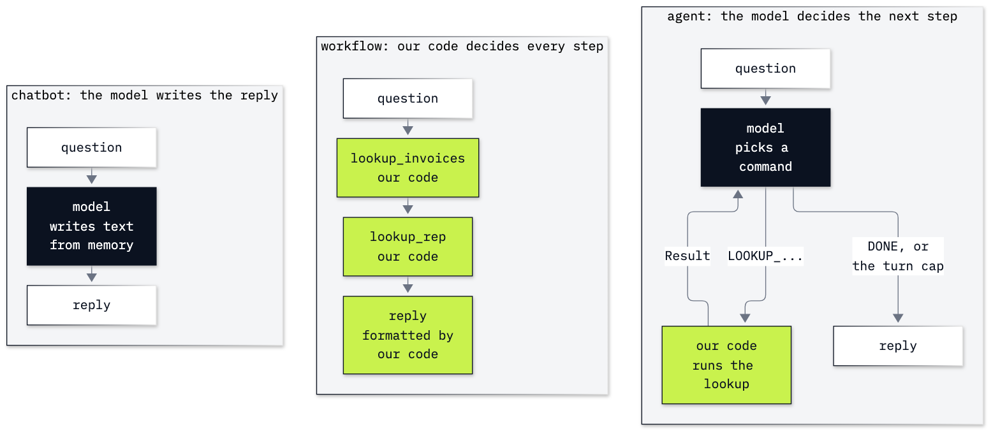

# Lab 02: What is an agent

**CPU | API key: `OPENAI_API_KEY` | Practises: how an agent works from the inside; when an agent is the wrong choice**

## Goal

Tell a chatbot, a workflow and an agent apart by one test: **who decides the next step?** You ask all three the same
question about a customer of the Chinook music shop and check every answer against the shop's database. The moment
that teaches it is the chatbot: it often answers correctly about one customer from its memory, and its right replies
read exactly like its wrong ones. Nothing was looked up in either case.

## What you will learn

- How to say who decides the next step in a chatbot, a workflow and an agent.
- How to answer a question with a workflow: fixed lookups on `chinook.db`, in an order our code sets.
- Why an answer from the model's memory is no evidence, even when it is right.
- How to write an agent by hand with a text protocol: one turn by hand, then a loop with a turn cap where the model
  picks the next lookup.
- How to check the agent's final answer in code against the database.
- How to count model calls and tokens for each shape and turn them into dollars.
- How to choose an autonomy level (suggest, draft, act with audit, act) for a job, and when an agent is the wrong
  choice.

## Coming from

Lab 01 sent a list of messages to the Chat Completions API and read the reply. That is all this lab needs: the same
call becomes a chatbot, and then one step of an agent. Lab 03 replaces the agent's home-made text commands with the
API's tool calls.

## What you will do

All parts use the shop's running question: *How many invoices does Helena Holý have, how much has she spent, and who
is her support rep?*, and the same question about a second customer, Puja Srivastava.

**Part A: Look up the facts in the database.** Read Helena's row, her invoices and her rep from `chinook.db`
(opened read-only), write two lookup functions, and keep both customers' facts as the answer key.
**Part B: Answer the question with a fixed workflow.** Two lookups in an order we wrote, no model call. Our code
decides every step, and the workflow cannot take a question it was not written for.
**Part C: Ask a chatbot and check its answers against the database.** Five replies per customer, each printed beside
the database's facts and checked in code. Helena's numbers come back right from memory in most runs, with a wrong rep
in some; Puja gets refusals. Nothing is looked up.
**Part D: Let the model choose the next lookup.** A text protocol (`LOOKUP_INVOICES`, `LOOKUP_REP`, `DONE`), a loop on
a plan we wrote, two agent turns by hand, then `run_agent` with a turn cap, a code check on the `DONE` line, and ten
runs. The message list shows where the facts came from.
**Part E: Count the model calls and tokens of each shape.** Calls, tokens and dollars for the workflow, the chatbot and
the agent, priced from `models.env`.
**Part F: Choose an autonomy level, or no agent at all.** The duplicate-charge refund (ticket 14) at the four levels,
what has happened by Monday if the agent picks the wrong invoice, three cases for no agent, and six jobs to judge.
**Challenge.** Ask the agent a question its commands cannot answer, then add the command it needs.

## Checkpoints

| After | You should see |
|---|---|
| Part A | Helena Holý: 7 invoices, 49.62, Steve Johnson; Puja Srivastava: 6, 36.64, Jane Peacock |
| Part B | the same facts for both customers, with 0 model calls |
| Part C | every reply printed beside the facts. Helena: count and total right in most runs, the rep not always (ours: all three facts in 4 of 5; Jane Peacock in one run, and Martha Silva, a name not in the database, in the first call). Puja: a refusal or a wrong answer, never a lookup (ours: refused 5 of 5) |
| Part D | `LOOKUP_INVOICES -> LOOKUP_REP -> DONE` and all three facts in the `DONE` line (ours: 10 of 10 runs); two `Result:` messages in the agent's list, none in the chatbot's |
| Part E | 0 / 1 / 3 model calls for workflow, chatbot and agent; ours: 46 + 30 tokens ($0.000020) for the chatbot, 469 + 52 tokens ($0.000073) for the agent |
| Part F | the six-job table filled in and compared with the solution's answers |
| Challenge | before the new command, `LOOKUP_INVOICES -> DONE` and no date; after it, `LOOKUP_LATEST_INVOICE -> DONE` with 2013-11-13 and 25.86 (ours: 5 of 5) |

**About the saved outputs.** The saved outputs come from `gpt-6-luna` with reasoning effort `none`, as set in
`models.env`. Replies change from run to run: the chatbot's memory answers in particular move between runs, so check
your replies against the database's facts, not against ours. Token counts move a little.

## Before you start

- **Lab 00 first.** It checks your environment, the key and the data.
- **Open the notebook** `02_what_is_an_agent.ipynb` in VS Code or JupyterLab (`uv run jupyter lab`) and choose the
  repository's `.venv` kernel.
- **Data:** `data/chinook.db` and two files in `data/corpus/` (ticket 14 and the refunds policy), read in place and
  never changed.
- **Cost:** about 45 model calls with short prompts, a few thousand tokens in all: well under one US cent with the
  prices in `models.env`.

## Folder contents

| Path | What it is |
|---|---|
| `02_what_is_an_agent.ipynb` | the guided notebook, with saved outputs |
| `resources/lab02_three_shapes.mmd`, `.png` | the diagram of the three shapes, its source and the exported image |
| `solved/02_what_is_an_agent_solution.ipynb` | the challenge solved and run, and our answers to Part F's six jobs |

## Resources

- [OpenAI: Chat Completions API reference](https://developers.openai.com/api/reference/resources/chat/subresources/completions/methods/create): `messages`, `max_completion_tokens`, `reasoning_effort` and `usage`
- [OpenAI: conversation state](https://developers.openai.com/api/docs/guides/conversation-state): why the list of messages is the model's only memory
- [OpenAI: A practical guide to building agents](https://cdn.openai.com/business-guides-and-resources/a-practical-guide-to-building-agents.pdf): when an agent fits, and where people stay in the loop
- [Anthropic: Building effective agents](https://www.anthropic.com/engineering/building-effective-agents): workflows (steps set in code) and agents (the model directs its own steps), and when each fits
- [Python: `sqlite3`](https://docs.python.org/3/library/sqlite3.html) and [SQLite: URI filenames](https://www.sqlite.org/uri.html): placeholders, and opening a database with `mode=ro`

Next: [Lab 03: How a model asks for a tool](../03_Tool_Calling/README.md). Back to [the lab list](../README.md).
