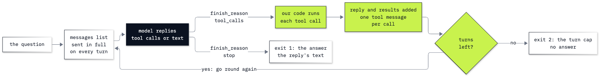

# Lab 03: How to write the agent loop

**CPU | API key: `OPENAI_API_KEY` | Practises: writing the tool loop with no framework, reading a run turn by turn, and designing what a tool returns**

## Goal

Write the loop that lets a model work through a question one step at a time: call the model, run the tools it asks
for, send the results back, and repeat until it answers or a turn cap stops it. The lab has two notebooks.

**Notebook 1** is a playground. We play an envelope hunt, where each envelope holds a clue to the next, so nobody
can say in advance how many must be opened. One tool call run by hand ends with the model asking for another
envelope and no code left to open it. The loop closes that gap, and then a hunt with no end shows why the loop needs
an exit of our own.

**Notebook 2** takes the same loop to the Chinook support desk. A rep asks how many invoices Helena Holý has, what
they add up to and who her support rep is: three lookups, where two cannot start before the first has answered.
Then a lookup fails in the middle of a run. And then the rep types *Helena Holy*, without the accent: the lookup
finds nobody, the model writes a polite reply, and the loop ends as if the question had been answered. One change
to what the tool returns lets the same loop find her.

## What you will learn

- How to run one tool call by hand on the Chat Completions API, and turn those steps into a loop that stops when a
  reply has no tool call in it.
- How to read a run from its message list and turn by turn, and why every call sends more tokens than the one
  before.
- How to add a turn cap, and tell a run that ended with an answer from a run the cap stopped.
- How to give the loop several tools, with one schema each and a dictionary from tool names to functions.
- How to return a tool's error to the model as a result, so that a failing tool does not crash the run.
- Why a `finish_reason` of `stop` does not mean the question was answered, and how to write a tool result that
  helps the model recover from a near miss.

## What you will do

### Notebook 1: meet the loop on an envelope hunt (`03a_meet_the_agent_loop.ipynb`)

**Part A: Ask a question that needs an unknown number of steps.** One model call with no tools, then a plain Python
function that opens an envelope, played by hand.
**Part B: Run one tool call by hand, and see where it stops.** The tool schema, the model's request, our code
running the function and sending the result back, and a second reply that asks for the next envelope.
**Part C: Turn those steps into a loop.** The loop, the run read from its message list, the prompt tokens of each
turn, and the loop as a drawing.
**Part D: Give the loop a second exit, the turn cap.** A hunt that goes in a circle, and a hunt with no end.
**Challenge.** Add a second tool, and make the loop say why it stopped.

### Notebook 2: the agent loop at the Chinook desk (`03b_agent_loop_at_the_desk.ipynb`)

**Part A: Run the loop over three lookups that depend on each other.** The three lookups called by hand, their
schemas, the dictionary of functions, and Helena's question read turn by turn.
**Part B: Return a tool's error to the model as a result.** A closed database, the error caught and sent back as
text, and what the model does with it.
**Part C: Find and fix a run that ends normally without an answer, on a near-miss name.** *Helena Holy* without the
accent, the empty result, the polite reply, and a tool result that lists the close names.
**Challenge.** A first name that matches two customers, and a loop that says why it stopped.

### Going further (`03_extra_react.ipynb`)

The same loop written as plain text, the ReAct pattern, beside native tool calls: what the API's tool calls took over
from our prompt and our parser. We build it once, to understand what the loop does; agents today use native tool
calls. Notebook 2 also ends with a short "Going further" on what a run costs, the other values of `finish_reason`, and
why long runs fail more often.

## Checkpoints

| After | You should see |
|---|---|
| Notebook 1, Part A | without a tool the model cannot say where the prize is (ours wrote that it would start by opening envelope 1, and nothing was opened); by hand, three `TOOL CALLED` lines, and envelope 2 holds the prize |
| Notebook 1, Part B | `finish_reason` `tool_calls`, `content` `None`, one call to `open_envelope` with `{"number":1}` and nothing run yet; after the result is sent back, a second tool call, for envelope 4 |
| Notebook 1, Part C | three `TOOL CALLED` lines (envelopes 1, 4 and 2) in four turns; the answer names envelope 2; 9 messages in the transcript; prompt tokens growing per turn (ours: 182, 221, 260 and 299) |
| Notebook 1, Part D | in the circle, three `TOOL CALLED` lines and then a reply, with no fourth envelope opened; in the hunt with no end, eight `TOOL CALLED` lines and `answer: None` |
| Notebook 2, Part A | Helena Holý: `customer_id` 6, 7 invoices, $49.62, Steve Johnson; three turns (`find_customer`, then `get_invoices` and `get_support_rep` in one reply, then the answer); prompt tokens growing per turn (ours: 259, 316 and 419) |
| Notebook 2, Part B | `Error: ProgrammingError: Cannot operate on a closed database.` as a tool result; no crash; a reply saying the database cannot be reached (ours tried the lookup twice first) |
| Notebook 2, Part C | `[]` for *Helena Holy*, then a "could not find" reply in two turns, ended by `stop`; with close names, four turns (`find_customer` twice, the second time with the accent) and Helena's three facts |
| Challenges | notebook 1: `open_envelope(1)`, `open_drawer(kitchen)`, `open_envelope(3)` and an answer naming envelope 3; then five `TOOL CALLED` lines, `None` and `turn cap`. Notebook 2: a tool result listing Mark Philips and Mark Taylor, and after one more sentence in the system prompt a reply that asks which Mark; then `None` and `turn cap` after two turns |

**About the saved outputs.** They come from `gpt-6-luna`, the model `models.env` names. The model chooses its tool
calls and writes its replies on every run, so wording and token counts will differ on yours. Check the tool calls and
the facts, not the words. How often each result repeated on this model: in the circle the model stopped after three
envelopes in all 11 runs we made (the saved reply wrongly names envelope 1 as the prize; the other ten said only that
the clues loop); the hunt with no end ran to the cap every time, also with a cap of 40. *Helena Holy* ended with a
polite "not found" in 29 of the 31 runs we have seen, and in the other two the model tried the accented name by
itself; with close names it found her in every run. In the extra notebook the text loop stopped after one envelope
with a wrong final answer in 2 of 10 runs, and never wrote its own `Observation:` line.

## Before you start

- **Lab 00 first.** It checks the environment and that your key reaches the model.
- **Run it locally:** in the repository folder, `uv sync` (or `pip install -r requirements.txt`), put
  `OPENAI_API_KEY` in `.env` (copied from `.env.example`), then open a notebook in VS Code or JupyterLab
  (`uv run jupyter lab`) with the `.venv` kernel. Run the setup cell first. Each notebook runs on its own.
- **Reasoning effort:** `REASONING_EFFORT=none` in `models.env`, as shipped. On Chat Completions the model calls
  tools only at that setting.
- **Data:** notebook 2 reads `data/chinook.db`, the Chinook sample music shop, opened read-only. Notebook 1 and the
  extra notebook use a dictionary of five envelopes and nothing else.
- **Cost:** about 40 small model calls in all, well under one US cent.

## Folder contents

| Path | What it is |
|---|---|
| `03a_meet_the_agent_loop.ipynb` | notebook 1, the playground, with saved outputs |
| `03b_agent_loop_at_the_desk.ipynb` | notebook 2, the Chinook desk, with saved outputs |
| `03_extra_react.ipynb` | going further: ReAct as text beside native tool calls |
| `resources/lab03_agent_loop.png` and `.mmd` | the drawing of the loop and its source |
| `solved/03a_meet_the_agent_loop_solution.ipynb` | notebook 1's challenge solved, run with its outputs |
| `solved/03b_agent_loop_at_the_desk_solution.ipynb` | notebook 2's challenge solved, run with its outputs |

## Resources

- [OpenAI: function calling](https://developers.openai.com/api/docs/guides/function-calling): tool schemas, strict
  mode, tool calls and sending results back
- [OpenAI: Chat Completions API reference](https://developers.openai.com/api/reference/resources/chat/subresources/completions/methods/create):
  `messages`, `tools`, `finish_reason` and `usage`
- [OpenAI Agents SDK: running agents](https://openai.github.io/openai-agents-python/running_agents/): the same loop
  as a framework runs it, with `max_turns`
- [Yao and others, the ReAct paper (2022)](https://arxiv.org/abs/2210.03629): reasoning and acting written as one
  text
- [Python: `difflib`](https://docs.python.org/3/library/difflib.html): `get_close_matches`

Next: [Lab 04: What is an agent](../04_What_Is_An_Agent/README.md). Back to [the lab list](../README.md).
