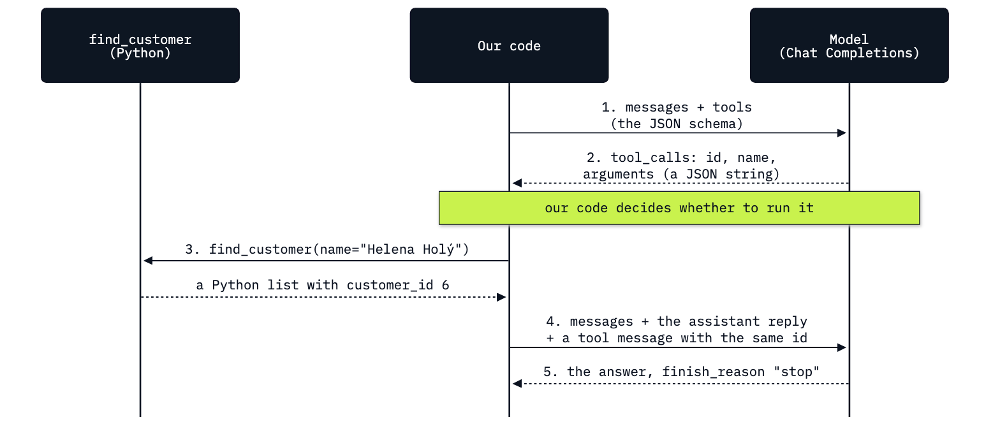

# Lab 03: How a model asks for a tool

**CPU | API key: `OPENAI_API_KEY` | Practises: how an agent works from the inside (the model asks, our code runs the tool)**

## Goal

Give a model a tool and run the round trip yourself: describe a Python function as a JSON schema, read the request
the model sends back, run the function in your own code and return its result. The moment that teaches it comes in
Part F. We send back a false result (2 invoices, where the database has 7) and the model repeats it in every run
(5 of 5), although asked from memory it usually says 7. The model never runs anything: it believes whatever our code
returns.

## What you will learn

- How to describe a Python function to the model as a strict JSON schema (`strict`, `additionalProperties: false`,
  every field required).
- How to read a tool call: its `id`, the function name, and `arguments`, which is a JSON string.
- How to run the function in our own code and send the result back in a `tool` message with the same id.
- How to handle a reply that asks for several tools at once.
- What the API answers when a tool message has the wrong id or is missing.
- Why the tool result is the thing to protect: the model repeats what it is given.

## Coming from

You have sent a message list to Chat Completions and read the response (lab 01), and you have seen an agent choose
its next lookup through a text protocol we invented and parsed ourselves (lab 02). Tool calling is the same idea
built into the API: the model returns a tool name and a JSON string, and our code decides whether to run anything.

## What you will do

**Part A: Look up Helena's facts with plain Python functions.** Open `chinook.db` read-only, read Helena Holý's row,
and write `find_customer`, `get_invoices` and `get_support_rep`. Their results (customer 6, 7 invoices, $49.62, Steve
Johnson) are the facts every later answer is checked against.
**Part B: Describe a function to the model as a strict JSON schema.** Ask a question with no tools and see the model
guess, then describe `find_customer` as a strict schema, field by field, and see the reply stop with a tool call and
no text.
**Part C: Read the tool request the model sends back.** Read the call's `id`, name and `arguments`, see that the
arguments are a string, and parse them with `json.loads`.
**Part D: Run the function and send its result back with the call's id.** Run `find_customer(**args)`, wrap the
result in a `tool` message, append it after the assistant message (the list now mixes an SDK object and dicts) and
get the answer.
**Part E: Handle several tool calls in one reply.** Describe all three lookups and answer the full question in three
turns: `find_customer`, then `get_invoices` and `get_support_rep` in one reply, run in order, then the answer.
**Part F: See that the model repeats what the tool returns.** Ask from memory, then replay Part E's conversation with
one false tool result, five times, and count what the model says.
**Part G: Read the errors the API returns for a broken round trip.** Trigger the 400 for a wrong `tool_call_id` and
the 400 for a missing tool message, and read the rule they state.
**Challenge.** Add a fourth tool, `get_last_invoice`, and ask two questions that need it.

## Checkpoints

| After | You should see |
|---|---|
| Part A | `(6, 'Helena', 'Holý', 'Czech Republic', 5)`; customer 6, 7 invoices, $49.62, Steve Johnson |
| Part B | without tools, `finish_reason` `stop` and a customer id that changes from run to run (ours: 16, 5, 5; the database says 6); with the schema, `finish_reason` `tool_calls`, `content` `None`, one tool call |
| Part C | `find_customer` with `{"name":"Helena Holý"}`; `arguments` is a `str`, and a `dict` after `json.loads` |
| Part D | the list holds three `dict`s and one `ChatCompletionMessage`; the answer says Czech Republic and customer ID 6 |
| Part E | turn 1 `find_customer`; turn 2 `get_invoices` and `get_support_rep` together, both with `customer_id` 6; the answer has 7 invoices, $49.62 and Steve Johnson (three ✅) |
| Part F | from memory, 7 (ours: 5 of 5); with the false result, "2 invoices" in 5 of 5 runs |
| Part G | `'tool_call_id' of 'call_wrong123' not found in 'tool_calls' of previous message`; `An assistant message with 'tool_calls' must be followed by tool messages responding to each 'tool_call_id'` |
| Challenge | `get_last_invoice(6)` gives invoice 404, 2013-11-13, $25.86; the second question gets two tool calls in one reply |

**About the saved outputs.** They come from `gpt-6-luna` at reasoning effort `none`, the model `models.env` names.
Tool call ids, wording and the guesses without tools change from run to run, and from model to model: check the facts
(customer 6, 7 invoices, $49.62, Steve Johnson) and the shape of each run (which tools, in which turn), not the words.

## Before you start

- **Lab 00 first.** It checks the environment and that your key reaches the model.
- **Run it locally:** in the repository folder, `uv sync` (or `pip install -r requirements.txt`), put
  `OPENAI_API_KEY` in `.env` (copied from `.env.example`), then open `03_tool_calling.ipynb` in VS Code or
  JupyterLab (`uv run jupyter lab`) with the `.venv` kernel. Run the setup cell first.
- **Data:** `data/chinook.db`, the Chinook sample music shop, opened read-only. Nothing is downloaded.
- **Cost:** about 20 short calls to the model, a few thousand tokens in all: well under one US cent at the prices
  in `models.env`.
- The notebook ends with a troubleshooting table: a strict schema without `additionalProperties`, arguments used
  without `json.loads`, a tool result sent as a Python list, a reasoning effort other than `none`, the two pairing
  errors, and a turn where the model answers in text instead of asking.

## Folder contents

| Path | What it is |
|---|---|
| `03_tool_calling.ipynb` | the guided notebook, with saved outputs |
| `resources/lab03_tool_call_round_trip.mmd` and `.png` | the round-trip diagram: its mermaid source and the exported image |
| `solved/03_tool_calling_solution.ipynb` | the challenge solved, run with its outputs |

## Resources

- [OpenAI: function calling](https://developers.openai.com/api/docs/guides/function-calling): tool schemas, strict
  mode, parallel tool calls, the round trip on Chat Completions and Responses
- [OpenAI: structured outputs](https://developers.openai.com/api/docs/guides/structured-outputs): the JSON Schema
  features strict mode supports
- [OpenAI API reference: create chat completion](https://developers.openai.com/api/reference/resources/chat/subresources/completions/methods/create):
  `tools`, `parallel_tool_calls`, the tool message's fields
- [Understanding JSON Schema: object](https://json-schema.org/understanding-json-schema/reference/object):
  `properties`, `required`, `additionalProperties`
- [Python: `sqlite3`](https://docs.python.org/3/library/sqlite3.html): placeholders and URI connections (`mode=ro`)
- [Python: `json`](https://docs.python.org/3/library/json.html): `json.loads` and `json.dumps`

Next: [Lab 04: How to write the agent loop](../04_Agent_Loop/README.md). Back to [the lab list](../README.md).
