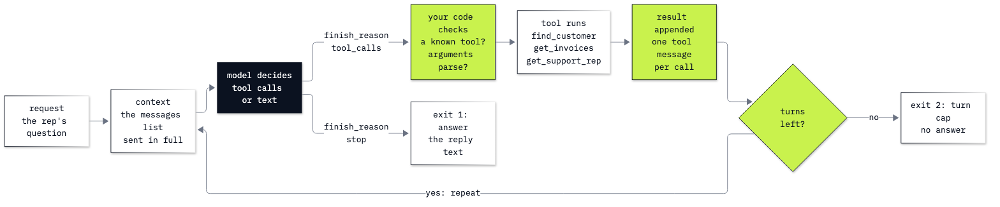

# Lab 04: How to write the agent loop

**CPU | API key: `OPENAI_API_KEY` | about 45 small model calls**

## Goal

Write the loop that turns one tool call into an agent: call the model, run the tools it asks for, send the results
back, and repeat until the model answers or a turn cap stops it. The moment comes at the end. Typed without its
accent, "Helena Holy" gets an empty list from our exact-match lookup, and the agent usually stops with a fluent "I
couldn't find a customer ..." without trying another spelling. The loop records that as a finished answer. One change to what
the tool returns, a list of close names, lets the agent find her in four turns.

## What you will learn

- How to turn the tool-call round trip into a loop that stops on `finish_reason` or on a turn cap, and why it needs
  both.
- How to record each turn: the tools called and the prompt tokens of every call, which grow because the whole list is
  sent again.
- How ReAct (a thought, an action and an observation written as text) differs from native tool calls on the same
  question, and what each costs.
- How to return a tool's error to the model as a result, instead of letting it crash the loop.
- Why reliability falls with every turn, with 0.95 to the power n worked for 1, 3, 6 and 10 turns.
- How to design a tool result that helps the model recover from a near miss.

## Where this lab starts

Lab 03 ran one tool-call round trip by hand: send the messages with the tool schemas; run each requested function and
append the assistant message and one `tool` message per call; send the list again for the answer. This lab puts those
steps in a loop, because only the model's reply says whether another round trip is needed. The notebook restates the
three lookups, their schemas and the round trip, so it runs on its own; you need some Python and nothing from earlier
labs.

## What you will do

All of it on the Chinook music shop's database, `data/chinook.db`, opened read-only, with three lookups:
`find_customer`, `get_invoices` and `get_support_rep`. The question: how many invoices Helena Holý has, what they add
up to, and who her support rep is.

**Part A: Turn the round trip into an agent loop.** Call the three lookups yourself for the right answers, describe
them as strict tool schemas, run one turn by hand, then write the loop: call, append, stop on text, otherwise run every
call and go round again, inside a turn cap.
**Part B: Measure how the context grows each turn.** Put the loop in `run_agent`, record each turn's messages sent,
prompt tokens and output tokens, and price the run from `models.env`.
**Part C: Stop the loop on an answer or a turn cap.** Read the `finish_reason` values, run the same question with a
cap of one turn, and see why a loop needs both exits.
**Part D: Compare ReAct text with native tool calls.** Write a ReAct prompt and a parser for its `Thought:`, `Action:`
and `Action Input:` lines, run it on the same question, and compare calls, tokens and cost with the native run.
**Part E: Return tool errors to the model as results.** Catch the error a lookup raises for a customer id that does
not exist, send it back as the tool's result and read the model's reply; then work out 0.95 to the power n.
**Part F: Help the agent recover from a near-miss name.** Run "Helena Holy" against the exact-match lookup five times
and read every reply, then return `close_names` from `difflib` and run it five times again.
**Challenge.** Stop an agent on a cost budget as well as a turn cap, on Puja Srivastava's question.

## Checkpoints

| After | You should see |
|---|---|
| Part A | three turns: `find_customer`, then `get_invoices` and `get_support_rep` in one reply, then the answer with 7 invoices, 49.62 US dollars and Steve Johnson |
| Part B | messages sent 2, 4 and 7; prompt tokens rising each turn (ours: 259, 316, 431); 1,006 input tokens paid for in all, more than any single call sent |
| Part C | with `max_turns=1`: one turn ending in `tool_calls`, stop reason `turn cap`, answer `None` |
| Part D | the same facts from both loops; the ReAct run with a `Thought:` line every turn, 4 calls against the native 3, and more tokens (ours: 1,282 input and 161 output against 1,006 and 95) |
| Part E | the `tool` message `Error: ValueError: no customer with id 60` and a reply saying no such customer was found; 0.950, 0.857, 0.735 and 0.599 for 1, 3, 6 and 10 turns |
| Part F | exact match: `[]` and a "couldn't find" reply that ends the run (4 of 5 in our run; the fifth tried the accented name from memory); with close names: four turns and the right facts (5 of 5) |

**About the saved outputs.** They come from `gpt-6-luna` with reasoning effort `none`, the model named in
`models.env`. Replies change from run to run, and from model to model if you change `models.env`: check the facts
(7 invoices, 49.62, Steve Johnson) and the shape of each run (the number of turns, which tools, which exit), not the
wording. Token counts can move by a few if the model words a tool call differently. In Part F, the exact-match question
stopped without an answer in 18 of the 20 runs we have seen (this notebook's five and fifteen more outside it), and twice the model tried the accented name on its own, from what it knows of this public sample database
rather than from the tool. A run of yours may do either; read the replies it prints.

## Before you start

- **Lab 00 first.** It checks the environment, your key and the shop's data.
- **Open** `04_agent_loop.ipynb` in VS Code or JupyterLab on the repository's `.venv` kernel and run the cells from
  the top. The config cell finds `models.env` and your key from the repository folder.
- **Data:** `data/chinook.db`, read in place and opened read-only. Nothing is downloaded or written.
- **Cost:** about 45 calls of a few hundred tokens each, well under one US cent at the prices in `models.env`. The
  solution notebook makes 5 more.

## Folder contents

| Path | What it is |
|---|---|
| `04_agent_loop.ipynb` | the lab notebook, with saved outputs |
| `resources/lab04_agent_loop.mmd` | the loop diagram's source (mermaid) |
| `resources/lab04_agent_loop.png` | the diagram, exported from the source |
| `solved/04_agent_loop_solution.ipynb` | the challenge, solved and run |

## Resources

- [OpenAI: function calling](https://developers.openai.com/api/docs/guides/function-calling): tool schemas, strict
  mode, `tool_calls`, parallel calls and sending results back.
- [OpenAI: Chat Completions API reference](https://developers.openai.com/api/reference/resources/chat/subresources/completions/methods/create):
  `finish_reason`, `usage` and `max_completion_tokens`.
- [Yao and others, the ReAct paper (2022)](https://arxiv.org/abs/2210.03629): the paper that named the pattern in
  Part D, reasoning and acting written as one text.
- [OpenAI Agents SDK: running agents](https://openai.github.io/openai-agents-python/running_agents/): the agent loop
  a framework runs for you, with `max_turns`.
- [Python: `difflib`](https://docs.python.org/3/library/difflib.html): `get_close_matches` and `SequenceMatcher`.
- [Python: `sqlite3`](https://docs.python.org/3/library/sqlite3.html): opening a database read-only with a URI.

Next: [Lab 05: How to manage what an agent sees](../05_Context_And_Skills/README.md). Back to
[the lab list](../README.md).
