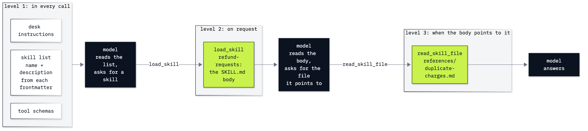

# Lab 05: How to manage what an agent sees

**CPU | API key: `OPENAI_API_KEY` | Practises: how an agent works from the inside (our code holds the context and decides what goes in it); costing an agent**

## Goal

Measure what the model reads on every call, and cut it with Agent Skills, prompt caching and compaction. The moment
that teaches it: the same refund question costs 2,391 input tokens on its first call when every shop policy
and playbook rides in the system prompt, and 515 with a short list of skills that the agent loads only
when a question needs one. That list works only when each description says when to use its skill: with vague
descriptions, the agent loaded skills for a question none of them covers in 5 of 5 runs, and paid for
every load.

## What you will learn

- How to list what fills the context on one call (system prompt, tool schemas, history, tool results) and count each
  part from `usage`.
- How to write an Agent Skill: a folder with a `SKILL.md` whose frontmatter holds `name` and `description`, a body
  of steps, and a reference file.
- How to load skills in three levels: the list from the frontmatter, the body on request, the reference only when
  the body points to it.
- How to compare a prompt that carries everything with one that loads on demand, on the first call and over the
  whole question.
- How to read `cached_tokens` and `cache_write_tokens` in `usage` and price a call with them.
- How to compact a long conversation in your own code, count what it saves and what the summary call costs, and
  check that a detail survived; and which APIs and frameworks compact for you.

## Coming from

Lab 03 wrote the agent loop and measured it: every call sends the whole message list again, so the input tokens grow
with each turn. This lab looks inside that list, part by part, and cuts it. Lab 06 moves the tools themselves into
their own process.

## What you will do

All parts use the Chinook shop's support desk, its 20 policies in `data/corpus/` and ticket 14, a customer charged
twice for the same album on the same day.

**Part A: Count what the model reads on one call.** One real call with the desk's instructions, a question and one
tool, its `usage` read, then each part's tokens by difference: the question, the system prompt, the tool schema, and
on the second call the tool call and its result.
**Part B: Write the refund steps as an Agent Skill.** The `skills/` folder, the `SKILL.md` of `refund-requests`, its
frontmatter read with `yaml.safe_load`, and all three skills checked against the format's rules.
**Part C: Load skills in three levels, only when they apply.** The skill list built from the frontmatter,
`load_skill` and `read_skill_file` called by hand and as tools, the duplicate charge one call at a time, the loop,
then sharp against vague descriptions on three questions, five runs each, with the failing replies printed.
**Part D: Compare a prompt that carries everything with skills loaded on demand.** The fat prompt (every policy and
playbook) against the thin one on two questions: calls, first-call tokens and tokens over the whole question, and
what the thin prompt can no longer answer.
**Part E: Pay less for a repeated prompt with caching.** The fat prompt twice under a fresh `prompt_cache_key`:
`cache_write_tokens`, then `cached_tokens`, each priced; a different question on the same prefix; the thin prompt,
never cached.
**Part F: Compact a long conversation in our own code.** Five requests in one conversation, the check question on the
whole list, a summary call, the compacted list, every call counted and priced, and a tighter word budget; then the
APIs and frameworks that compact for you.
**Challenge.** Add a fourth skill and check when it loads; keep the skills when you compact.

## Checkpoints

| After | You should see |
|---|---|
| Part A | the question alone about 23 input tokens; the system prompt adding about 55 and the tool schema about 147; the second call +161 for the tool call and its result |
| Part B | `meta` as a dictionary with `name: 'refund-requests'` and its description; three ✅ lines from the format check |
| Part C | `load_skill(refund-requests)`, then `read_skill_file(refund-requests, references/duplicate-charges.md)`, then the later invoice refunded in full; the change-of-mind question loading the skill without its reference; support hours: no skill loaded with sharp descriptions (ours: 5 of 5), skills loaded with vague ones (ours: 5 of 5) |
| Part D | first call: fat about 2,400, thin about 500 input tokens; duplicate charge over all calls: fat 2,391, thin 2,322; Helena's invoices: fat 4,939, thin 1,187 |
| Part E | first fat call `cache_write_tokens` 2,241 and `cached_tokens` 0; second the other way round (2,241 cached); input cost $0.0002244 uncached, $0.0002804 for the write, $0.0000227 for the read; the thin prompt never cached |
| Part F | the whole list about 2,400 input tokens; the compacted list's first call about 660; the summary call's tokens counted; compaction in all costing more than the cached whole list (ours: $0.0006344 against $0.0000516) and the skill loaded again; invoice 58217 kept in 6 of 6 compacted runs |
| Challenge | `digital-downloads` in 5 of 5; for support hours, no skill in 5 of 10 runs and one unrelated skill in the other 5, against no load in 5 of 5 with three skills in Part C; with the skills kept, the pasted text still reloaded the skill in 3 of 3; the kept messages answered in one call with no reload, 3 of 3 |

**About the saved outputs.** The saved outputs come from `gpt-6-luna` with reasoning effort `none`, as set in
`models.env`. Token counts depend on the model's tokenizer, and the agent's choices can change from run to run (which
skill it loads, whether it reads the reference, what a summary keeps), so compare your counts and loads with the
spread above rather than with one number. Cache results also depend on what you ran in the last 30 minutes.

## Before you start

- **Lab 00 first.** It checks your environment, the key and the data.
- **Open the notebook** `05_context_and_skills.ipynb` in VS Code or JupyterLab (`uv run jupyter lab`) and choose the
  repository's `.venv` kernel.
- **Data:** `data/chinook.db` (opened read-only) and the 20 policy files in `data/corpus/`, read in place and never
  changed; the three skills in `skills/`.
- **Cost:** about 140 model calls, about 125,000 input tokens in all: under two US cents with the prices in
  `models.env`.

## Folder contents

| Path | What it is |
|---|---|
| `05_context_and_skills.ipynb` | the guided notebook, with saved outputs |
| `skills/refund-requests/SKILL.md`, `skills/refund-requests/references/duplicate-charges.md` | the refund skill and the reference its body points to |
| `skills/damaged-media/SKILL.md`, `skills/account-changes/SKILL.md` | the two other skills |
| `resources/lab05_three_levels.mmd`, `.png` | the diagram of the three levels, its source and the exported image |
| `solved/05_context_and_skills_solution.ipynb` | the challenge solved and run |
| `solved/my_skills/digital-downloads/SKILL.md` | the fourth skill, written by the solution |

## Resources

- [Agent Skills: specification](https://agentskills.io/specification): the folder, the frontmatter fields and their limits, the three levels
- [Agent Skills: adding skills support to an agent](https://agentskills.io/client-implementation/adding-skills-support): the skill list, an activation tool, listing resources, and protecting skills from compaction
- [OpenAI: skills](https://developers.openai.com/api/docs/guides/tools-skills): the same `SKILL.md` folders uploaded to the Responses API's shell tool, for a hosted agent
- [OpenAI: prompt caching](https://developers.openai.com/api/docs/guides/prompt-caching): the 1,024-token minimum, cache writes and reads, `prompt_cache_key`, and pricing from `usage`
- [OpenAI: compaction](https://developers.openai.com/api/docs/guides/compaction): `context_management` with `compact_threshold`, and the `/responses/compact` endpoint
- [LangChain: built-in middleware](https://docs.langchain.com/oss/python/langchain/middleware/built-in): `SummarizationMiddleware` and its `trigger` and `keep` settings
- [OpenAI: Chat Completions API reference](https://developers.openai.com/api/reference/resources/chat/subresources/completions/methods/create): `usage`, `prompt_cache_key`, `max_completion_tokens` and `reasoning_effort`

Next: [Lab 06: How to share tools with MCP](../06_MCP/README.md). Back to [the lab list](../README.md).
