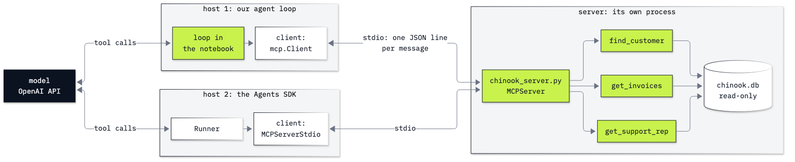

# Lab 06: How to share tools with MCP

**CPU | API key: `OPENAI_API_KEY` | Practises: how an agent works from the inside (tools in their own process, behind a protocol any host can speak)**

## Goal

Move the three Chinook lookups out of the notebook into an MCP server that runs as its own process, call it with the
official MCP client, and then let two hosts use the same server: our own agent loop, and the OpenAI Agents SDK, which
we did not write. The moment that teaches the protocol comes in Part C. We type the request that older tutorials
show, a bare `tools/list`, and the server refuses it. With the two `_meta` keys that MCP's 2026-07-28 revision puts on
every request, the same server answers with its tools, each with an `outputSchema` it wrote from our type hints.

## What you will learn

- What a host, a client, a server and a transport are, and which is which in this lab.
- How to write an MCP server from typed Python functions with `MCPServer` and `@mcp.tool()`, and run it over stdio.
- How to call it with the `mcp` client (`list_tools`, `call_tool`) and read `content`, `structuredContent` and
  `isError`.
- How to read the 2026-07-28 request envelope on the wire (`_meta`, `server/discover`), and what that revision
  removed (the `initialize` handshake) and deprecated (Roots, Sampling, Logging).
- How to let our own agent loop use MCP tools: the tool list turned into Chat Completions schemas, each tool call sent
  to `call_tool`.
- Why an MCP server is code you run with your own permissions, and why a stdio server must keep stdout for the
  protocol.

## Coming from

Lab 03 described the three lookups to the model as JSON schemas and ran its tool calls by hand, and lab 04 put that
round trip in a loop. Here the lookups move out of the notebook into a server process, and the loop reaches them
through MCP. The lab repeats the lookups and the loop it needs, so it runs on its own.

## What you will do

**Hosts, clients, servers and transports.** The four words, which is which in this lab, and a diagram of the two
hosts reaching one server.
**Part A: Turn the three lookups into an MCP server.** Run the lookups as plain functions, then read
`chinook_server.py`: the same bodies under `@mcp.tool()`, with typed parameters and `TypedDict` return types.
**Part B: Call the server with the official MCP client.** Start the server with `mcp.Client` over stdio, read the
tool list (names, descriptions, `inputSchema`, `outputSchema`), call `find_customer`, and read a call with no match and
a call the server refuses.
**Part C: Read the request envelope on the wire.** Start the server with `subprocess` and write JSON-RPC lines by
hand: `server/discover`, `tools/list` with `_meta`, the bare `tools/list` that is refused, and a fresh connection that
a bare request puts in the older handshake era.
**Part D: Use the server's tools from our own agent loop.** Delete the notebook's own lookups, turn the server's
tools into Chat Completions tools, and answer the Helena question with every call sent through `call_tool`.
**Part E: Use the same server from a host we did not write.** Give the server to the Agents SDK with
`MCPServerStdio`, read what it called, and run both hosts three times each.
**Part F: Keep stdout for the protocol.** Add a `print()` to a copy of the server, find the printed line on the
protocol channel and in the client's log, then move it to stderr.
**Challenge.** Add a fourth tool to a copy of the server and give it to both hosts without changing their code.

## Checkpoints

| After | You should see |
|---|---|
| Part A | customer 6 in the Czech Republic, 7 invoices, 49.62, Steve Johnson; `chinook_server.py` with the same three bodies under `@mcp.tool()` |
| Part B | protocol version `2026-07-28`; three tools; `find_customer`'s `structuredContent` `{'result': [{'customer_id': 6, ...}]}`; `"Helena Holy"` without the accent gives an empty `content` and `{'result': []}`; `"six"` as `customer_id` gives `isError: True` |
| Part C | `server/discover` lists `["2026-07-28"]`; `tools/list` with `_meta` gives the three tools; the bare `tools/list` gives -32602 naming the two envelope keys; on a fresh connection a bare request first gives -32602 `Invalid request parameters`, then the enveloped one -32600 (handshake era) |
| Part D | no lookups left in the notebook; turn 1 `find_customer`, turn 2 `get_invoices` and `get_support_rep`; the answer has 7 invoices, $49.62 and Steve Johnson (three ✅) |
| Part E | the SDK lists the same three tools and gives the same answer after the same three tool calls; 3 model calls and the three facts in every repeated run (ours: 3 of 3 for each host) |
| Part F | with `print()`: the reply is right, `'looking up 6\n'` follows on stdout, and the client logs `Invalid JSON ... input_value='looking up 6'`; with `print(..., file=sys.stderr)`: the text on stderr and no log record |
| Challenge | four tools; `get_recent_invoices` gives invoices 404 (2013-11-13, 25.86), 393 (2013-10-03, 1.98) and 272 (2012-04-11, 0.99); both hosts call `find_customer`, then `get_recent_invoices`, and list the three invoices |

**About the saved outputs.** They come from `gpt-6-luna` at reasoning effort `none`, the model `models.env` names.
Everything in Parts A, B, C and F is the same on every run (the server and the protocol decide it); in Parts D and E
the model chooses its tool calls, so the wording and, now and then, the calls can change from run to run and from
model to model. Check the facts (customer 6, 7 invoices, $49.62, Steve Johnson) and which tools were called, not the
words.

## Before you start

- **Lab 00 first.** It checks the environment and that your key reaches the model.
- **Run it locally:** in the repository folder, `uv sync` (or `pip install -r requirements.txt`), put
  `OPENAI_API_KEY` in `.env` (copied from `.env.example`), then open `06_mcp.ipynb` in VS Code or JupyterLab
  (`uv run jupyter lab`) with the `.venv` kernel. Run the setup cell first.
- **Processes:** the notebook starts `chinook_server.py` as a child process many times, with the notebook's own Python
  (`sys.executable`), and stops each one when its block ends. Part F writes two changed copies of the server to
  `06_MCP/outputs/`, which git ignores.
- **Data:** `data/chinook.db`, the Chinook sample music shop, opened read-only by the server. Nothing is downloaded.
- **Cost:** about 25 short calls to the model, a few thousand tokens in all: well under one US cent at the prices in
  `models.env`. Parts A to C and F call no model.
- The notebook ends with a troubleshooting table: the -32602 and -32600 envelope errors, arguments the server refuses,
  the client's "Failed to parse JSONRPC message" log, a server started with a Python that lacks `mcp`, and `await` in
  a script.

## Folder contents

| Path | What it is |
|---|---|
| `06_mcp.ipynb` | the guided notebook, with saved outputs |
| `chinook_server.py` | the MCP server: the three Chinook lookups as tools, run over stdio |
| `resources/lab06_mcp_host_client_server.mmd` and `.png` | the hosts, clients and server diagram: its mermaid source and the exported image |
| `solved/06_mcp_solution.ipynb` | the challenge solved, run with its outputs |
| `solved/chinook_server_plus.py` | the server copy with the challenge's fourth tool |

## Resources

- [MCP specification 2026-07-28: key changes](https://modelcontextprotocol.io/specification/2026-07-28/changelog):
  what the revision removed, added and deprecated
- [MCP specification: the stdio transport](https://modelcontextprotocol.io/specification/2026-07-28/basic/transports/stdio):
  one message per line, stdout only for messages, stderr for logs
- [MCP specification: versioning](https://modelcontextprotocol.io/specification/2026-07-28/basic/versioning): the
  per-request envelope and backward compatibility with handshake-era clients
- [MCP: architecture overview](https://modelcontextprotocol.io/docs/2026-07-28/learn/architecture): hosts, clients and
  servers
- [MCP Python SDK documentation](https://py.sdk.modelcontextprotocol.io/): `MCPServer`, `Client`, transports
- [OpenAI Agents SDK: MCP](https://openai.github.io/openai-agents-python/mcp/): `MCPServerStdio` and the other server
  classes
- [The MCP Registry](https://modelcontextprotocol.io/registry/about) and
  [MCP security best practices](https://modelcontextprotocol.io/docs/2026-07-28/tutorials/security/security_best_practices)
- [JSON-RPC 2.0 specification](https://www.jsonrpc.org/specification): requests, responses and error codes

Next: [Lab 07: How the OpenAI Agents SDK runs your loop](../07_OpenAI_Agents_SDK/README.md). Back to [the lab list](../README.md).
