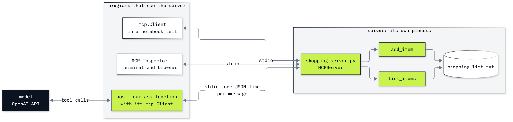

# Lab 06: How to share tools with MCP

**CPU | API key: `OPENAI_API_KEY` | Optional: Node.js for the MCP Inspector | Practises: how an agent works from the inside (tools in a program of their own, which any program that speaks MCP can use)**

## Goal

Move tools out of a notebook into an MCP server, a small program of its own, and watch programs we did not write
use them. The lab has two notebooks and one extra.

**Notebook 1** is a playground. We ask a model *what is on my shopping list?* and watch it fail. We write two
functions over a text file, put the same two functions in a server file, open that file in the MCP Inspector, call
it from Python with the official client, and then let the model answer the opening question through the server.

**Notebook 2** takes the same idea to the Chinook support desk. One question needs three database lookups: *How
many invoices does Helena Holý have, what do they add up to, and who is her support rep?* We answer it with three
lookups that live in the notebook. Then the notebook deletes its own lookups, and the OpenAI Agents SDK, a program
we did not write, answers the same question through a server file that we do not edit.

## What you will learn

- Why a tool that lives in one notebook cannot be used by any other program, and what an MCP server changes.
- How to write an MCP server from typed Python functions with `MCPServer` and `@mcp.tool()`, and where each tool's
  name, description and schema come from.
- How to open a server in the MCP Inspector, from the terminal and in the browser, and call a tool there.
- How to call a server from Python with the official client (`list_tools`, `call_tool`) and read a result's
  `content`, `structuredContent` and `isError`, including a lookup that finds nobody.
- How a host turns an MCP tool into the tool description a model reads, sends the model's tool calls to the
  server, and repeats those steps in a loop until the model answers.
- How to give a server to an agent framework in a few lines, and check that its answer came from the server's
  tools.

## What you will do

### Notebook 1: meet MCP on a shopping list (`06a_meet_mcp.ipynb`)

**Part A: Ask about a list the model cannot see.** One model call with no tools, then `add_item` and `list_items`
over a text file, called by hand.
**Part B: Put the same two functions in a server file.** `shopping_server.py` read line by line: `MCPServer`,
`@mcp.tool()` and `mcp.run("stdio")`.
**Part C: Open the server in the MCP Inspector.** The Inspector's command-line client run from the notebook, then
its browser page: connect, open *Tools*, run `list_items`.
**Part D: Call the server from Python with the official client.** `list_tools`, one tool's schema, `call_tool`, and
the three fields of a result.
**Part E: Let the model answer through the server.** An MCP tool turned into the tool description the model reads,
and one tool call sent to the server by hand.
**Part F: Run the same steps in a loop, and name the pieces.** The host's steps in a loop, a request that needs both
tools, and the names of the pieces: server, client, host, transport.
**Challenge.** Give the shopping list a third tool, `remove_item`.

### Notebook 2: MCP at the Chinook desk (`06b_mcp_at_the_desk.ipynb`)

**Part A: Answer a desk question with three lookups that live in this notebook.** The lookups called by hand, their
tool descriptions typed by hand, and a tool loop that runs them in the notebook.
**Part B: Read the same three lookups in a server file.** `chinook_server.py` read line by line, its tools listed
with the client, the server's schema beside the one typed by hand, one lookup called, and a lookup that finds
nobody.
**Part C: Delete the notebook's lookups and let a host we did not write answer.** The lookups deleted, the Agents
SDK connected to the server with `MCPServerStdio`, its answer, and the calls it sent to our server.
**Challenge.** Give the desk a fourth lookup without touching the host.

### Going further (`06_extra_on_the_wire.ipynb`)

The messages themselves, written by hand. No model and no key.

**Part A: Write a request by hand and read the reply.** The server started as a process, a `tools/list` request with
its envelope, and a `tools/call`.
**Part B: Tell apart the errors a request without the envelope gets.** -32602 on a 2026-07-28 connection, -32602 and
-32600 on a fresh one, the older handshake, and a tool failure, which is a result.
**Part C: Keep the server's standard output for the protocol.** A `print()` in a tool, where its text lands, and the
fix.

## Checkpoints

| After | You should see |
|---|---|
| Notebook 1, Part A | without a tool the model says it cannot see the shopping list; by hand, `Added milk.`, `Added eggs.`, `['milk', 'eggs']`, and the file `'milk\neggs\n'` |
| Notebook 1, Part B | `shopping_server.py` with the two functions of Part A, each under `@mcp.tool()`, one new line in `add_item` that creates `outputs/`, and `mcp.run("stdio")` at the end |
| Notebook 1, Part C | from the notebook, the Inspector lists `add_item` and `list_items` and its call to `list_items` returns two text blocks, `milk` and `eggs`, with `isError` `false`; in the browser, the *Tools* tab lists the same two tools and *Execute Tool* shows the same result. Without Node.js: one line saying the cell is skipped |
| Notebook 1, Part D | protocol version `2026-07-28`; the schema of `add_item` with one required string, `item`; `list_items` gives `{'result': ['milk', 'eggs']}`; after `add_item` with `bread` the file ends with `bread` |
| Notebook 1, Part E | the tool description of `add_item` with our docstring; a tool call for `list_items` and nothing run; an answer that names milk, eggs and bread |
| Notebook 1, Part F | four `SERVER CALLED` lines for the cake request (three `add_item`, one `list_items`), an answer that lists six items, and a file of six items |
| Notebook 2, Part A | customer 6 in the Czech Republic, 7 invoices, 49.62, Steve Johnson; three `NOTEBOOK FUNCTION CALLED` lines, `find_customer` first, and an answer with the three facts |
| Notebook 2, Part B | three tools from the server; its schema for `find_customer` beside ours, both with one required string `name`; `{'result': [{'customer_id': 6, 'name': 'Helena Holý', 'country': 'Czech Republic'}]}`; `Helena Holy` without the accent gives an empty `content`, `{'result': []}` and `isError` `False` |
| Notebook 2, Part C | `left in this notebook: []`; the SDK's answer with 7 invoices, $49.62 and Steve Johnson; three calls to our server, `find_customer` first; three ✅ |
| Extra | `tools/list` answered with the two tools; -32602 naming the two envelope keys; on a fresh connection -32602 `Invalid request parameters`, then -32600; `2025-11-25` after `initialize`; `isError` `True` with `Field required`; `'greeting Sam\n'` on the standard output with `print()`, on the error stream with `file=sys.stderr` |
| Challenges | notebook 1: three tools, `remove_item` called with `{'item': 'eggs'}`, and no `eggs` in the file (`['milk', 'bread']` in the solved run, which starts from milk, eggs and bread); notebook 2: four tools, invoices 404 (2013-11-13, 25.86), 393 (2013-10-03, 1.98) and 272 (2012-04-11, 0.99) by hand, then `find_customer` and `get_recent_invoices` called by the SDK |

**About the saved outputs.** They come from `gpt-6-luna` at reasoning effort `none`, the model `models.env` names.
What the servers, the client and the Inspector print is the same on every run. The model writes its replies and
chooses its tool calls on every run, so the wording will differ on yours. In the runs we made on this model the
tool calls did not vary: the same calls for the shopping-list question (4 of 4), the cake request (4 of 4) and
Helena's question (3 of 3 with each host). Check the tool calls and the facts, not the words.

## Before you start

- **Lab 00 first.** It checks the environment and that your key reaches the model.
- **Run it locally:** in the repository folder, `uv sync` (or `pip install -r requirements.txt`), put
  `OPENAI_API_KEY` in `.env` (copied from `.env.example`), then open a notebook in VS Code or JupyterLab
  (`uv run jupyter lab`) with the `.venv` kernel. Run the setup cell first. Each notebook runs on its own.
- **Node.js** (optional, version 22.19 or newer): the MCP Inspector in notebook 1, Part C is a Node.js program that
  `npx` downloads on first use. Without Node.js its two cells print one line and skip; the saved outputs show what
  they print, and nothing else depends on them. The Inspector's page listens on `127.0.0.1:6274`, your own machine
  only, and its address carries a token: open the address the command prints.
- **Processes:** the notebooks start `shopping_server.py` and `chinook_server.py` as child processes, with the
  notebook's own Python (`sys.executable`), and stop each one when its block ends.
- **Files it writes:** the shopping list is `06_MCP/outputs/shopping_list.txt`, and the extra notebook writes two
  small server files beside it. Git ignores `outputs/`.
- **Traces:** notebook 2, Part C uses the OpenAI Agents SDK, which sends a trace of every run (the question, the
  tool results, the answer) to the Traces page of the OpenAI account that owns the key. The part says how to
  switch that off.
- **Data:** `data/chinook.db`, the Chinook sample music shop, opened read-only. Nothing is downloaded.
- **Cost:** about a dozen short model calls in the two notebooks, well under one US cent at the prices in
  `models.env`. The extra notebook calls no model.

## Folder contents

| Path | What it is |
|---|---|
| `06a_meet_mcp.ipynb` | notebook 1, the playground, with saved outputs |
| `06b_mcp_at_the_desk.ipynb` | notebook 2, the Chinook desk, with saved outputs |
| `06_extra_on_the_wire.ipynb` | going further: MCP messages written by hand |
| `shopping_server.py` | notebook 1's MCP server: `add_item` and `list_items` over a text file |
| `chinook_server.py` | notebook 2's MCP server: the three Chinook lookups, on the read-only database |
| `resources/lab06_shopping_server.mmd` and `.png` | notebook 1's picture: its mermaid source and the exported image |
| `resources/lab06_mcp_host_client_server.mmd` and `.png` | notebook 2's picture: the host, its client and the server |
| `solved/06a_meet_mcp_solution.ipynb` and `solved/shopping_server_plus.py` | notebook 1's challenge solved, run with its outputs, and its server with `remove_item` |
| `solved/06b_mcp_at_the_desk_solution.ipynb` and `solved/chinook_server_plus.py` | notebook 2's challenge solved, run with its outputs, and its server with `get_recent_invoices` |

## Resources

- [What is the Model Context Protocol?](https://modelcontextprotocol.io/docs/2026-07-28/getting-started/intro) and
  the [architecture overview](https://modelcontextprotocol.io/docs/2026-07-28/learn/architecture): hosts, clients
  and servers
- [MCP Python SDK documentation](https://py.sdk.modelcontextprotocol.io/): `MCPServer`, `@mcp.tool()`, `Client`
- [MCP Inspector](https://modelcontextprotocol.io/docs/2026-07-28/tools/inspector): the browser page, the
  command-line client and their options
- [Connect to local MCP servers](https://modelcontextprotocol.io/docs/2026-07-28/develop/connect-local-servers): the
  settings file a desktop assistant reads
- [OpenAI Agents SDK: MCP](https://openai.github.io/openai-agents-python/mcp/): `MCPServerStdio` and the other
  server classes
- [MCP security best practices](https://modelcontextprotocol.io/docs/2026-07-28/tutorials/security/security_best_practices)
  and [local server security](https://modelcontextprotocol.io/docs/2026-07-28/tutorials/security/local-server-security)
- [MCP specification: the stdio transport](https://modelcontextprotocol.io/specification/2026-07-28/basic/transports/stdio)
  and [the 2026-07-28 changes](https://modelcontextprotocol.io/specification/2026-07-28/changelog), for the extra
  notebook

Next: [Lab 07: How the OpenAI Agents SDK runs your loop](../07_OpenAI_Agents_SDK/README.md). Back to [the lab list](../README.md).
