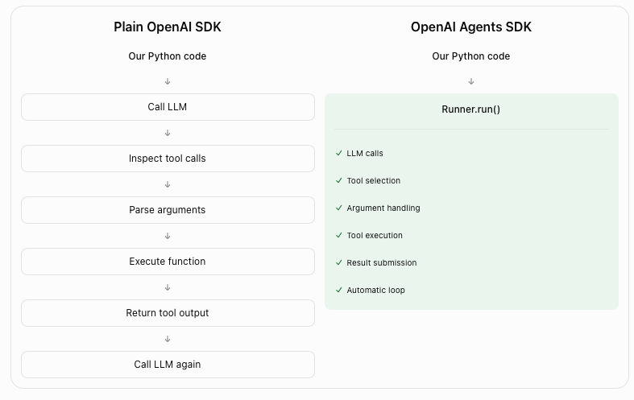

# Lab 07: How the OpenAI Agents SDK runs your loop

**CPU | API key: `OPENAI_API_KEY` | Optional: Graphviz for the drawings, `GEMINI_API_KEY` for one optional part | Practises: building an agent in a framework and recognising the loop inside it; choosing how two agents work together**

## Goal

Meet the OpenAI Agents SDK on an everyday question, then put it to work at the Chinook support desk. The lab has
two notebooks.

**Notebook 1** is a playground. We ask a model about today's weather in Amman, watch it fail, write the tool loop
by hand once, and then let the SDK run the same loop with three names: `function_tool`, `Agent` and `Runner.run`.
From there one agent chains several tools, a triage agent hands a question to a specialist, and hosted tools search
the web and a PDF.

**Notebook 2** takes the same SDK to the desk. One question there needs two
specialists: *How many invoices does Puja Srivastava have, what do they add up to, and who is her support rep?* A
triage agent that **hands the question off** loses the rep: control moves to the invoices specialist, which has no
rep tool, and never comes back. The same two specialists **used as tools** answer all three facts, at 8 model
requests against 3 for one agent with all three tools.

## What you will learn

- How to write the tool loop by hand on the Responses API, and which of its steps `function_tool`, `Agent` and
  `Runner.run` take over.
- How to read what a run did from its result: `last_agent`, `raw_responses`, `new_items` and the usage.
- How one agent chains several tools, and how a handoff passes a question to a specialist.
- How hosted tools (web search and file search) differ from tools that run in our own Python.
- How to set an agent's reasoning effort from `models.env`, and keep a conversation across runs with
  `SQLiteSession`.
- How to connect two specialists as tools and with a handoff, and say for each who controls the next step and what
  it costs.

## What you will do

### Notebook 1: meet the SDK on an everyday question (`07a_meet_the_agents_sdk.ipynb`)

**Part A: Ask a question the model cannot answer alone.** One model call with no tools, then a plain Python function
that gets the weather from Open-Meteo, called by hand.
**Part B: Write the tool loop by hand, once.** The tool schema, the model's `function_call`, our code running the
function and sending the result back, then the same steps in a loop, on one city and on three.
**Part C: Let the Agents SDK run the same loop.** `function_tool`, `Agent`, the agent drawn with `draw_graph`,
`Runner.run`, the run read from its result, the turn cap, and where to see the run on the Traces page.
**Part D: Give one agent several tools and watch it chain them.** An adventure planner with three tools that works
out their order.
**Part E: Pass a question to a specialist with a handoff.** A triage agent, two specialists, and who answered.
**Part F: Use tools that run on OpenAI's side.** Web search, file search over a PDF (the AI governance guide in
`data/documents/`), both in one agent, and deleting what we stored.
**Part G (optional): Run the same agent on another vendor's model.** The weather agent on a Gemini model through
LiteLLM.
**Challenge.** Give the adventure planner a budget tool.

### Notebook 2: the Agents SDK at the Chinook desk (`07b_agents_sdk_at_the_desk.ipynb`)

**Part A: Build the desk agent from three database lookups.** The lookups called by hand, the agent with its
reasoning effort set, its run read turn by turn, and what the run cost.
**Part B: Keep a conversation across runs with a session.** A follow-up question without and with `SQLiteSession`,
and what the session stored.
**Part C: Connect two specialists as tools or with a handoff.** Puja's two-part question answered by one agent, by
a manager that calls the specialists as tools, and by a triage agent that hands off; then a question with one
destination.
**Challenge.** Let the specialists hand back to the triage, and carry a conversation through the manager.

### Going further (`07_extra_async_await.ipynb`)

`async`, `await` and `asyncio.gather` from the beginning, for anyone new to the `await` in `await Runner.run(...)`.

## Checkpoints

| After | You should see |
|---|---|
| Notebook 1, Part A | without a tool the model says it cannot check live weather; `get_weather("Amman")` prints `TOOL CALLED` and returns today's values for Amman, Jordan |
| Notebook 1, Part B | a `function_call` for `get_weather` with `{"city":"Amman"}` and nothing run yet; after the result is sent back, a reply with Amman's weather; three `TOOL CALLED` lines for the three-city question |
| Notebook 1, Part C | a `FunctionTool` with a schema like Part B's (strict, `city` a string); one `TOOL CALLED` line and an answer; 2 model calls; `new_items` with a tool call, its output and a message; `MaxTurnsExceeded` at `max_turns=1` |
| Notebook 1, Part D | three `TOOL CALLED` lines, `get_weather(Dubai)` first, and `suggest_activity` called with the weather that came back |
| Notebook 1, Part E | the Tokyo question answered by `Weather Specialist`, the Barcelona question by `Adventure Specialist`; the handoff listed before the specialist's tool calls |
| Notebook 1, Part F | a web answer with a source and no `TOOL CALLED` line (`web_search_call`; ours used 10,189 input tokens); the guide's four recommended references through a `file_search_call`; a `file_search_call` and one or more `web_search_call` items from the agent with both tools; the store and the file deleted |
| Notebook 1, Part G | with a Gemini key, `TOOL CALLED` once and an answer from the Gemini model; without one, a message that the part is skipped |
| Notebook 2, Part A | Helena 6, 7 invoices, $49.62, Steve Johnson; Puja 59, 6 invoices, $36.64, Jane Peacock; three model calls (`find_customer`, then `get_invoices` and `get_support_rep` together, then the message); input tokens growing per request (ours: 206, 264 and 375) |
| Notebook 2, Part B | without a session the follow-up asks who "she" is; with `SQLiteSession` it answers $49.62; 10 items stored, found again under the same id, none under another |
| Notebook 2, Part C | one agent: three facts, 3 requests; as tools: three facts, `last agent` `Manager`, 8 requests; handoff: the rep missing, `last agent` `Invoices`, no `get_support_rep` call; the rep-only question answered by `Support reps` |
| Challenges | notebook 1: four `TOOL CALLED` lines, `estimate_budget` after `suggest_activity`; notebook 2: handoffs `Triage -> Invoices -> Triage -> Support reps` with all three facts in most runs, and Helena's three facts after *And what about Helena Holý?* |

**About the saved outputs.** They come from `gpt-6-luna`, the model `models.env` names; notebook 1's optional Part G
also ran `gemini-3.5-flash-lite`. The weather is the weather on the day of the run, and the model chooses its tool
calls and writes its replies on every run, so wording, numbers and token counts will differ on yours. Check the
tool calls, the agents and the facts, not the words. The handoff losing the rep did not vary: it happened in every
run we made on this model (more than ten).

## Before you start

- **Lab 00 first.** It checks the environment and that your key reaches the model.
- **Run it locally:** in the repository folder, `uv sync` (or `pip install -r requirements.txt`), put
  `OPENAI_API_KEY` in `.env` (copied from `.env.example`), then open a notebook in VS Code or JupyterLab
  (`uv run jupyter lab`) with the `.venv` kernel. Run the setup cell first. Each notebook runs on its own.
- **Internet:** notebook 1 calls Open-Meteo for the weather (free, no key) and uses OpenAI's web search.
- **Graphviz** (optional): `draw_graph` needs the `dot` program (`sudo apt install -y graphviz` on Ubuntu,
  `brew install graphviz` on a Mac). Without it only the drawing cells fail.
- **Traces:** the SDK sends a trace of every run (questions, tool results, answers) to the Traces page of the OpenAI
  account that owns the key. Notebook 1, Part C says how to switch that off.
- **Stored on OpenAI's side:** notebook 1, Part F uploads the AI governance guide (`data/documents/`) to a
  vector store and deletes both at the end of the part. Run that last cell.
- **Optional Gemini key:** Part G of notebook 1 runs only when `GEMINI_API_KEY` is in `.env`. Nothing else needs it.
- **Files it writes:** notebook 2 keeps its conversation in `07_OpenAI_Agents_SDK/outputs/sessions.db`, which git
  ignores.
- **Data:** `data/chinook.db`, the Chinook sample music shop, opened read-only.
- **Cost:** about 55 model calls in all, a few US cents. Most of it is notebook 1's web search: OpenAI charges a
  small fee per search call on top of the tokens of the pages it reads (about 10,000 input tokens in our run).

## Folder contents

| Path | What it is |
|---|---|
| `07a_meet_the_agents_sdk.ipynb` | notebook 1, the playground, with saved outputs |
| `07b_agents_sdk_at_the_desk.ipynb` | notebook 2, the Chinook desk, with saved outputs |
| `07_extra_async_await.ipynb` | going further: `async` and `await` from the beginning |
| `resources/plain_loop_vs_runner.png` | the picture of our loop beside `Runner.run` |
| `solved/07a_meet_the_agents_sdk_solution.ipynb` | notebook 1's challenge solved, run with its outputs |
| `solved/07b_agents_sdk_at_the_desk_solution.ipynb` | notebook 2's challenge solved, run with its outputs |

## Resources

- [OpenAI Agents SDK](https://openai.github.io/openai-agents-python/): the documentation's home, with a quickstart
- [Agents](https://openai.github.io/openai-agents-python/agents/) and
  [Running agents](https://openai.github.io/openai-agents-python/running_agents/): `Agent`, `Runner.run`, the agent
  loop, `max_turns`
- [Tools](https://openai.github.io/openai-agents-python/tools/): `function_tool`, hosted tools, agents as tools
- [Results](https://openai.github.io/openai-agents-python/results/): `final_output`, `new_items`, `raw_responses`,
  `last_agent`
- [Tracing](https://openai.github.io/openai-agents-python/tracing/): what a trace records and how to control it
- [Sessions](https://openai.github.io/openai-agents-python/sessions/): `SQLiteSession` and the other session classes
- [Handoffs](https://openai.github.io/openai-agents-python/handoffs/) and
  [Agent orchestration](https://openai.github.io/openai-agents-python/multi_agent/): handoffs and agents as tools
- [Models](https://openai.github.io/openai-agents-python/models/): using other providers' models
- [Visualization](https://openai.github.io/openai-agents-python/visualization/): `draw_graph`
- [Python `asyncio`: coroutines and tasks](https://docs.python.org/3/library/asyncio-task.html): `await`, `gather`

Next: [Lab 08: How to build and run an agent with Google ADK](../08_Google_ADK/README.md). Back to [the lab list](../README.md).
