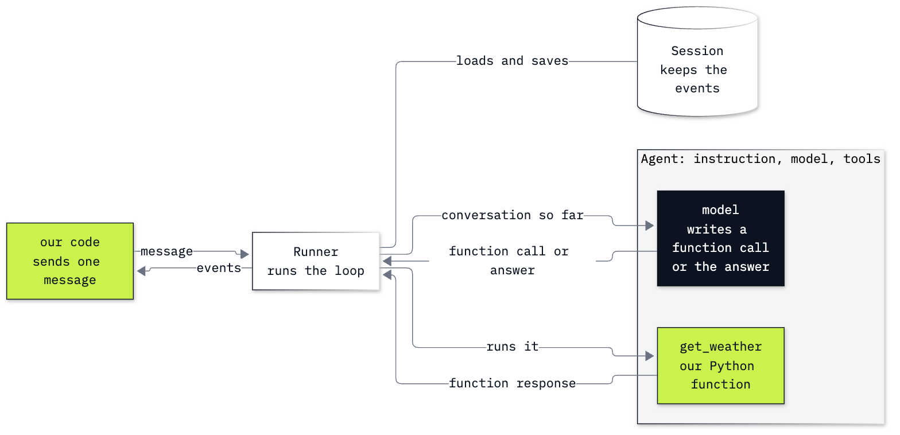

# Lab 08: How to build and run an agent with Google ADK

**CPU | API key: `OPENAI_API_KEY` | Own environment | Optional: `GEMINI_API_KEY` (notebook 1, Part G) | Practises: building an agent in a framework and reading its run; choosing how two agents work together**

## Goal

Meet Google's Agent Development Kit (ADK) on everyday questions, then put it to work at the Chinook support desk.
The lab has two notebooks.

**Notebook 1** is a playground. We start from one plain model call and add ADK's four objects one at a time:
`Agent`, `Runner`, `Session` and `Event`. We give an agent a weather function as a tool and read its run as three
events: the model's function call, our function's response, the answer. Then we keep an agent in a file, run it
from the terminal with `adk run`, run two steps in a fixed order with a `Workflow`, and inspect both in the
browser with `adk web`.

**Notebook 2** takes ADK to the desk. One question there needs two specialists: *How many invoices does Puja
Srivastava have, what do they add up to, and who is her support rep?* With the specialists as `sub_agents`, the
conversation moves: one specialist looks up its part and transfers to the other, the rep gets all three facts for
more than twice the model calls of one agent (8 against 3 in our run), and the next question starts at the
specialist that spoke last. With the same specialists as tools, the conversation stays with a manager.

## What you will learn

- What `Agent`, `Runner`, `Session` and `Event` each add to a plain model call.
- How to give an agent a Python function as a tool, and read the function-call and function-response events of a
  run.
- How a session keeps a conversation, in memory and in a file.
- How to keep an agent in a file, run it with `adk run` and inspect it with `adk web`.
- How a `Workflow` runs steps in an order that our code sets, and how a step can be a function or an agent.
- How to connect two specialists as `sub_agents` and as tools, and say for each who holds the conversation and
  what the run costs.

## What you will do

### Notebook 1: meet ADK on everyday questions (`08a_meet_google_adk.ipynb`)

**Part A: One plain model call, and the work it leaves to our code.** Two calls with the plain OpenAI client; the
second cannot name the city the first one mentioned.
**Part B: Meet `Agent`, `Runner`, `Session` and `Event`, one at a time.** The same two questions through ADK, the
reply read from an event's parts, and a new session that starts from nothing.
**Part C: Give the agent a tool and read the events of a run.** A weather function called by hand, then by the
agent: the function call, the function response and the answer, with the model calls counted.
**Part D: Keep an agent in a file and run it from the terminal.** `my_agent/city_buddy/agent.py`, an agent that
tells the weather and the local time in any city, its functions called by hand, and `adk run`.
**Part E: Run steps in a fixed order with a `Workflow`.** `my_agent/surprise_trip/agent.py`: a Python function
picks a city at random, then an agent suggests what to do there.
**Part F: Inspect a run in the browser with `adk web`.** Both agents in ADK's development page, with screenshots.
**Part G (optional): Run the same agent on a Gemini model.** The plain call on Google's client, then the weather
agent with a Gemini model name.
**Challenge.** Chain two tools, and add a third step to the workflow.

### Notebook 2: ADK at the Chinook desk (`08b_google_adk_at_the_desk.ipynb`)

**Part A: Build the desk agent from three database lookups.** The lookups called by hand, the agent's run read
event by event, and its model calls counted.
**Part B: Keep the rep's conversation in a file.** A follow-up question in a session stored with
`SqliteSessionService`, read back by a second service object.
**Part C: Split the desk between two specialists and follow the transfers.** Puja's two-part question answered by
one agent, by a team of `sub_agents` and by a manager with the specialists as tools; then a follow-up to each team.
**Challenge.** Make the transfers one way, and carry a conversation through the manager in a file.



Light green is our own code, the dark box is the model, white and grey are ADK.

## Checkpoints

| After | You should see |
|---|---|
| Notebook 1, Part A | a suggestion for a weekend in Lisbon; the second call cannot name the city |
| Notebook 1, Part B | creating the agent prints its name, `OpenAIResponsesLlm` and the instruction, and sends nothing; one event, written by `assistant` and final; the follow-up names Lisbon; four stored events; in a new session the follow-up cannot name the city |
| Notebook 1, Part C | without a tool the assistant cannot report the weather; `get_weather("Lisbon")` prints `TOOL CALLED` and today's values; three events (a function call with `{'city': 'Lisbon'}`, the function response, the answer); two model calls (ours: 110 and 217 input tokens); the Tokyo follow-up calls the function for Tokyo only |
| Notebook 1, Part D | the agent file with `find_city`, `get_weather`, `get_local_time` and `root_agent`; `Europe/Lisbon` and a dictionary with the day and the time from the two functions called by hand; from `adk run`, the time and the weather in Lisbon and in Tokyo, the first line starting with `[city_buddy]` |
| Notebook 1, Part E | two events: a city from the list, written by `surprise_trip` (ours: Kyoto), then `plan_agent`'s suggestion for that city |
| Notebook 1, Part F | `adk web` lists `city_buddy` and `surprise_trip`; the question about Lisbon and Tokyo shows function calls for both cities and their responses before the answer (ours: four calls in one event); the workflow's drawing shows `pick_city` and `plan_agent` between `START` and `END` |
| Notebook 1, Part G | with a Gemini key, a suggestion from the Gemini model, then `TOOL CALLED` and a weather report; without one, a message that the part is skipped |
| Notebook 2, Part A | Helena 6, 7 invoices, $49.62, Steve Johnson; Puja 59, 6 invoices, $36.64, Jane Peacock; `find_customer` first, then `get_invoices` and `get_support_rep`, then the answer (ours: five events and three model calls); input tokens growing per model call (ours: 221, 281 and 392) |
| Notebook 2, Part B | the follow-up answered with $49.62; both runs' events stored (ours: 8) and found by a second service object on the same file; `None` under another id |
| Notebook 2, Part C | one agent: three facts, 3 model calls; `sub_agents`: three facts, more than one author, `transfer_to_agent` calls between them (ours: `triage`, `support_reps`, `invoices`, `support_reps`; 8 model calls); the follow-up starts at the agent that spoke last (ours: `support_reps`); `AgentTool`: three facts, every event written by `manager`, and the follow-up starts at `manager` |
| Challenges | notebook 1: `get_weather`, then `to_fahrenheit` with the temperature that came back (ours: 19.4 gives 66.9); three workflow events in the order of the edges. Notebook 2: with one-way transfers one specialist answers and part of the answer is missing (ours: the support rep's name and no invoice facts, 4 model calls); through the manager, Helena's three facts after *And what about Helena Holý?* |

**About the saved outputs.** They come from `gpt-6-luna`, the model `models.env` names; notebook 1's optional Part G
also ran `gemini-3.5-flash-lite`. The weather and the times are those of the moment of the run, and the model
chooses its function calls and writes its replies on every run, so wording, numbers and token counts will differ
on yours. Check the function calls, the authors and the facts, not the words. The team of `sub_agents` gave all
three facts in every run we made on this model (five), with 7 to 11 model calls: the count depends on how often
the specialists pass the conversation back and forth before one of them answers. Asked five times for a random
city, the model named Lisbon four times, which is why `pick_city` in notebook 1 is a Python function.

## When to use it

ADK suits a team that wants the pieces this lab used: a development page and a command line for every agent, a
`Workflow` for steps in a fixed order next to agents that choose their own steps, and sessions that can move from
memory to a file or a database by changing one object. It was built for Gemini models first. With an OpenAI model,
pass `OpenAIResponsesLlm`, as this lab does. The other OpenAI class, `OpenAILlm`, uses the Chat Completions API,
which returns an error when `gpt-6-luna` is given function tools (the error is in notebook 1's Troubleshooting
table). ADK had two costs here. It needs an environment of its own, because its OpenAI support needs an older
`openai` package. And the team of `sub_agents` took 8 model calls where one agent took 3.

## Before you start

- **Lab 00 first.** It checks the repository, Python, `uv` and that your key in `.env` reaches the model.
- **This lab has its own environment,** because ADK's OpenAI support needs an older `openai` package than the core
  labs use. From the repository folder:

  ```bash
  cd 08_Google_ADK
  uv sync --locked --python 3.13
  ```

  In VS Code, choose this folder's `.venv/bin/python` as the notebook's kernel (Windows:
  `.venv\Scripts\python.exe`). With `pip`: make a virtual environment in this folder, activate it, and run
  `python -m pip install -r requirements.txt`. The notebooks install nothing.
- **Open the notebooks from this folder,** so that `my_agent/` and `resources/` are found. Each notebook runs on
  its own.
- **Internet:** notebook 1 and the `city_buddy` agent call Open-Meteo for the weather (free, no key).
- **The `adk` command.** The first time you run `adk` in a terminal it asks *Enable telemetry? [Y/n]*. The
  lines printed above the question say what Google would collect: which commands and flags you use (not the values you type),
  how long they ran, your operating system and Python version, and which features of the web page you use.
  Pressing Enter answers yes; type `n` to decline. `adk telemetry disable` switches it off later.
- **`adk web` is for your own machine.** It has no login. Do not start it on a shared or public network.
- **Optional Gemini key:** Part G of notebook 1 runs only when `GEMINI_API_KEY` is in `.env`. Nothing else needs it.
- **Files it writes:** notebook 2 keeps its conversation in `outputs/sessions.db`, and `adk run` and `adk web` keep
  theirs in a `.adk/` folder inside each agent folder. Git ignores both.
- **Data:** `data/chinook.db`, the Chinook sample music shop, opened read-only.
- **Cost:** about 55 model calls in all, a fraction of one US cent.

## Folder contents

| Path | What it is |
|---|---|
| `08a_meet_google_adk.ipynb` | notebook 1, the playground, with saved outputs |
| `08b_google_adk_at_the_desk.ipynb` | notebook 2, the Chinook desk, with saved outputs |
| `my_agent/city_buddy/` | an agent with two tools (the weather and the local time in a city), for `adk run` and `adk web` |
| `my_agent/surprise_trip/` | a workflow of a Python function and an agent, for `adk run` and `adk web` |
| `resources/adk_runner_and_events.png` and `.mmd` | the picture of one run, and its source |
| `resources/adk_web_city_buddy.png`, `resources/adk_web_surprise_trip.png` | the two `adk web` screenshots |
| `solved/08a_meet_google_adk_solution.ipynb` | notebook 1's challenge solved, run with its outputs |
| `solved/08b_google_adk_at_the_desk_solution.ipynb` | notebook 2's challenge solved, run with its outputs |
| `pyproject.toml`, `uv.lock`, `requirements.txt` | this lab's environment, and the same pins for `pip` |

## Resources

- [Agent Development Kit](https://adk.dev/): the documentation's home
- [LLM agents](https://adk.dev/agents/llm-agents/): `Agent`, its instruction, its tools and its transfer settings
- [Runtime](https://adk.dev/runtime/): the runner and the event loop;
  [the command line](https://adk.dev/runtime/command-line/) and
  [the web interface](https://adk.dev/runtime/web-interface/)
- [Sessions](https://adk.dev/sessions/session/): what a session holds, and the session services
- [Events](https://adk.dev/events/): what an event carries and how to read it
- [Function tools](https://adk.dev/tools-custom/function-tools/): Python functions as tools, and `AgentTool`
- [Workflows](https://adk.dev/workflows/) and
  [collaborative agent workflows](https://adk.dev/workflows/collaboration/): fixed steps, `sub_agents` and transfers
- [Models](https://adk.dev/agents/models/): Gemini models by name, and other vendors' models
- [Open-Meteo](https://open-meteo.com/en/docs): the weather service `get_weather` calls

Next: [Lab 09: How to build an agent from LangChain's pieces](../09_LangChain/README.md). Back to [the lab list](../README.md).
