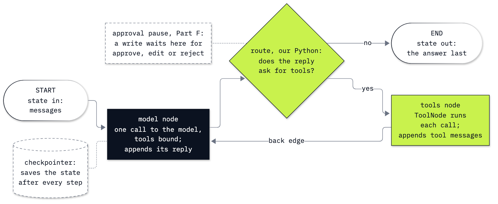

# Lab 10: How LangChain and LangGraph run the same agent

**CPU | API key: `OPENAI_API_KEY` | about 30 small model calls | Practises: recognising the agent loop inside a framework, and stopping an agent for a person's approval before it writes**

## Goal

Rebuild the shop's support-desk agent with LangChain's `create_agent`, see that what it returns is a LangGraph graph,
build that same graph by hand, then make the agent stop before it files a refund and wait for a person's approval,
also across a kernel restart. Two moments teach it. The agent answers correctly, but its answer's `content` is a list
of blocks, not a string, so the `.content.lower()` that worked on a plain model call crashes on it: the framework
chose a different API for us. And after a restart, a paused run kept only in memory is gone; resuming it raises no
error, and the model, now holding no request at all, can propose a refund nobody asked for.

## What you will learn

- How to construct LangChain's `ChatOpenAI` from `models.env`, call it directly and read the `AIMessage` it returns
  (`content`, `text`, `usage_metadata`, `response_metadata`).
- How to turn plain Python functions into LangChain tools with `tool` and build the desk agent with `create_agent`.
- Why the agent's answer arrives as a list of content blocks, and how `.text` reads every reply the same way.
- What `create_agent` returns, a LangGraph `CompiledStateGraph`, and how to build the same graph by hand with
  `StateGraph`: the state, the `add_messages` reducer, the nodes, the routing function and the back edge.
- How to ask the agent for a typed answer with `response_format`.
- How to pause before a write with `HumanInTheLoopMiddleware`, resume with `Command`, and why only a checkpointer that
  writes to a file (`SqliteSaver`) keeps a paused run across a restart.

## Where this lab starts

Lab 03 wrote the agent loop by hand: send the messages and the tool schemas, run every tool the model asks for,
append the results, and repeat until the model answers in text. Lab 07 ran the same loop in the OpenAI Agents SDK.
This lab runs it in LangChain (the building blocks: a chat model object, messages, tools, and `create_agent`, a
prebuilt loop) and LangGraph (the engine underneath, which runs a program written as a graph of a state, nodes and
edges, and can save the state after every step). It uses the same three lookups and the same question as lab 03 and
defines everything it needs, so it runs on its own.

## What you will do

All of it on the Chinook music shop's database, `data/chinook.db`, opened read-only, with three lookups:
`find_customer`, `get_invoices` and `get_support_rep`. The question: how many invoices Helena Holý has, what they add
up to, and who her support rep is.

**Part A: Call a LangChain chat model directly.** Construct `ChatOpenAI` from `models.env`, send a system and a human
message, and read the `AIMessage` field by field.
**Part B: Build the desk agent with `create_agent`.** Turn the three lookups into tools with `tool`, read the schema
LangChain sends, build the agent, print and draw its graph, and run Helena's question message by message.
**Part C: Read the agent's answer from content blocks.** Watch `.content.lower()` crash on the agent's answer, read
the block it holds and the response id that shows which API answered, then read every reply with `.text`.
**Part D: Build the same graph by hand in LangGraph.** Call the `add_messages` reducer on two small lists, build a
graph with no model, then the model node, `ToolNode`, a routing function and the back edge; compare its edges with
`create_agent`'s and run the same question.
**Part E: Ask the agent for a typed answer.** Describe the answer as a Pydantic model, pass it as `response_format`,
read the raw message beside the parsed object, and run two customers with `batch`.
**Part F: Pause a refund for a person's approval.** Add a tool that writes to a refund table, put
`HumanInTheLoopMiddleware` in front of it, read the interrupt, check the invoice and approve with `Command`.
**Part G: Keep a paused run across a kernel restart.** Pause the same request on an `InMemorySaver` agent and a
`SqliteSaver` agent, restart the kernel, read both threads, approve the one that survived, and see what a resume on
the lost thread does.
**Challenge.** Ask Puja Srivastava's question on the graph you built by hand, and reject a refund with a reason.

## Checkpoints

| After | You should see |
|---|---|
| Part A | an `AIMessage` whose `content` is a `str`, `finish_reason` `stop`, a response id starting with `chatcmpl-` |
| Part B | nodes `['__start__', 'model', 'tools', '__end__']`; `find_customer`, then `get_invoices` and `get_support_rep` in one reply; an answer with 7 invoices, 49.62 US dollars and Steve Johnson, printed as a list |
| Part C | `AttributeError: 'list' object has no attribute 'lower'`; one block of type `text`; a response id starting with `resp_`; `.text` gives the answer and `names the rep: True` |
| Part D | `add_messages` appends, then replaces by `id`; the lookup graph returns `customer_id` 6 and `invoice_count` 7; `✅ same nodes and edges`; the hand-built graph gives the same answer |
| Part E | `['messages', 'structured_response']`; `DeskAnswer(customer_name='Helena Holý', invoice_count=7, total_usd=49.62, support_rep='Steve Johnson')`; an average invoice of 7.09; Puja with 6, 36.64 and Jane Peacock |
| Part F | a fifth node, `HumanInTheLoopMiddleware.after_model`; an interrupt for `file_refund_request` with invoice 393 and 1.98, and an empty table; after approval, one row |
| Part G | after the restart, the `memory` thread empty and the `file` thread waiting on invoice 284 and 8.91; after approval, two rows; a resume on the lost thread raises no error and starts a new run (in our run it asked what the rep needed, and 2 of 5 more empty threads got an invented refund); still two rows |

**About the saved outputs.** They come from `gpt-6-luna` with reasoning effort `none`, the model named in
`models.env`. Replies change from run to run, and from model to model if you change `models.env`: check the facts and
the shape of each run (which tools, in which order, where it stops), not the wording. With another model, Part C can
change too: whether the agent's `content` is a list depends on which OpenAI API LangChain picks for that model, which
is why the lab reads replies with `.text`. Part G's resume on the lost thread is a spread, not a fixed result: over
23 such resumes we have seen, the model wrote a refund request nobody asked for in 14 and asked
what the rep needed in the rest; the approval step stopped every one of them before it could write.

## Before you start

- **Lab 00 first.** It checks the environment, your key and the shop's data.
- **Open** `10_langchain_langgraph.ipynb` in VS Code or JupyterLab on the repository's `.venv` kernel and run the
  cells from the top. Part G asks you to restart the kernel and run the config cell again; the notebook says when.
- **Data:** `data/chinook.db`, read in place and opened read-only. Parts F and G write two files of their own in this
  lab's `outputs/` folder (`refund_requests.db` and `checkpoints.db`), which git ignores; delete the folder whenever you
  like.
- **Cost:** about 30 calls of a few hundred tokens each, well under one US cent at the prices in `models.env`. The
  solution notebook makes about 7 more.

## Folder contents

| Path | What it is |
|---|---|
| `10_langchain_langgraph.ipynb` | the lab notebook, with saved outputs |
| `resources/lab10_graph_by_hand.mmd` | the source (mermaid) of the graph this lab builds |
| `resources/lab10_graph_by_hand.png` | that diagram, exported from the source |
| `resources/lab10_create_agent_graph.mmd` | the Mermaid text `create_agent`'s graph prints, in the lab's colours |
| `resources/lab10_create_agent_graph.png` | that drawing, exported from the source |
| `solved/10_langchain_langgraph_solution.ipynb` | the challenge, solved and run |

## Resources

- [LangChain: Agents](https://docs.langchain.com/oss/python/langchain/agents): `create_agent`, its loop, tools,
  system prompt and middleware.
- [LangChain: Messages](https://docs.langchain.com/oss/python/langchain/messages): message objects, `.text` and
  content blocks.
- [LangChain: ChatOpenAI](https://docs.langchain.com/oss/python/integrations/chat/openai): the OpenAI chat model,
  including when it uses the Responses API.
- [LangChain: Tools](https://docs.langchain.com/oss/python/langchain/tools): `tool`, docstrings and type hints as the
  schema.
- [LangChain: Structured output](https://docs.langchain.com/oss/python/langchain/structured-output): `response_format`
  and the provider and tool strategies.
- [LangChain: Human-in-the-loop](https://docs.langchain.com/oss/python/langchain/human-in-the-loop):
  `HumanInTheLoopMiddleware`, decisions and resuming with `Command`.
- [LangGraph: Graph API](https://docs.langchain.com/oss/python/langgraph/graph-api): state, reducers, nodes, edges and
  conditional edges.
- [LangGraph: Checkpointers](https://docs.langchain.com/oss/python/langgraph/checkpointers): `InMemorySaver`,
  `SqliteSaver`, threads and `get_state`.
- [LangGraph: Interrupts](https://docs.langchain.com/oss/python/langgraph/interrupts): how a graph pauses and resumes.

The LangChain half of this lab continues in [lab 09](../09_LangChain/README.md), which stays with one model call at a
time and composes LangChain's smaller pieces around it: prompt templates, `prompt | model | parser` chains, typed records from
`with_structured_output`, and `batch` and `stream`.

Next: [Lab 11: How to choose an agent framework (a guide)](../11_Choose_A_Framework/README.md). Back to [the lab list](../README.md).
