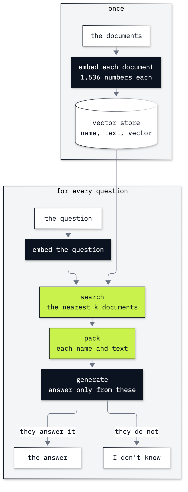

# Lab 12: How to answer from documents with retrieval

**CPU | API key: `OPENAI_API_KEY` | Practises: embedding and searching documents by meaning, storing them in Chroma, and answering only from what the search found**

## Goal

Answer questions from documents that were not in the model's training data: turn each document into an embedding, find the documents
nearest to the question, and let the model answer only from those, or say it does not know. The lab has two
notebooks and an extra one.

**Notebook 1** uses seven one-line notes that a host leaves for a guest in a flat. A question about parking finds the
parking note without sharing a word with it. Then the guest asks who has the spare key: the nearest note is about
other keys, and with only that note the model says, politely and without any error, that it does not know. With one
more note it answers. A question that no note answers still gets notes back, so the refusal has to come from the generate
step, through the rule in the model's instructions, and not from the search.

**Notebook 2** takes the same pipeline to the Chinook music shop's support desk and its 36 policy and ticket files. A
rep asks *When is support staffed?* The nearest file is the one about the support staff, not the one with the hours,
and with one file the reply is a careful "I don't know" that hides the miss. Then a metadata filter narrows the
search, and the collection is kept on disk.

## What you will learn

- How to compare two vectors with cosine similarity, and turn a text into an embedding and read its shape and length.
- How to search texts by meaning, first with one matrix product and then in a Chroma collection, reading the raw
  query result before a helper wraps it.
- How to answer only from the retrieved texts, and print which texts were used, so a search that missed can be seen.
- Why a search returns texts even when none of them answers, and which step has to refuse.
- How to narrow a search with a metadata filter, and keep a collection on disk with `PersistentClient`.
- In the extra notebook: how to split a long document into chunks, measure a search with hit@1 and hit@3, and run
  Chroma as a server.

## What you will do

### Notebook 1: meet retrieval on the house notes of a flat (`12a_meet_retrieval.ipynb`)

**Part A: Ask the model a question about our flat.** One model call with no notes, then the seven notes.
**Part B: Measure how close two meanings are with cosine similarity.** Cosine by hand on vectors of two numbers, then
one note as an embedding: its 1,536 numbers and its length.
**Part C: Search the notes by meaning.** All seven notes in one matrix, the question as a vector, a picture of the
notes in two dimensions, and the scores.
**Part D: Store and search the notes in Chroma.** A collection, `peek()`, the raw query result and its keys, then
`search` as a helper.
**Part E: Answer from the notes the search found.** Pack the notes with their names, answer only from them, and
`answer()`.
**Part F: Ask a question whose nearest note is the wrong one.** *Who has the spare key?* with one note and with two.
**Part G: Ask a question that no note answers.** The landlord's bank PIN: the search still returns notes.
**Challenge.** Ask the locked-out question in other words, and add a note to the collection.

### Notebook 2: retrieval at the Chinook support desk (`12b_retrieval_at_the_desk.ipynb`)

**Part A: Store the shop's files in a Chroma collection.** The 36 files embedded in one call, stored with `kind`
labels, one record fetched with `get`, and `retrieve` as a helper.
**Part B: Answer a rep's question from the retrieved files.** The returns question answered from three files.
**Part C: Find the miss when the nearest file is not the one that answers.** *When is support staffed?* with one
file and with three.
**Part D: Narrow the search with a metadata filter.** The policies-only filter, and a question it makes impossible to
answer.
**Part E: Keep the collection on disk with `PersistentClient`.** The collection written to a folder and opened again
by a new client.
**Challenge.** Choose the filter that can answer, and make the reply cite its files with a check in code.

### Going further (`12_extra_chunking_and_measuring.ipynb`)

**Part A: Split a long document into chunks tagged with their source.** The policies joined into one handbook, cut
every 300 characters, then split at headings and paragraphs.
**Part B: Measure the search with hit@1 and hit@3 on labelled questions.** Whole sections against paragraph chunks.
**Part C: Test a score threshold as a guard.** The best scores of answerable and unanswerable questions side by side.
**Part D: Run Chroma as a server from a terminal.** `chroma run`, `HttpClient`, the server's API page, and stopping
it.

## Checkpoints

| After | You should see |
|---|---|
| Notebook 1, Part A | without the notes the model says it does not know the wifi password; the seven notes |
| Notebook 1, Part B | cosine 0.8 for `a` and `b`, 0 for `a` and `c`; a `list` of 1,536 numbers of length 1 (ours 1.0003) |
| Notebook 1, Part C | `D` of shape (7, 1536); the question drawn next to the parking note; `parking` first at 0.379 |
| Notebook 1, Part D | `stored: 7`, `distance: cosine`; the raw result's keys, the filled fields each a list with one inner list per question; `parking`, `bins`, `neighbours` |
| Notebook 1, Part E | `[parking] Guests park on Hill Street, outside number 12.` and a reply that sends the car to Hill Street |
| Notebook 1, Part F | `window_keys` (0.6) before `neighbours` (0.553); with `k=1` "I don't know who has the spare key"; with `k=2` Omar and Lina in flat 4 |
| Notebook 1, Part G | three notes back for the PIN question (best 0.318) and a reply that the notes do not say |
| Notebook 2, Part A | 36 files, 20 policies and 16 tickets; 36 vectors of 1,536 numbers; `stored: 36`; `policy_returns.md` first at 0.6133 |
| Notebook 2, Part B | the 30-day rule from a prompt of 290 tokens |
| Notebook 2, Part C | `policy_support_reps.md` (0.5276) before `policy_support_hours.md` (0.4725); with `k=1` "I don't know"; with `k=3` Monday to Friday, 09:00 to 17:00 |
| Notebook 2, Part D | Puja's ticket first without the filter; with `where={"kind": "policy"}` `policy_digital_downloads.md` first at the same cosine (0.5044); ticket 06 gone for the shipping date |
| Notebook 2, Part E | `stored on disk: 36`, `chroma.sqlite3` in `chroma_db/shop`, then `read from disk: 36` and the hours line |
| Extra, Part A | 23 chunks by size, the damaged-twice rule cut in half; 20 sections and 67 paragraph chunks, `Damaged media#1` whole |
| Extra, Part B | whole sections hit@1 5/8, hit@3 6/8; paragraphs hit@1 7/8, hit@3 8/8 |
| Extra, Part C | with whole sections the unanswerable questions score 0.1988 and 0.3153 while three best sections are wrong; with paragraphs the CEO question reaches 0.4676, above the best chunks of two answerable questions (0.4585 and 0.4333) |
| Extra, Part D | a heartbeat; `stored on the server: 67`; `Support hours and SLA#0` first for the staffing question |
| Challenges | notebook 1: the window-keys note first again for *I'm locked out. Who can let me in?*, and the new recycling note first for the wine bottle; notebook 2: the date 2012-07-20 with the tickets-only filter, and a `Sources:` line whose files all pass the check |

**About the saved outputs.** They come from `gpt-6-luna`, the chat model `models.env` names, and from
`text-embedding-3-small`, its embedding model. The same text embedded twice can differ in the third or fourth decimal,
so check the order of the files and notes, not the last digits. Chat replies change wording from run to run: check
what each reply says (an answer, or "I don't know"), not its words. On this model the spare-key and staffing questions
gave "I don't know" with one note or file in all 11 runs we made of each, and the right answer with two notes (11 of
11) or three files (5 of 5).

## Before you start

- **Lab 00 first.** It checks the environment and that your key reaches the model.
- **Run it locally:** in the repository folder, `uv sync` (or `pip install -r requirements.txt`), put
  `OPENAI_API_KEY` in `.env` (copied from `.env.example`), then open a notebook in VS Code or JupyterLab
  (`uv run jupyter lab`) with the `.venv` kernel. Run the setup cell first. Each notebook runs on its own.
- **Data:** notebook 1 uses seven notes typed into the notebook. Notebook 2 and the extra notebook read the 36 files
  of `data/corpus/` in place; the extra notebook's handbook is built in memory. Nothing is written to `data/`.
- **Files it writes:** notebook 2 keeps a collection in `12_Retrieval/chroma_db/shop/`, and the extra notebook's
  server keeps its data in `12_Retrieval/chroma_db/server/`. Git ignores every `chroma_db/` folder.
- **Extra notebook, Part D:** you start a Chroma server in a terminal on port 8012, bound to this computer only, and
  stop it with Ctrl+C. If port 8012 is busy, use another port in the command and in the notebook's `PORT`.
- **Cost:** about a dozen small chat calls and about three dozen embedding calls, solutions included: well under one US cent in all.

## Folder contents

| Path | What it is |
|---|---|
| `12a_meet_retrieval.ipynb` | notebook 1, the house notes of a flat, with saved outputs |
| `12b_retrieval_at_the_desk.ipynb` | notebook 2, the Chinook support desk, with saved outputs |
| `12_extra_chunking_and_measuring.ipynb` | going further: chunking, hit@k, a score threshold and a Chroma server |
| `resources/lab12_retrieve_then_generate.png` and `.mmd` | the retrieve-then-generate drawing and its source |
| `resources/lab12_chunks_keep_their_source.png` and `.mmd` | the two splits of the handbook and their source |
| `solved/12a_meet_retrieval_solution.ipynb` | notebook 1's challenge solved, run with its outputs |
| `solved/12b_retrieval_at_the_desk_solution.ipynb` | notebook 2's challenge solved, run with its outputs |

## Resources

- [OpenAI: vector embeddings](https://developers.openai.com/api/docs/guides/embeddings): the embedding models, their
  sizes, and why their vectors have length 1.
- [Chroma: adding data](https://docs.trychroma.com/docs/collections/add-data) and
  [updating data](https://docs.trychroma.com/docs/collections/update-data): `add` and `upsert`.
- [Chroma: query and get](https://docs.trychroma.com/docs/querying-collections/query-and-get): `query`, `get`,
  `include`, and the shape of the result.
- [Chroma: metadata filtering](https://docs.trychroma.com/docs/querying-collections/metadata-filtering): `where` and
  its operators.
- [Chroma: configure a collection](https://docs.trychroma.com/docs/collections/configure): the distance functions
  (`l2`, `cosine`, `ip`).
- [Chroma: clients](https://docs.trychroma.com/docs/run-chroma/clients) and
  [client-server mode](https://docs.trychroma.com/docs/run-chroma/client-server): `PersistentClient` for a
  collection on disk, and `chroma run` with `HttpClient`.
- [Lewis and others, Retrieval-Augmented Generation for Knowledge-Intensive NLP Tasks (2020)](https://arxiv.org/abs/2005.11401):
  the paper that named RAG.

Next: [Lab 13: How to give an agent a search tool](../13_Agentic_RAG/README.md). Back to [the lab list](../README.md).
