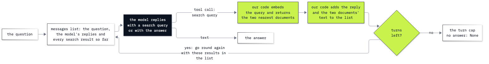

# Lab 13: How to give an agent a search tool

**CPU | API key: `OPENAI_API_KEY` | Practises: turning retrieval into a tool whose queries the model writes, reading every query, and choosing between an agent and a single bigger search**

## Goal

Give a model a search over your documents as a tool, so that it can search again with words it found in the first
result. The lab has two notebooks.

**Notebook 1** works on eight short notes that I, the lab's author, keep for myself, and one question: *What is the
address of my dentist?* One note says who my dentist is; another gives her address and never says "dentist". One
search with the question's words cannot reach the second note. Given the search as a tool, the model first answers
after one search, even though the search result names the dentist. When we add one sentence to the system message,
the model's second query uses the dentist's name. Then a turn cap stops a run, and a question the notes cannot answer
ends with "I do not know".

**Notebook 2** puts the same tool on the Chinook music shop's 36 policy and ticket files. A customer whose warped vinyl
was replaced once (ticket 06) writes back that the replacement arrived warped too, and the rep asks what to offer now
and how long the refund takes. The rule for a second damaged copy is in a policy that only the ticket names. The model
reads the ticket and writes its next query in the ticket's words. A single search that returns six files does the same
job more cheaply on this wording, and stops being enough when the rep asks the same thing in other words.

## What you will learn

- How a search over short texts works with embeddings and one matrix multiplication, and why one search with the
  question's words can miss the document that has the answer.
- How to describe a search to a model as a tool, so that the model writes the query and our code runs it.
- How to read the queries a model writes, and tell a query written from the question from one written from a
  document the model has just read.
- What one sentence in the system message changes: a model that stops at a name, and a model that searches for it.
- How to run the searches in a loop with a turn cap, and read a run the cap stopped.
- How to compare the agent with a single search that returns more files (a bigger `k`), and say when the bigger `k`
  is enough.

## What you will do

### Notebook 1: search my own notes, once and then as a tool (`13a_meet_agentic_rag.ipynb`)

**Part A: Search my notes once, with the question's words.** The eight notes, the question with no notes, the search
built from embeddings and `D @ q`, and one answer from the two nearest notes.
**Part B: Give the model the search as a tool, one turn at a time.** The tool schema, the model's first query, our
code running the search, and a reply that names Mia Rana and gives no address.
**Part C: Let the model search again, and read where the second query came from.** One added sentence, the turns in a
loop, the two queries side by side, and the loop as a drawing.
**Part D: Stop the loop with a turn cap, and see how it ends on a question the notes cannot answer.** A cap of two
turns, and the dentist's phone number.
**Challenge.** A question the first search answers, and a question where the added sentence is not enough.

### Notebook 2: the search tool at the Chinook support desk (`13b_agentic_rag_at_the_desk.ipynb`)

**Part A: State the case, and see one search miss the rule for a second damaged copy.** Ticket 06, the rep's
question, the two facts and the two policies that give them, the search over 36 files, and one answer at `k=2`.
**Part B: Give the model the search as a tool, and read the query it writes after the ticket.** The tool, the system
message, two turns by hand, and the two queries side by side.
**Part C: Run the search in a loop until the model answers both parts.** `run_loop` with a turn cap, and the answer
checked against the policies.
**Part D: Find when a bigger `k` is enough, and when the agent finds a policy the bigger `k` misses.** A single
search at `k=6`, the same question reworded, and both approaches on it.
**Going further.** Which words of each query came from a file already read, and what each approach cost (no new model
calls).
**Challenge.** Helena's rep and the first-reply time, and whether that question needed the agent.

## Checkpoints

| After | You should see |
|---|---|
| Notebook 1, Part A | 8 notes; without notes, no address; `D.shape` `(8, 1536)`; `health.md` and `okafor.md` nearest the question, `rana.md` 4th; an answer that says the notes do not give the dentist's address |
| Notebook 1, Part B | turn 1: `tool_calls` and one query (ours: *dentist address*), returning `health.md` and `okafor.md`; turn 2: `stop` and a reply that names Mia Rana and says the notes give no address |
| Notebook 1, Part C | two searches, the second with "Mia Rana" in it (ours: *Mia Rana clinic address*) and returning `rana.md`; the answer 12 Garden Street, second floor; "Mia Rana" not in the question and in `health.md` |
| Notebook 1, Part D | with `max_turns=2`, two searches and `answer: None`; the phone question: two searches and an answer that says the notes give no phone number |
| Notebook 2, Part A | 36 files; `D.shape` `(36, 1536)`; `policy_refunds.md` 3rd and `policy_damaged_media.md` 5th nearest the question; at `k=2` an answer with neither fact |
| Notebook 2, Part B | turn 1 returns ticket 06; turn 2's query has words from ticket 06 that are not in the question (ours: *damaged*, *policy* and *Germany*) and returns `policy_damaged_media.md` |
| Notebook 2, Part C | a later query with words from the ticket returning `policy_damaged_media.md` (ours: *damaged media* on turn 2); an answer with a refund instead of a third copy and 5 to 10 business days after approval |
| Notebook 2, Part D | `k=6` gives both facts in one call (ours: 555 input tokens against the agent's 1,196 over 3 calls); reworded, `policy_refunds.md` is 10th and `k=6` misses the refund time; the agent gives both facts |
| Challenges | notebook 1: the GP's surgery at 3 Mill Lane from the first search; "Which day is my dentist closed?" answered only after a sentence that tells the model to search for a name (Fridays). Notebook 2: Steve Johnson and 1 business day; the first search already returns both files, and one search at `k=2` answers in one call |

**About the saved outputs.** They come from `gpt-6-luna` with reasoning effort `none`, the model `models.env` names,
and `text-embedding-3-small` for the embeddings. The search rankings are the same on every run (the third decimal of a
score may move); the model's queries and replies change from run to run, so check which files come back and where each
query's words came from, not the wording. How often each result repeated on this model: On the notes, with the first
system message the model stopped after one search in all 16 runs we made, and with the added sentence it searched for
Mia Rana in all 17. At the support desk, the loop found the damaged-media policy in all 10 runs we made, and the
answer had both facts in 8 of those 10; in the other 2, the refund-time search returned tickets and the answer said it
could not find the refund time. With parallel tool calls allowed (notebook 2 turns them off), the model split the
rep's question into two searches on turn 1 in 9 of 10 runs.

## Before you start

- **Lab 00 first.** It checks the environment and that your key reaches the model.
- **Run it locally:** in the repository folder, `uv sync` (or `pip install -r requirements.txt`), put
  `OPENAI_API_KEY` in `.env` (copied from `.env.example`), then open a notebook in VS Code or JupyterLab
  (`uv run jupyter lab`) with the `.venv` kernel. Run the setup cell first. Each notebook runs on its own.
- **Reasoning effort:** `REASONING_EFFORT=none` in `models.env`, as shipped. On Chat Completions the model calls
  tools only at that setting.
- **Data:** notebook 1 reads the eight notes in `my_notes/`; notebook 2 reads the 36 files in `data/corpus/`. Both are
  read in place, and nothing is written to disk. The search is a NumPy array in memory: no vector database and no
  server.
- **Cost:** about 25 model calls and 25 small embedding requests in all, well under one US cent.

## Folder contents

| Path | What it is |
|---|---|
| `13a_meet_agentic_rag.ipynb` | notebook 1, my notes, with saved outputs |
| `13b_agentic_rag_at_the_desk.ipynb` | notebook 2, the Chinook support desk, with saved outputs |
| `my_notes/` | the eight notes notebook 1 searches |
| `resources/lab13_agentic_rag.png` and `.mmd` | the drawing of the loop and its source |
| `solved/13a_meet_agentic_rag_solution.ipynb` | notebook 1's challenge solved, run with its outputs |
| `solved/13b_agentic_rag_at_the_desk_solution.ipynb` | notebook 2's challenge solved, run with its outputs |

## Resources

- [OpenAI: function calling](https://developers.openai.com/api/docs/guides/function-calling): tool schemas, strict
  mode, `tool_calls`, parallel tool calls, and sending results back
- [OpenAI: vector embeddings](https://developers.openai.com/api/docs/guides/embeddings): what an embedding is, and
  several texts embedded in one request
- [OpenAI: file search](https://developers.openai.com/api/docs/guides/tools-file-search): the hosted search tool on
  the Responses API, over a vector store OpenAI keeps
- [NumPy: `argsort`](https://numpy.org/doc/stable/reference/generated/numpy.argsort.html): the positions that sort
  an array

Next: [Lab 14: How to search your documents with LlamaIndex](../14_LlamaIndex_RAG/README.md). Back to
[the lab list](../README.md).
