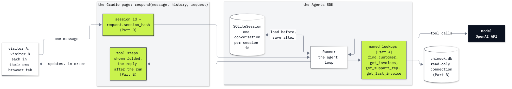

# Lab 13: How to build a customer-support agent over a database

**CPU | API key: `OPENAI_API_KEY` | Practises: grounding an agent in business data (a database behind a chat page that several people use at once)**

## Goal

Put the Chinook desk agent behind a chat page that several support reps use at the same time, with tools that can
only read the shop's database. Two measurements decide how it is built. In Part A, named lookups and a free SQL tool
answer the same four questions, and the free tool misses a customer whose name is typed without its accent. In Part D
comes the moment the lab is about: with one conversation for the whole page, a second visitor who asks *"Which customer
were we talking about?"* is told about the first visitor's customer. With the visitor's browser session as the
conversation key, they are asked for a name instead.

## What you will learn

- How to choose between named lookup tools and a free SQL tool, from what each gets right and wrong on the same
  questions.
- How to open a database read-only and prove that a write fails, whatever the model asks for.
- How to put a Python function behind a Gradio `ChatInterface` and test the page from code as two visitors with
  `gradio_client`.
- How to give each visitor their own conversation with the Agents SDK's `SQLiteSession`, keyed by the browser session.
- How to stream the agent's tool steps to the page as folded messages, and read what the visitor saw, update by update.
- How to run the same page from the terminal with `app.py`.

## Coming from

Labs 03 and 04 wrote the three Chinook lookups and the agent loop by hand; lab 07 runs that loop in the OpenAI Agents
SDK (`function_tool`, `Agent`, `Runner`, sessions). This lab defines the lookups and the agent it needs, explains each
SDK object where it first appears, and runs on its own.

## What you will do

**Part A: Choose named tools or free SQL.** Four named lookups (`find_customer` with close names, `get_invoices`,
`get_support_rep`, `get_last_invoice`) and one `run_sql` tool, each given to an agent, on four questions: Helena, Helena
typed without her accent, the top billing country, and a request to delete an invoice. Count, read the failing
replies, choose.
**Part B: Keep the database read-only.** Send the `DELETE` the model never sent, through `run_sql` and on the
connection, and read SQLite's refusal; then the same statement on a writable copy.
**Part C: Put a function behind a chat page.** An echo function behind `gr.ChatInterface`, two visitors from
`gradio_client`, the `history` the page sends, and the session id each visitor gets from `gr.Request`.
**Part D: Give every visitor their own conversation.** What `SQLiteSession` stores and where; the desk agent behind
the page with one session for everyone, then with `request.session_hash` as the session id, two visitors each time,
and the sessions file read after each.
**Part E: Show the visitor what the agent did.** `Runner.run_streamed` and its run item events; each tool step as a
folded `ChatMessage`, the reply after the run; every update a visitor received, with its time.
**Part F: Run the page from the terminal.** `app.py` read, its functions checked against the notebook's, then started
as its own process, visited once and stopped.
**Challenge.** A named tool for the country question, and a `start over` command that clears one visitor's
conversation.



## Checkpoints

| After | You should see |
|---|---|
| Part A | named tools: Helena 3 of 3, without the accent 10 of 10, the country question declined (0 of 3), no write; free SQL: the country 3 of 3, without the accent 6 of 10 (the misses reply *"I couldn't find a customer named Helena Holy"*), no write attempted in 3 of 3 |
| Part B | `['SQLite error: attempt to write a readonly database']`; `OperationalError \| attempt to write a readonly database` and invoice 404 still there; on the writable copy 412 invoices, then 411 |
| Part C | the echo page counts 0, then 2 earlier messages for visitor A, and 0 for visitor B; visitor A keeps one session id, visitor B has another |
| Part D | without a session the follow-up asks for a name, with one it names Helena Holý (12 items stored); one session for the page: rep B told about Helena in 3 of 3 rounds, one `page` session in the file; one per visitor: 0 of 3, a session per visitor |
| Part E | seven updates for one message: each tool step pending, then done with its result inside; the reply only in the last update (ours at 8.4 s) |
| Part F | five ✅ (the notebook's functions are `app.py`'s); the page on port 7861 answers with three folded steps and the reply; exit code 0; the key not in its output |
| Challenge | `top_billing_countries` called once per run and the USA with 523.06 in 3 of 3; the delete still declined; after `start over` visitor A is asked for a name, A's conversation drops from 8 items to 4, and visitor B's keeps its 8 |

**About the saved outputs.** They come from `gpt-6-luna` at reasoning effort `none`, the model `models.env` names.
Parts B and C, and the plumbing in Parts D to F (which session a message lands in, what each update holds), are the
same on every run. The model's replies, its tool calls and the timings vary from run to run and from model to model:
the free SQL miss on the unaccented name in particular comes and goes, so expect a different count there. Check the
facts (customer 6, 7 invoices, $49.62, Steve Johnson) and which session a reply came from, not the words.

## Before you start

- **Lab 00 first.** It checks the environment and that your key reaches the model.
- **Run it locally:** in the repository folder, `uv sync` (or `pip install -r requirements.txt`), put
  `OPENAI_API_KEY` in `.env` (copied from `.env.example`), then open `13_support_desk_agent.ipynb` in VS Code or
  JupyterLab (`uv run jupyter lab`) with the `.venv` kernel. Run the setup cell first.
- **Pages and ports:** the notebook starts its pages on `http://127.0.0.1:7860`, one at a time, and closes each; Part F
  starts `app.py` on port 7861 and stops it. Open an address in your browser while its page is running to try it by
  hand.
- **On a remote VM or in Codespaces:** `127.0.0.1` is the remote machine, not yours. VS Code forwards ports 7860 and
  7861 for you (see its **Ports** panel; add the port there if it is missing): open the forwarded address instead of
  `127.0.0.1`.
- **Files it writes:** `13_Support_Desk_Agent/outputs/` (git ignores it): the sessions file, a writable copy of the
  database for Part B, and `app.py`'s own sessions file. `data/chinook.db` is only ever opened read-only.
- **Cost:** about 60 short agent runs, most of them in Part A's comparison: around one US cent at the prices in
  `models.env`. Parts B and C call no model.
- The notebook ends with a troubleshooting table: a port still in use, the SDK's HTTP client used from two event
  loops, `AppError` from the client, the read-only error, and `app.py` without a key.

## Run the page from the terminal

From the repository folder:

```
uv run python 13_Support_Desk_Agent/app.py
```

Then open `http://127.0.0.1:7861` in your browser, in two tabs to see two conversations. Ctrl+C stops it.

## Folder contents

| Path | What it is |
|---|---|
| `13_support_desk_agent.ipynb` | the guided notebook, with saved outputs |
| `app.py` | the support desk page as a program: the same lookups, agent and `respond` as the notebook |
| `resources/lab13_page_flow.mmd` and `.png` | the page flow diagram: its mermaid source and the exported image |
| `solved/13_support_desk_agent_solution.ipynb` | the challenge solved, run with its outputs |

## Resources

- [OpenAI Agents SDK: sessions](https://openai.github.io/openai-agents-python/sessions/): `SQLiteSession`, how a
  session is loaded and saved, and the other session stores
- [OpenAI Agents SDK: tools](https://openai.github.io/openai-agents-python/tools/): `function_tool` and the schema it
  writes from a function
- [OpenAI Agents SDK: streaming](https://openai.github.io/openai-agents-python/streaming/): `run_streamed` and the run
  item events
- [Gradio: `ChatInterface`](https://www.gradio.app/docs/gradio/chatinterface): the function's arguments, `history` and
  streaming with `yield`
- [Gradio: `Chatbot` and `ChatMessage`](https://www.gradio.app/docs/gradio/chatbot): `metadata` titles and status for
  folded messages
- [Gradio: agents and tool usage](https://www.gradio.app/guides/agents-and-tool-usage): showing an agent's steps in a
  chat
- [Gradio: the Python client](https://www.gradio.app/guides/getting-started-with-the-python-client): `Client`,
  `predict` and `submit`
- [SQLite: URI filenames](https://www.sqlite.org/uri.html): `mode=ro` and the other query parameters

Next: [Lab 14: How a coding agent edits files and runs tests](../14_Coding_Agent/README.md). Back to [the lab list](../README.md).
