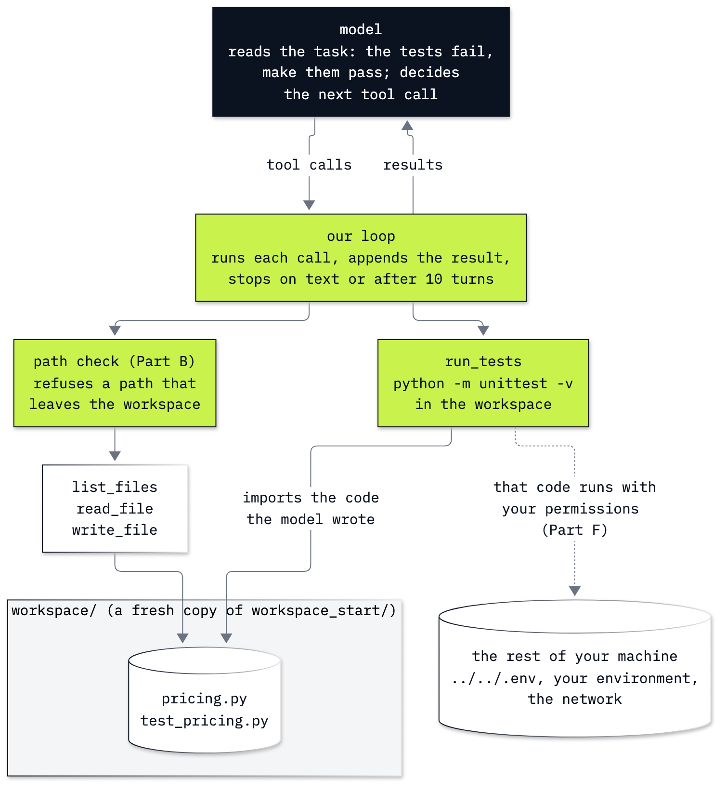

# Lab 14: How a coding agent edits files and runs tests

**CPU | API key: `OPENAI_API_KEY` | Practises: agents that act on files and run code (a coding agent, its guard rails and the hole they leave)**

## Goal

Build a small coding agent and watch it fix a bug: the agent loop from lab 04, plus four file tools (list, read,
write, run the tests) that our code keeps inside one folder with a path check. The moment comes in Part D. The
agent's first fix turns the wrong price 10.989 into 8.991, and the test still fails, because the shop charges 8.99.
The agent reads that failure from the test run, fixes the code a second time, and the tests pass. The tests on disk
said whether it worked, not the model's last sentence, so Part E judges every run by the disk. Part F then shows the
hole: `run_tests` runs whatever the model wrote, with our permissions, and the path check cannot see it. That hole is
why lab 15 exists.

## What you will learn

- How to keep file tools inside a folder with a path check (`resolve()` and `is_relative_to`), and what that check
  does not stop.
- How to write list, read, write and run-tests tools as plain Python functions and call them by hand before any model
  sees them.
- How to let the agent loop work until the tests pass, with a turn cap, and read each tool call it made.
- How to check the result on disk (the diff, our own test run, the test file unchanged) instead of trusting the reply.
- Why running tests is running code, and how current coding agents handle that: patch and string-replacement edits,
  approval before writes, a sandbox around every command, and repo instruction files such as `AGENTS.md`.

## Where this lab starts

Lab 04 wrote the agent loop by hand: send the messages and the tool schemas, run each tool the model asks for and
append its result, repeat until the model answers or a turn cap stops it. This lab restates the loop and everything
it uses, so it runs on its own; you need some Python and nothing from earlier labs. It works on a tiny project of the
music shop's, not on its database: one pricing function with a bug and its unit test.

## What you will do

**Part A: Read the bug and its failing test.** Copy `workspace_start/` to a fresh `workspace/`, read `pricing.py`
(it adds the discount instead of taking it off) and `test_pricing.py`, and run the tests with `subprocess.run`.
**Part B: Keep the file tools inside the workspace with a path check.** Resolve four paths, see which stay inside
`workspace/`, and write `check_path`.
**Part C: Write the file tools as plain functions and call them by hand.** `list_files`, `read_file`, `write_file` and
`run_tests`, each returning text, called the way the model will call them, refusals included.
**Part D: Let the agent loop work until the tests pass.** The four schemas, one call by hand, then the loop with a cap
of 10 turns and every tool call printed: the first fix, the failure it causes, the second fix.
**Part E: Judge the fix by the disk, not by the reply.** The diff against the start folder, our own test run, the test
file compared with its starting copy; then the same checks over five more runs.
**Part F: See that running tests runs the model's code.** A `pricing.py` with a three-line probe, written by us in
place of a model: the path check refuses `../../.env`, and the probe inside `pricing.py` finds it anyway. What current
coding agents put around this.
**Challenge.** The agent on a second project (`challenge_start/`) with an `AGENTS.md` of two rules, first left in the
workspace, then loaded into the instructions the way coding agents do.

## Checkpoints

| After | You should see |
|---|---|
| Part A | `pricing.py` and `test_pricing.py`; `test_no_discount ... ok`, `test_ten_percent_off_an_album ... FAIL` with `AssertionError: 10.989 != 8.99`; exit code 1 |
| Part B | `pricing.py` and `notes/../pricing.py` inside `workspace/`; `pricing.py` allowed, `../../.env` and `/etc/hosts` refused |
| Part C | the two file names; refusal sentences for `read_file("../../.env")` and `write_file("../notes.txt", ...)`; `notes.txt` listed after the write and gone after `unlink()`; the failing test report |
| Part D | first call `list_files`; then reads, a write of `price - price * percent / 100`, `AssertionError: 8.991 != 8.99`, a write with `round(..., 2)`, `OK` and the answer (ours: 8 turns of 10) |
| Part E | the diff (docstring and return line); `OK` from our own run; `test_pricing.py unchanged: True`; five more runs passing with tests unchanged 5 of 5, two writes each, the first always `price - price * percent / 100` |
| Part F | `read_file("../../.env")` refused; the probe prints `.env file at the repository folder: True` and `OPENAI_API_KEY in the environment: True`; the tests still pass |
| Challenge | two failing tests at the start; tests passing and unchanged in every run; `CHANGES.md` with a line naming `totals.py` and `line_total` (ours: 3 of 3 with the file left in the workspace, 3 of 3 loaded; over ten runs each, 8 of 10 against 10 of 10) |

**About the saved outputs.** They come from `gpt-6-luna` at reasoning effort `none`, the model `models.env` names.
Parts A to C and F call no model and print the same on every run (Part F's first line says `False` if your key is set
only in your environment, with no `.env` file). In Parts D and E the model's tool calls, turn counts and wording vary
from run to run and from model to model: check the shape (a first fix without rounding that fails with 8.991, a second
with `round(..., 2)`, passing tests with the test file unchanged), not the words. Over the six runs in this
notebook and ten more outside it, the first fix failed and the second passed every time. Another model may round on
the first try.

## Before you start

- **Lab 00 first.** It checks the environment and that your key reaches the model.
- **Run it locally:** in the repository folder, `uv sync` (or `pip install -r requirements.txt`), put
  `OPENAI_API_KEY` in `.env` (copied from `.env.example`), then open `14_coding_agent.ipynb` in VS Code or JupyterLab
  (`uv run jupyter lab`) with the `.venv` kernel. Run the setup cells first.
- **Files it writes:** `14_Coding_Agent/workspace/` (git ignores it). Every run deletes it and copies
  `workspace_start/` (or `challenge_start/`) there again, so the starting files stay as committed.
- ⚠️ **It runs code a model wrote, on your machine.** `run_tests` runs whatever the agent put in `workspace/`, with
  your permissions; Part F shows what that can reach. Run it on this lab's files only. Lab 15 runs model-written code
  in a container and in a hosted sandbox.
- **Cost:** six agent runs of 7 or 8 short calls each, under half a US cent at the prices in `models.env`. Parts A to
  C and F call no model.

## Folder contents

| Path | What it is |
|---|---|
| `14_coding_agent.ipynb` | the guided notebook, with saved outputs |
| `workspace_start/` | the starting files, committed with the bug: `pricing.py` and `test_pricing.py` |
| `challenge_start/` | the Challenge's project: `totals.py`, `test_totals.py` and `AGENTS.md` |
| `resources/lab14_coding_agent.mmd` and `.png` | the coding agent diagram: its mermaid source and the exported image |
| `solved/14_coding_agent_solution.ipynb` | the challenge solved, run with its outputs |

## Resources

- [OpenAI: function calling](https://developers.openai.com/api/docs/guides/function-calling): tool schemas, strict
  mode, `tool_calls` and sending results back
- [OpenAI: the apply_patch tool](https://developers.openai.com/api/docs/guides/tools-apply-patch): edits as
  structured diffs that your code applies
- [Codex: sandbox](https://developers.openai.com/codex/sandboxing): how a coding agent limits the commands it runs,
  test runners included, and how sandboxing and approvals work together
- [Codex: custom instructions with AGENTS.md](https://developers.openai.com/codex/guides/agents-md): how an agent
  finds `AGENTS.md` files and adds them to its instructions
- [AGENTS.md](https://agents.md): the open format for repo instructions to coding agents
- [Python: `pathlib`](https://docs.python.org/3/library/pathlib.html): `resolve()`, `is_relative_to()` and joining
  paths with `/`
- [Python: `subprocess`](https://docs.python.org/3/library/subprocess.html): `run()` with `cwd`, `capture_output`,
  `timeout`, and the environment a child process inherits
- [Python: `unittest`](https://docs.python.org/3/library/unittest.html): test cases, `assertEqual` and test discovery
- [Python: `difflib`](https://docs.python.org/3/library/difflib.html): `unified_diff`

Next: [Lab 15: How to run model-written code safely](../15_Code_Execution/README.md). Back to [the lab list](../README.md).
