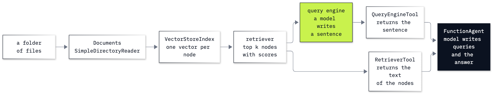

# Lab 14: How to search your documents with LlamaIndex

**CPU | API key: `OPENAI_API_KEY` | Practises: grounding an agent in documents with a data framework; choosing what an agent's search tool hands back**

## Goal

Index a folder of documents with LlamaIndex, search it, ask it questions, and hand the search to an agent. The lab
has two notebooks.

**Notebook 1** is a folder of notes about a new flat. The question is an everyday one, *When can I call someone about
the internet?*, and its answer is in two notes: one names the building manager, the other gives his hours and never
mentions the internet. We meet LlamaIndex's objects one at a time, each printed when it first appears, and then give
the search to an agent in two ways: as a **query-engine tool**, which hands back a sentence that a second model call
wrote about the notes, and as a **retriever tool**, which hands back the notes themselves.

**Notebook 2** takes the same choice to the Chinook music shop's support desk. A rep asks: *Ticket 06's replacement
arrived warped too. What do we offer now, and how long does the refund take?* The answer is in two policy files, and
ticket 06 points to one of them: a line that names the policy it was handled under. Called on ticket 06, the
query-engine tool's sentence leaves that line out; the retriever tool hands it over with the ticket.

## What you will learn

- How to check which models LlamaIndex will call, and set them from `models.env` with `Settings`.
- How a `Document` holds a text, and how `SimpleDirectoryReader` turns a folder of files into documents with the
  metadata you choose.
- How to index documents with `VectorStoreIndex`, and read what a retriever returns and how it scores it.
- How a query engine writes an answer from what it retrieved, and how to check it against its `source_nodes` and the
  prompt it fills in.
- How to give a search to a `FunctionAgent` as a query-engine tool or a retriever tool, and read every search it made
  and what each tool handed back.
- How to count every model call of a run, including those inside a tool, split a long document into nodes, and watch
  an agent's events (Going further).

## What you will do

### Notebook 1: meet LlamaIndex on a folder of notes (`14a_meet_llamaindex.ipynb`)

**Part A: Check which models LlamaIndex will call, then choose them.** `Settings` before and after we set it, and the
question asked with no notes.
**Part B: Represent a note as a Document, then read the whole folder.** One `Document` by hand, the two notes the
answer needs, and `SimpleDirectoryReader` with only the file name kept as metadata.
**Part C: Index the notes and read what a retriever returns.** `VectorStoreIndex`, the default top k, and the scores.
**Part D: Ask a query engine, and read its sources and its prompt.** The answer, its `source_nodes`, and
`get_prompts()`.
**Part E: Wrap the search as two tools and call each by hand.** `QueryEngineTool` and `RetrieverTool` called on the
same question: one hands back a sentence, the other the notes.
**Part F: Give an agent each tool and read what it searched.** A `FunctionAgent` with each tool, every search and
every result printed.
**Challenge.** Find where the missing note ranks, and add a note to the index in code.

### Notebook 2: LlamaIndex at the Chinook support desk (`14b_llamaindex_at_the_desk.ipynb`)

**Part A: Index the shop's policy and ticket files.** The 36 files, ticket 06, and the two facts the answer needs.
**Part B: Ask a query engine and check its answer against its sources.** The answer, a check in code, the sources, and
the prompt the engine filled in.
**Part C: Call both tools by hand on ticket 06.** What each tool hands back, and whether the ticket's pointer to the
policy reaches the agent.
**Part D: Run the agent with the query-engine tool.** One run, every search, the files it found and the sentences the
agent read.
**Part E: Run the same agent with the retriever tool.** One run, every search and the files it found; what each agent
read, side by side.
**Challenge.** A query engine limited to one file by a metadata filter, and a second search on another ticket.
**Going further.** Every model call counted with an instrumentation handler and priced, a long document split into
nodes, and an agent's events as they happen.

## Checkpoints

| After | You should see |
|---|---|
| Notebook 1, Part A | LlamaIndex's own default models (an older chat model and an older embedding model) before `Settings` is set, the `models.env` models after; with no notes, general advice about calling an internet provider |
| Notebook 1, Part B | a `Document` printed with a made-up id and its text; seven notes; six default metadata fields, `file_path` among them; with `keep_name`, only `file_name` |
| Notebook 1, Part C | 7 nodes; default top k 2: `move_in.md` (0.303) and `landlord.md` (0.283), not `haddad.md` |
| Notebook 1, Part D | an answer that names Sam Haddad and says no time is given, from `move_in.md` and `landlord.md`; four prompt templates |
| Notebook 1, Part E | a schema with one `input` argument; the query-engine tool's sentence saying no time is given, beside the text of `move_in.md` and `landlord.md` |
| Notebook 1, Part F | the query-engine-tool agent reads only sentences and says it has no hours (in our saved runs of the notebook and its solution); the retriever-tool agent searches for Sam Haddad on its second search and answers Sunday to Thursday, 18:00 to 20:00 |
| Notebook 2, Part A | 36 documents (20 policies, 16 tickets), 36 nodes; ticket 06's line *Damaged-media policy: replace once at no charge* |
| Notebook 2, Part B | an answer that offers a refund and gives 5 to 10 business days; the check failing fact 1 and passing fact 2; sources ticket 06 (0.6122) and `policy_refunds.md` (0.4842); the damaged-media policy not in the prompt |
| Notebook 2, Part C | the query-engine tool's sentence about ticket 06 without the words *Damaged-media policy*; the retriever tool's text with that line |
| Notebook 2, Parts D and E | every search printed with the files it found; in ours, the query-engine-tool agent read only sentences, found the damaged-media policy on its first search and gave both facts, and one sentence said no refund time is given (the solution notebook's run of the same agent missed both facts); the retriever-tool agent found the policy on its second search, after the ticket's pointer, and gave both facts |
| Challenges | notebook 1: `haddad.md` fourth, a top k of 4 gives the hours, `wifi.md` first after `insert` and still 7 files on disk; notebook 2: the gift-card engine with one source and both points; for ticket 10, both agents answer no and no after one search each |
| Going further | two searches each and 5 model calls for the query-engine-tool agent against 3 for the retriever-tool agent (ours); the handbook in 2 nodes at the default size and 16 at 128 tokens, with `PREVIOUS` and `NEXT` links; `AgentOutput`, `ToolCall` and `ToolCallResult` events in order |

**About the saved outputs.** They come from `gpt-6-luna` and `text-embedding-3-small`, the models `models.env` names.
Embeddings are close to deterministic, so the files each search returns and their order should match ours, with the
last decimal of a score free to move. The agents write their own searches on every run, so their queries and replies
will differ on yours: check which files were found and what each agent read, not the wording. With these notebooks' prompts, the retriever-tool agent found the second note or file in every run we checked, while the query-engine-tool agent found Sam Haddad's hours in 7 of 10 runs and the damaged-media rule in 8 of 18; each notebook gives its counts beside its run.

## Before you start

- **Lab 00 first.** It checks the environment and that your key reaches the model.
- **Run it locally:** in the repository folder, `uv sync` (or `pip install -r requirements.txt`), put
  `OPENAI_API_KEY` in `.env` (copied from `.env.example`), then open a notebook in VS Code or JupyterLab
  (`uv run jupyter lab`) with the `.venv` kernel. Run the setup cell first. Each notebook runs on its own.
- **Data:** notebook 1 reads the seven notes in `resources/new_flat/`; notebook 2 reads the shop's 36 policy and
  ticket files in `data/corpus/`, in place. The indexes live in memory; nothing is written to disk.
- **Cost:** about 35 small model calls and a few embedding calls for the two notebooks, well under one US cent at the prices in `models.env`. The solution notebooks make about as many again.

## Folder contents

| Path | What it is |
|---|---|
| `14a_meet_llamaindex.ipynb` | notebook 1, the folder of notes, with saved outputs |
| `14b_llamaindex_at_the_desk.ipynb` | notebook 2, the Chinook support desk, with saved outputs |
| `resources/new_flat/` | the seven notes notebook 1 indexes |
| `resources/lab14_documents_to_answer.mmd` and `.png` | the drawing of the path from files to an agent's answer, and its source |
| `solved/14a_meet_llamaindex_solution.ipynb` | notebook 1's challenge solved, run with its outputs |
| `solved/14b_llamaindex_at_the_desk_solution.ipynb` | notebook 2's challenge solved, run with its outputs |

## Resources

- [LlamaIndex: Documents and Nodes](https://developers.llamaindex.ai/python/framework/module_guides/loading/documents_and_nodes/):
  what a `Document` and a node hold
- [LlamaIndex: SimpleDirectoryReader](https://developers.llamaindex.ai/python/framework/module_guides/loading/simpledirectoryreader/):
  reading a folder, and the `file_metadata` argument
- [LlamaIndex: configuring Settings](https://developers.llamaindex.ai/python/framework/module_guides/supporting_modules/settings/):
  the global LLM and embedding model
- [LlamaIndex: using VectorStoreIndex](https://developers.llamaindex.ai/python/framework/module_guides/indexing/vector_store_index/):
  building an index, retrievers and `insert`
- [LlamaIndex example: Simple Vector Store](https://developers.llamaindex.ai/python/examples/vector_stores/simpleindexdemo/):
  a query engine limited by `MetadataFilters`
- [LlamaIndex: query engines](https://developers.llamaindex.ai/python/framework/module_guides/deploying/query_engine/)
  and [response modes](https://developers.llamaindex.ai/python/framework/module_guides/deploying/query_engine/response_modes/):
  how a query engine turns retrieved nodes into an answer
- [LlamaIndex: prompts](https://developers.llamaindex.ai/python/framework/module_guides/models/prompts/usage_pattern/):
  `get_prompts` and the default templates
- [LlamaIndex: agents](https://developers.llamaindex.ai/python/framework/module_guides/deploying/agents/) and
  [tools](https://developers.llamaindex.ai/python/framework/module_guides/deploying/agents/tools/): `FunctionAgent` and
  `QueryEngineTool`; the [`RetrieverTool` reference](https://developers.llamaindex.ai/python/framework-api-reference/tools/retriever/)
- [LlamaIndex: instrumentation](https://developers.llamaindex.ai/python/framework/module_guides/observability/instrumentation/):
  events and handlers
- [LlamaIndex: streaming agent events](https://developers.llamaindex.ai/python/framework/understanding/agent/streaming/):
  `stream_events`, `ToolCall` and `ToolCallResult`

Next: [Lab 15: How to build a customer-support agent over a database](../15_Support_Desk_Agent/README.md). Back to
[the lab list](../README.md).
