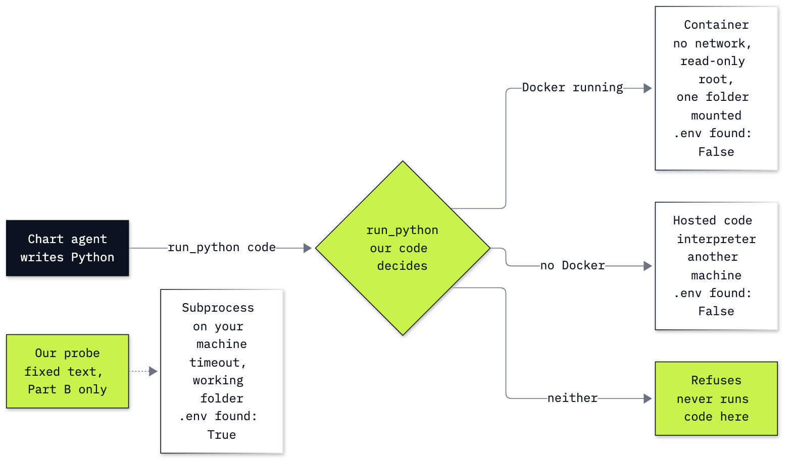

# Lab 17: How to run model-written code safely

**CPU | API key: `OPENAI_API_KEY` | Docker: optional | Practises: running code an agent writes in an isolated sandbox, and checking where its numbers came from**

## Goal

Let an agent answer a data question with a chart by writing its own Python, and run that Python only where it cannot
reach your files. The moment that teaches it is one probe, a few lines we wrote that ask what any untrusted code could
ask: is the `.env` file with your API key two folders up, is the key in my environment, can I reach the internet? From
a subprocess with a timeout, its own working folder and a trimmed environment, the probe finds the `.env` file and
reaches the network. From a Docker container with no network, a read-only root and one mounted folder, it finds
neither. In OpenAI's hosted code interpreter it runs on another machine, where neither exists. Then the agent
draws the chart, and its code shows that the numbers took a path through the model: it typed the five yearly totals
into its code by hand, in 3 of 3 runs.

## What you will learn

- What a subprocess with a timeout, a working folder and a trimmed environment stops, and what it does not, read
  from a probe we wrote.
- How to run code in a Docker container with limits (no network, a read-only root, memory, CPU, a process count, a
  user who is not root, one mounted folder), flag by flag.
- How to run code in OpenAI's hosted code interpreter with the Responses API, check that the code that ran is the code
  you sent, and price a run.
- How to give a chart agent a `run_python` tool that runs code only in a container or in the hosted sandbox, and
  refuses when neither is there.
- How to check a chart's numbers against the database, and why numbers the model typed are a risk even when they are
  right.
- Which isolation each option gives (a process, a container, a micro-VM, a hosted sandbox), and which products offer
  each.

## Coming from

Labs 02 and 03 wrote tool calling and the agent loop by hand on Chat Completions; lab 15 gave an agent a free
`run_sql` tool on a read-only database; lab 16's coding agent ran its tests, and so the model's code, with our
permissions. This lab defines the tools, the loop and the runners it needs, explains each where it first appears, and
runs on its own.

**Model-written code never runs on your machine in this lab.** The agent's `run_python` tool sends code to a Docker
container when Docker is running, or to OpenAI's hosted code interpreter otherwise, and refuses when neither is
available. The only code that runs in a plain subprocess is the probe in Part B, which we wrote ourselves.

## What you will do

**Part A: Draw the reference chart from the database.** The yearly revenue query, the five totals, and the chart drawn
by our own code: the truth any agent's chart must match.
**Part B: Test what a subprocess can reach with a probe.** Our probe (`.env` two folders up, the key in the
environment, the network) run in a subprocess with a timeout, a working folder and a trimmed environment; an endless
loop stopped by the timeout; the four sandbox controls and which ones a process lacks.
**Part C: Run code in a container with limits.** The Dockerfile line by line, the image built, every `docker run` flag
explained, the probe in the container, and `run_in_container`.
**Part D: Run code in a hosted sandbox.** One Responses call with the `code_interpreter` tool, the call item read field
by field, the probe on another machine, the price of a run, `run_hosted`, and a probe the model retyped wrongly.
**Part E: Give the chart agent a run_python tool that only runs in a sandbox.** `run_python` (container, hosted, or a
refusal), `run_sql` on the read-only database, the schemas, one call by hand, then the loop on the chart question.
**Part F: Check the chart's numbers against the database.** The numbers typed into the agent's code compared with the
database, over three runs.
**Part G: Choose an isolation level.** The probe's answers in all three runners, the four levels of isolation with the
products for each, and what changes in production.
**Challenge.** Keep the totals out of the model's code, and test the container's limits with two probes of your own.

## Checkpoints

| After | You should see |
|---|---|
| Part A | five rows, 2009 $449.46 to 2013 $450.58, 2010 the highest at $481.45; the reference chart |
| Part B | from the subprocess `.env there: True`, `key in environment: False`, `network: reachable`; the endless loop `TimeoutExpired after 3 seconds` |
| Part C | Docker's version (ours 29.9.1) or a skip line; the image with Python 3.13.18, matplotlib 3.11.2 and the user `sandbox`; the probe in the container `.env there: False`, `key in environment: False`, `network: blocked, gaierror`; `run_in_container` returns `45` and `refused: Read-only file system` |
| Part D | the probe in the hosted sandbox `working folder: oai`, `.env there: False`, `network: blocked`; the code that ran is the code we sent; one run about $0.03 for the session plus $0.00012 in tokens; the second probe came back changed (`from pathlib import import Path`) with our warning |
| Part E | `run_python` sends code to the container (hosted without Docker) and refuses when both are off; the delete returns `attempt to write a readonly database`; the agent recovers from two SQL errors (in our first run), runs one piece of chart code and saves a chart with five bars |
| Part F | all five totals typed into the code, each equal to the database's value, in 3 of 3 runs |
| Part G | for each runner, its three answers to the probe; for each isolation level, one product and one use |
| Challenge | with `rows` defined for the code, `0 of 5` totals typed in 3 of 3 runs and the same chart; exit codes 124 for the endless loop and 137 for 300 MB under the 256 MB limit |

**About the saved outputs.** They come from `gpt-6-luna` at reasoning effort `none`, the model `models.env` names,
and from Docker 29.9.1 for the container parts. The probe's answers in each runner and the container's limits are the
same on every run. The model's queries, its code and the number of calls vary from run to run and from model to
model; whether the hosted runner retypes the second probe wrongly comes and goes. Without Docker, the container cells
print a skip line, `run_python` uses the hosted sandbox, and the agent's chart comes back as `hosted_chart_1.png`.

## Before you start

- **Lab 00 first.** It checks the environment, that your key reaches the model, and whether Docker is running.
- **Run it locally:** in the repository folder, `uv sync` (or `pip install -r requirements.txt`), put
  `OPENAI_API_KEY` in `.env` (copied from `.env.example`), then open `17_code_execution.ipynb` in VS Code or
  JupyterLab (`uv run jupyter lab`) with the `.venv` kernel. Run the setup cells first.
- **Docker is optional.** With Docker running, Part C builds the image `chinook-sandbox` from `resources/Dockerfile`
  (about 320 MB; the first build downloads the Python image and installs matplotlib, so it needs the internet once)
  and the agent's code runs in it. Without Docker, every container cell prints a skip line and the agent's code runs
  in the hosted sandbox. To build the image yourself, from the repository folder:
  `docker build -t chinook-sandbox 17_Code_Execution/resources`.
- **Files it writes:** `17_Code_Execution/outputs/` (git ignores it): the probe, the code each run executed, and the
  charts. It is the one folder the container sees, as `/work`. `data/chinook.db` is only ever opened read-only.
- **Cost:** with Docker, about 6 US cents, almost all of it two hosted container sessions in Part D ($0.03 each, on
  OpenAI's pricing page on 30 Oct 2026); the agent's 18 model calls cost a fraction of a cent. Without Docker, each of
  the agent's three runs adds one more hosted session: about 15 cents in all. Set `USE_HOSTED = False` in Part E to
  refuse hosted runs.
- The notebook ends with a troubleshooting table: Docker not running, a library missing from the image, exit codes
  124 and 137, and the hosted runner's warning.

## Folder contents

| Path | What it is |
|---|---|
| `17_code_execution.ipynb` | the guided notebook, with saved outputs |
| `resources/Dockerfile` | the sandbox image: Python 3.13.18, matplotlib 3.11.2, a user who is not root |
| `resources/lab17_three_runners.mmd` and `.png` | where code runs: its mermaid source and the exported image |
| `solved/17_code_execution_solution.ipynb` | the challenge solved, run with its outputs |

## Resources

- [OpenAI: code interpreter](https://developers.openai.com/api/docs/guides/tools-code-interpreter): the tool, its
  containers (auto or explicit, memory sizes, the 20-minute expiry) and the files and images it returns
- [OpenAI: pricing, built-in tools](https://developers.openai.com/api/docs/pricing): the container session prices
- [Docker: `docker container run`](https://docs.docker.com/reference/cli/docker/container/run/): every flag used in
  Part C
- [Docker: resource constraints](https://docs.docker.com/engine/containers/resource_constraints/): `--memory`,
  `--memory-swap`, `--cpus`
- [Dockerfile reference: `USER`](https://docs.docker.com/reference/dockerfile/#user): running an image's commands as
  another user
- [Python: `subprocess`](https://docs.python.org/3/library/subprocess.html): `run`, `cwd`, `env`, `timeout` and
  `TimeoutExpired`
- [OpenAI Agents SDK: sandbox agents](https://openai.github.io/openai-agents-python/sandbox_agents/) and
  [sandbox clients](https://openai.github.io/openai-agents-python/sandbox/clients/): `SandboxAgent`, the Unix-local
  limits, Docker and the hosted providers
- [gVisor](https://gvisor.dev/docs/) and [Firecracker](https://firecracker-microvm.github.io/): the two stronger
  walls between a container and a full virtual machine
- [Azure Container Apps: dynamic sessions](https://learn.microsoft.com/en-us/azure/container-apps/sessions): a hosted
  sandbox on Azure

Next: [Lab 18: How to choose an agent design](../18_Agent_Designs/README.md). Back to [the lab list](../README.md).
