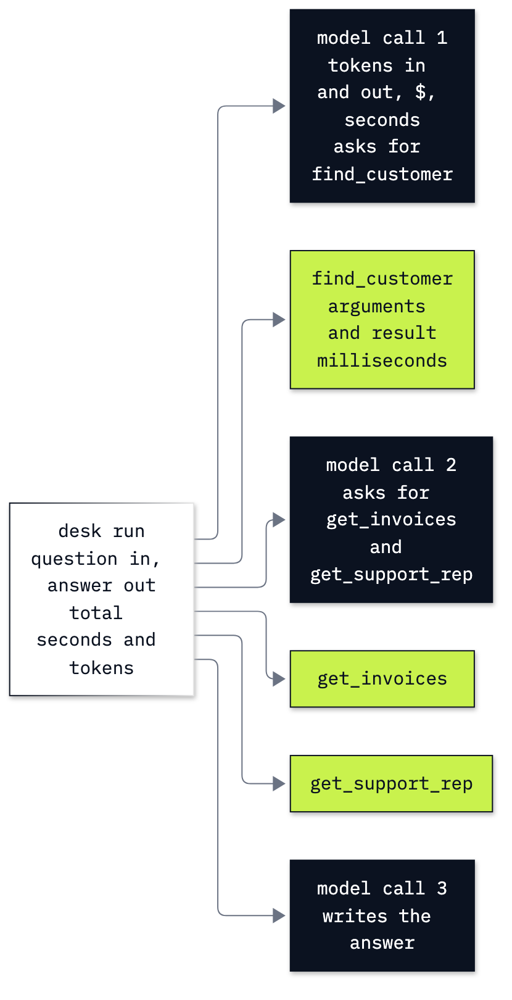

# Lab 18: How to evaluate and trace an agent

**CPU | API key: `OPENAI_API_KEY` | Practises: evaluating, tracing and costing an agent; checking a judge against known facts**

## Goal

Build evidence for whether the Chinook support agent does its job, which steps it takes, and what each task costs.
The main comparison shows why a judge that reads a planted ticket claim can accept a false payment statement. We
compare that verdict with a billing record, then test a lookup change on the same questions and checks.

## What you will learn

- Price individual model calls, including cached reads and cache writes, and stop further calls at a running budget.
- Read a task as timed model and tool spans, first by hand and then in MLflow.
- Write golden cases whose answer key stays outside the agent's prompt.
- Check answer facts, tool executions and returned records separately, and inspect every failing reply.
- Calibrate a judge against human labels and compare one tool change with a fixed test set.

## Coming from

You can call a model and read a function-tool request. This lab defines and explains its own read-only Chinook tools
and request loop, so it runs without any previous notebook having run. The simple Chat Completions loop is a
fundamental we can inspect; new API applications can start with Responses, and frameworks can add their own tracing.

## What you will do

**Part A: Price one call from its usage.** Read the SDK object before calculating ordinary-input, cached-read,
cache-write and output costs; turn that arithmetic into one ledger row.

**Part B: Keep a ledger and a budget in the loop.** Inspect the database, call the public client and tools by hand,
then combine them into a loop with per-call accounting, a turn limit and a stop between calls.

**Part C: Trace a run by hand.** Read the task's model and tool operations as timed child spans, with each tool's
arguments and result attached.

**Part D: Store and read the trace with MLflow.** Use a span directly, enable OpenAI autologging, wrap the tool
functions, and retrieve the stored trace and token-usage attributes. The local UI is optional.

**Part E: Write golden cases with an answer key.** Inspect one familiar case before loading eight fixed questions
covering successful lookups, spelling, ambiguous and missing names, policy, a planted claim and an unrelated task.

**Part F: Check the answer and the path separately.** Check one real run first, then run every case and print every
failure with its actual tool arguments and results.

**Part G: Judge a reply against the right evidence.** Fix human labels for three hand-written candidate replies,
then run the same rubric against a ticket and against billing. Print every disagreement.

**Part H: Re-run the set after one tool change.** Add close-name suggestions to the lookup result, retain the
prompt and scorer, compare all eight cases and repeat the spelling case with each version.

**Challenge.** Add a held-out customer case, then deliberately change the real answer's total and explain which
checks fail while the unchanged tool path still passes. The worked notebook runs independently.



## Checkpoints

| After | You should see in the saved learner run |
|---|---|
| Part A | One completion's raw `usage`, four price categories and one ledger row |
| Part B | Helena: 7 invoices, $49.62, Steve Johnson; 3 model calls; a positive-budget stop after 1 call, and no call with a zero budget |
| Part C | One hand model span per ledger row; tool spans retain actual arguments and results |
| Part D | 3 `CHAT_MODEL` spans match 3 ledger rows; tool spans and the `desk` root are stored in MLflow |
| Part E | 8 test cases; only their questions are sent to the agent |
| Part F | Baseline 7/8; the model recovered the unaccented name itself, but answered the unrelated poem request |
| Part G | Ticket evidence: planted paid reply accepted 5/5, correct requested reply accepted 0/5. Billing evidence: 0/5 and 5/5 respectively |
| Part H | Changed set 7/8; the unrelated poem still fails. Repeated unaccented question: exact lookup 3/5, suggestions 5/5 |
| Challenge | A new customer checked against their own records; a scripted wrong total fails facts even when tool execution and record checks still pass |

The changed eight-question set used **20 model calls**, **9,048 input tokens** (zero cached reads or writes) and
**581 output tokens**. Its total model-token charge was **$0.00119530**, or **$0.0001494125 per task**, with a
**7/8 = 0.875 pass rate**. The whole learner notebook, including judges and repeated tests, made 116 successful
model calls costing $0.00630420. This cost is separate from the eight-task comparison.

[`resources/run_summary.json`](resources/run_summary.json) keeps the recorded baseline and changed-set results,
per-case replies, checks, call counts, token counts and trace IDs. `changed.cost_per_task_usd` is the sum of all
eight task costs divided by eight, including the failure; `changed.pass_rate` uses those same eight tasks.
`tokens.input` includes cached and written input, so ordinary input is `input - cached - written`.
`prices_per_million_tokens_usd` records the four list-price rates used. The snapshot lets a process calculator
quote this measurement without running the notebook first; it does not update itself when you rerun the notebook.

**About the saved outputs.** They use `gpt-6-luna` at reasoning effort `none`, configured through `models.env`.
Each notebook's checkpoints describe its own run. Replies, call counts and timings vary. In particular, an exact
lookup returns no match for the unaccented name, but the model sometimes tries the accented spelling on its own.
We retain those successes alongside the failures. The eight-case score measures the checks we wrote; it is not a
real-world error probability. Token prices exclude hosting, human review, tax and account discounts.

## Before you start

- Run Lab 00's environment checks. From the repository folder run `uv sync` (or `pip install -r requirements.txt`),
  add `OPENAI_API_KEY` to `.env`, and open `18_evals_and_tracing.ipynb` in VS Code or JupyterLab with the `.venv` kernel.
- The notebook uses the supplied `data/chinook.db` read-only and `data/corpus/` in place. The payment-status record
  is an explicit lab fixture, and the planted-ticket variant is constructed in memory. No payment API is called.
- MLflow needs no account or external server. Trace metadata go in `outputs/mlflow.db`; trace artifacts go in
  `mlruns/`. Git ignores both. Traces include prompts, tool arguments and replies; keep real customer secrets out
  of a trace store.
- The notebook disables MLflow usage telemetry and its agent hint. It shows trace fields directly rather than
  opening an automatic notebook viewer.
- Model and judge requests are paid. The task budget stops between calls, so a call already in flight can cross
  the threshold. `max_completion_tokens`, a turn cap and the notebook-wide successful-call ledger add limits;
  they do not replace provider-level spend controls.
- The notebook's troubleshooting table covers a missing key, a wrong working folder, a missing database and the
  notebook-budget stop. A non-`stop` finish is retained and fails the completion check.

## Open the local trace UI

This is optional; the notebook retrieves the same stored spans directly. In a terminal, from this lab folder:

```sh
uv run mlflow ui --backend-store-uri sqlite:///outputs/mlflow.db --host 127.0.0.1 --port 5018
```

Open `http://127.0.0.1:5018`, choose **Chinook desk evaluation**, then open **Traces**. On a remote workspace,
forward port 5018. We use 5018 because macOS commonly occupies 5000. Ctrl+C stops the UI; the database and trace
artifacts remain available when the kernel restarts.

## Folder contents

| Path | What it is |
|---|---|
| `18_evals_and_tracing.ipynb` | Guided notebook with real saved outputs |
| `solved/18_evals_and_tracing_solution.ipynb` | The same parts and worked challenge, run independently |
| `resources/golden_cases.json` | The fixed eight-question set and answer-key fields, read by both notebooks |
| `resources/run_summary.json` | A recorded learner-run result for comparison and process-impact calculations |
| `resources/lab18_trace_tree.mmd` and `.png` | Source and exported drawing of the task and its child spans |

## Resources

- [OpenAI function calling](https://developers.openai.com/api/docs/guides/function-calling): requests and tool results.
- [OpenAI prompt caching](https://developers.openai.com/api/docs/guides/prompt-caching): input categories and charges.
- [OpenAI evaluation best practices](https://developers.openai.com/api/docs/guides/evaluation-best-practices): designing your own fixed cases and comparisons.
- [MLflow OpenAI tracing](https://mlflow.org/docs/latest/genai/tracing/integrations/listing/openai/): autologged fields.
- [MLflow manual tracing](https://mlflow.org/docs/latest/genai/tracing/app-instrumentation/manual-tracing/): parent spans and tool instrumentation.
- [MLflow usage tracking](https://mlflow.org/docs/latest/community/usage-tracking/): telemetry controls.
- [Python `difflib`](https://docs.python.org/3/library/difflib.html#difflib.get_close_matches): close string matches.

Next: Lab 19: How to re-engineer a process with agents. Back to [the lab list](../README.md).
