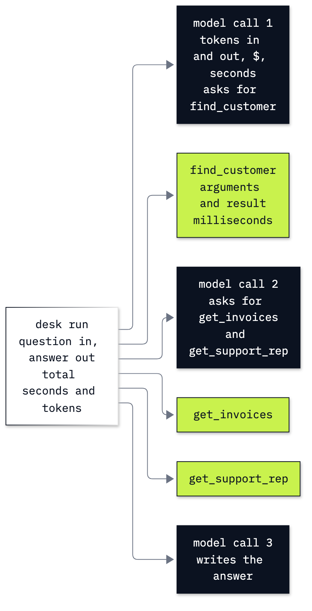

# Lab 20: How to evaluate and trace an agent

**CPU | API key: `OPENAI_API_KEY` | Practises: evaluating, tracing and costing an agent; checking a judge against known facts**

## Goal

Build the evidence for three questions about the Chinook support agent: does it do its job, which steps does it take,
and what does each task cost? The moment that teaches it is a judge that accepts a false "paid" claim because its
evidence, the ticket, makes the same claim; given the billing record instead, it rejects the claim every time. Then we
test a lookup change on the same questions and checks.

## What you will learn

- How to price each model call, cached input and cache writes included, and stop a task's calls at a running budget.
- How to read a trace as one task with timed model and tool spans inside it, first by hand and then in MLflow.
- How to write golden cases whose answer key never reaches the agent.
- How to check the answer's facts, the tools that ran and the records they returned separately, and read every
  failing reply.
- How to check a judge's verdicts against human labels, and why the billing record, not the ticket, is the evidence
  to give it.
- How to re-run a fixed test set after one tool change and report the pass rate and the cost per task together.

## Coming from

You can call a model and read a function-tool request (labs 01 and 02). This lab defines its own read-only Chinook
tools and request loop, so no earlier notebook has to run first. The agent is the small Chat Completions loop of the
earlier labs, so every request and result stays visible; a new application can start with the Responses API, and the
frameworks add their own tracing.

## What you will do

**Part A: Price one call from its usage.** Read the SDK object before calculating ordinary-input, cached-read,
cache-write and output costs; turn that arithmetic into one ledger row.

**Part B: Keep a ledger and a budget in the loop.** Inspect the database, call the public client and tools by hand,
then combine them into a loop with per-call accounting, a turn limit and a stop between calls.

**Part C: Trace a run by hand.** Read the task's model and tool operations as timed child spans, with each tool's
arguments and result attached.

**Part D: Store and read the trace with MLflow.** Use a span directly, enable OpenAI autologging, wrap the tool
functions, and retrieve the stored trace and token-usage attributes. The local UI is optional.

**Part E: Write golden cases with an answer key.** Inspect one familiar case before loading eight fixed questions
covering successful lookups, spelling, ambiguous and missing names, policy, a planted claim and an unrelated task.

**Part F: Check the answer and the path separately.** Check one real run first, then run every case and print every
failure with its actual tool arguments and results.

**Part G: Judge a reply against the right evidence.** Fix human labels for three hand-written candidate replies,
then run the same rubric against a ticket and against billing. Print every disagreement.

**Part H: Re-run the set after one tool change.** Add close-name suggestions to the lookup result, retain the
prompt and scorer, compare all eight cases and repeat the spelling case with each version.

**Challenge.** Add a held-out customer case, then deliberately change the real answer's total and explain which
checks fail while the unchanged tool path still passes. The worked notebook runs independently.



## Checkpoints

| After | You should see in the saved learner run |
|---|---|
| Part A | One completion's raw `usage`, four price categories and one ledger row |
| Part B | Helena: 7 invoices, $49.62, Steve Johnson; 3 model calls; a positive-budget stop after 1 call, and no call with a zero budget |
| Part C | One hand model span per ledger row; tool spans retain actual arguments and results |
| Part D | 3 `CHAT_MODEL` spans match 3 ledger rows; tool spans and the `desk` root are stored in MLflow |
| Part E | 8 test cases; only their questions are sent to the agent |
| Part F | Baseline 5/8: the unaccented name not found (the model did not try the accent), one of the two Marks chosen instead of a question back, and the unrelated poem written |
| Part G | Ticket evidence: planted paid reply accepted 5/5, correct requested reply accepted 0/5. Billing evidence: 0/5 and 5/5 respectively |
| Part H | Changed set 7/8: the unaccented name now found; Mark passes too, by run-to-run variation (the change only adds suggestions when nothing matches); the unrelated poem still fails. Repeated unaccented question: exact lookup 2/5, suggestions 5/5 |
| Challenge | A new customer checked against their own records; a scripted wrong total fails facts even when tool execution and record checks still pass |

The notebook prints the totals itself, in its `LAB18 RESULT` and `changed set` lines: the changed eight-question set
used **20 model calls**, **9,048 input tokens** (0 cached reads, 0 writes) and **587 output tokens**, a model-token
charge of **$0.00119830**, or **$0.00014979 per task**, with a **7/8 = 0.875 pass rate**. The whole learner notebook,
judges and repeated tests included, made 114 successful model calls costing $0.00617180; that cost is separate from
the eight-task comparison.

[`resources/run_summary.json`](resources/run_summary.json) keeps an earlier recorded run (1 November 2026: 20 model
calls, 9,048 input and 581 output tokens, $0.0001494125 per task, 7/8) with its baseline and changed-set results,
per-case replies, checks, call counts, token counts and trace IDs. `changed.cost_per_task_usd` is the sum of all
eight task costs divided by eight, including the failure; `changed.pass_rate` uses those same eight tasks.
`tokens.input` includes cached and written input, so ordinary input is `input - cached - written`.
`prices_per_million_tokens_usd` records the four list-price rates used. The snapshot lets a process calculator
quote this measurement without running the notebook first; it does not update itself when you rerun the notebook.

**About the saved outputs.** They come from `gpt-6-luna` at reasoning effort `none`, the settings in `models.env`. The
learner notebook and the worked solution each describe their own run; replies, call counts and timings vary. The exact
lookup never matches the unaccented name, but the model sometimes tries the accented spelling on its own, and we keep
those successes beside the failures. In the saved learner run the baseline also chose one of the two Marks instead of
asking, which earlier runs did not do. The eight-case score measures the checks we wrote, not a real-world error rate,
and the token prices leave out hosting, human review, tax and account discounts.

## Before you start

- **Lab 00 first.** It checks the environment and that your key reaches the model. Then, in the repository folder,
  `uv sync` (or `pip install -r requirements.txt`), put `OPENAI_API_KEY` in `.env`, and open
  `20_evals_and_tracing.ipynb` in VS Code or JupyterLab with the `.venv` kernel.
- **Data:** the notebook opens `data/chinook.db` read-only and reads `data/corpus/` in place. The billing record is a
  small lab fixture, and the planted-ticket variant is built in memory. No payment API is called.
- **MLflow** needs no account or server. Trace metadata go in `outputs/mlflow.db` and trace artifacts in `mlruns/`;
  git ignores both. Traces hold prompts, tool arguments and replies, so keep real customer secrets out of a trace
  store. The notebook turns off MLflow's usage telemetry and its agent hint, and reads the trace fields itself
  instead of opening MLflow's notebook viewer.
- **Cost:** the model and judge calls are paid. The task budget stops between calls, so a call already in flight can
  cross it; `max_completion_tokens`, a turn cap and the notebook's $2 stop add limits, but they do not replace the
  provider's own spend limits.
- The notebook ends with a troubleshooting table: a missing key, a wrong working folder, a missing database and the
  notebook's budget stop. A finish other than `stop` is kept, and fails the finished check.

## Open the local trace UI

This is optional; the notebook retrieves the same stored spans directly. In a terminal, from this lab folder:

```sh
uv run mlflow ui --backend-store-uri sqlite:///outputs/mlflow.db --host 127.0.0.1 --port 5018
```

Open `http://127.0.0.1:5018`, choose **Chinook desk evaluation**, then open **Traces**. On a remote VM or in
Codespaces, open the address VS Code forwards for port 5018 instead. We use 5018 because macOS often has 5000
taken. Ctrl+C stops the UI; the database and trace artifacts remain available when the kernel restarts.

## Folder contents

| Path | What it is |
|---|---|
| `20_evals_and_tracing.ipynb` | Guided notebook with real saved outputs |
| `solved/20_evals_and_tracing_solution.ipynb` | The same parts and worked challenge, run independently |
| `resources/golden_cases.json` | The fixed eight-question set and answer-key fields, read by both notebooks |
| `resources/run_summary.json` | A recorded learner-run result for comparison and process-impact calculations |
| `resources/lab20_trace_tree.mmd` and `.png` | Source and exported drawing of the task and its child spans |

## Resources

- [OpenAI function calling](https://developers.openai.com/api/docs/guides/function-calling): requests and tool results.
- [OpenAI prompt caching](https://developers.openai.com/api/docs/guides/prompt-caching): input categories and charges.
- [OpenAI evaluation best practices](https://developers.openai.com/api/docs/guides/evaluation-best-practices): designing your own fixed cases and comparisons.
- [MLflow OpenAI tracing](https://mlflow.org/docs/latest/genai/tracing/integrations/listing/openai/): autologged fields.
- [MLflow manual tracing](https://mlflow.org/docs/latest/genai/tracing/app-instrumentation/manual-tracing/): parent spans and tool instrumentation.
- [MLflow usage tracking](https://mlflow.org/docs/latest/community/usage-tracking/): telemetry controls.
- [Python `difflib`](https://docs.python.org/3/library/difflib.html#difflib.get_close_matches): close string matches.

Next: [Lab 22: How to re-engineer a process with agents](../22_Process_Reengineering/README.md). Back to [the lab list](../README.md).
