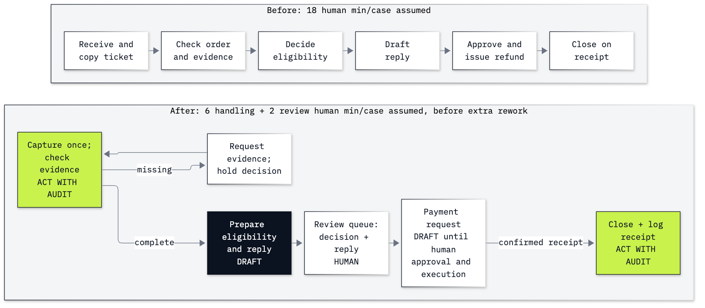

# Lab 22: How to re-engineer a process with agents

**CPU | No API key | No model calls | Practises: process design, per-step autonomy and impact estimates**

## Goal

Decide which steps of a damaged-media refund process are worth automating, set how far each step may act on its own,
and estimate what a redesign is worth. The refund itself stays at **draft**, for a person to approve. The moment that
teaches it is the estimate: the review and rework a redesign adds eat into the handling time it saves, and with ten
minutes of review per case and one case in ten reworked, the design costs more each month than the time it frees is
worth.

## What you will learn

- How to map a process as visible steps, with the evidence each one needs and the informal handoffs between them.
- How to ask five questions of each step, keeping the path (Q1) apart from the evidence (Q2), and choose a workflow
  or an agent candidate.
- How to set `suggest`, `draft`, `act with audit` or `act` for each step, with a reason.
- How to redesign the work and estimate the capacity it frees and its dollar value, with every assumption visible.
- How to defend a build, buy or neither decision, and apply the same worksheet to a process of your own.

## Before you start

In the repository folder, `uv sync` (or `pip install -r requirements.txt`), then open `22_process_reengineering.ipynb`
in VS Code or JupyterLab with the `.venv` kernel and run it from the top. You need no key: the notebook calls no
model, and reads only the shop's policy files and a bundled measurement snapshot. It writes no files and starts no
server. The Python is lists, dictionaries and arithmetic, explained where it carries a decision.

The worked solution in `solved/` repeats every part and runs on its own. No earlier lab has to run first.

## What you will do

**Part A: Map the process.** Read the policies and an illustrative case, inspect one step dictionary, then map six steps and their human effort.

**Part B: Ask the five questions of each step.** Separate path, evidence, recoverability, value and ownership; print every answer with a plain reason.

**Part C: Set how far each step may go.** Choose autonomy per step, keeping payment at draft and closure dependent on a receipt.

**Part D: Redesign the process.** Remove retyping, move evidence checks earlier, join eligibility and reply preparation, and add a review queue.

**Part E: Estimate the impact.** Reconstruct a recorded token charge, separate it from business assumptions, and vary review and rework to find where the benefit disappears.

**Part F: Decide build, buy or neither.** Compare illustrative system costs and identify the operating evidence that the decision still needs.

**Part G: Apply it to your own process.** Use a worksheet with a missing-photo fallback and a solo path.

**Challenge.** Recalculate with more review/rework, block the payment step on unavailable context, and write an owned decision. The worked notebook shows every result and reason.

## Checkpoints

| After | You should see |
|---|---|
| Part A | Six ordered steps, 18.0 human min/case in the assumed baseline |
| Part B | Five explained answers per step; Q1 Yes for all six; refund/Q3 No |
| Part C | Three steps at draft, three at act with audit; refund waits for human approval |
| Part D | Five redesigned steps, 6 handling + 2 review = 8 human min/case before extra rework |
| Part E | 8,800 min/month released; $3,779.85 USD/month net capacity-value estimate; break-even review 9.56 min/case at the base assumptions |
| Sensitivity | At 10 review min/case and 10% rework: 800 min/month released but −$220.15 USD/month net value |
| Part F | Illustrative build $3,779.85 and buy $3,199.85 USD/month; compare access, ownership and observed quality before choosing |
| Part G | A missing photo blocks context; request evidence before deciding eligibility |
| Solved challenge | At 6 review min/case and 30% rework: 2,400 min/month and $579.85 USD/month; unavailable payment evidence adds a context block without changing the workflow or human gate |

The base assumptions are 1,000 cases/month, 18 before and 6 non-review after min/case, 2 review min/case, 10% extra rework at 12 min/affected case, wage 30 USD/hour (convert a local wage to US dollars before entering it), one recorded lookup-equivalent model task/case, $120 operations/month and a $6,000 build allocated over 12 months. These are illustrative business assumptions. Capacity valued at a wage becomes cash savings only through an actual staffing or redeployment decision. The calculator excludes queue delays, wrong-payout losses, customer harm and compliance work.

**About the saved outputs.** This notebook calls no model. Its bundled Lab 20 snapshot records `gpt-6-luna` at
reasoning effort `none`, from source notebook `20_evals_and_tracing.ipynb`, recorded on 2026-11-01. The changed
eight-case set passed 7/8 = 0.875, like the baseline, with 20 model calls, 9,048 input tokens, no cached reads or
writes and 581 output tokens: $0.00119530 in all, or $0.0001494125 per task. The eight-case score is not a
refund-error rate, so we use only its token cost, as an editable stand-in, and vary the rework assumption separately.
Each notebook's outputs come from its own complete run.

## Folder contents

| Path | What it is |
|---|---|
| `22_process_reengineering.ipynb` | Guided process-design notebook with real local outputs |
| `solved/22_process_reengineering_solution.ipynb` | All parts and a fully worked challenge, run independently |
| `resources/lab20_run_summary.json` | Fixed recorded measurement; no prior run required |
| `resources/README.md` | Snapshot fields, policy provenance and limits |
| `resources/lab22_process_map.mmd` and `.png` | Source and exported before/after diagram |

## Resources

- [Python data structures](https://docs.python.org/3/tutorial/datastructures.html): dictionaries and lists.
- [Python JSON](https://docs.python.org/3/library/json.html): loading the recorded measurement.
- [Python copies](https://docs.python.org/3/library/copy.html): independent challenge assessments.
- [NIST AI Risk Management Framework](https://airc.nist.gov/airmf-resources/airmf/): governance, context, measurement and ongoing management.

Next: [Lab 23: What agent platforms sell](../23_Agent_Platforms/README.md). Back to [the lab list](../README.md).
