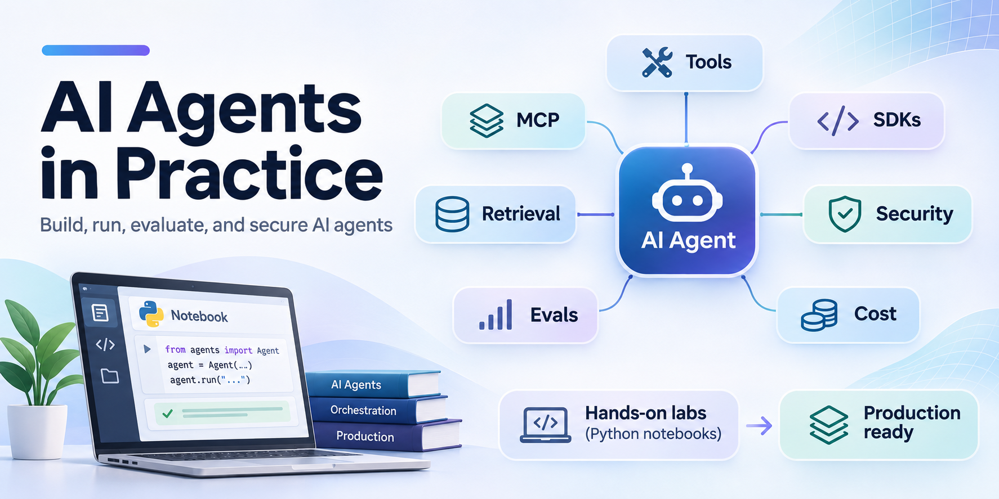

# AI Agents in Practice

Hands-on labs for building, running and judging AI agents. You start with one call to a model and write the agent
loop yourself, then see the same pieces inside the OpenAI Agents SDK, LangChain and LangGraph, LlamaIndex and other
frameworks. Then you ground an agent in a database and a document collection, run the code it writes safely, choose
between one agent and several, defend it from untrusted text, and evaluate, trace and cost it.

Every lab works on one running case: the support desk of the Chinook music shop, with its customer database
(`data/chinook.db`) and its policies and tickets (`data/corpus/`). Each lab stands alone: you can open any lab without
running the ones before it.

## Who it is for

Technical people who already write Python: developers, data scientists, technical managers. You do not need prior
agent experience. Many people who build agents have to explain them to a risk or compliance function, so the labs
treat cost, permissions and failure as part of the lesson.

## The labs

Start with Lab 00: it sets up the environment and checks that everything later labs need works.

**Part A: an agent with no framework**

| Lab | Title |
|---|---|
| 00 | [How to set up the lab environment](00_Environment_Check/) |
| 01 | [How to call a model and read the response](01_Model_Call/) |
| 02 | [What is an agent](02_What_Is_An_Agent/) |
| 03 | [How a model asks for a tool](03_Tool_Calling/) |
| 04 | [How to write the agent loop](04_Agent_Loop/) |
| 05 | [How to manage what an agent sees](05_Context_And_Skills/) |
| 06 | [How to share tools with MCP](06_MCP/) |

**Part B: frameworks and retrieval**

| Lab | Title |
|---|---|
| 07 | [How the OpenAI Agents SDK runs your loop](07_OpenAI_Agents_SDK/) |
| 08 | [How LangChain and LangGraph run the same agent](08_LangChain_LangGraph/) |
| 09 | [How to choose an agent framework (a guide)](09_Choose_A_Framework/) |
| 10 | [How to answer from documents with retrieval](10_Retrieval/) |
| 11 | [How to give an agent a search tool](11_Agentic_RAG/) |
| 12 | [How to build the same RAG agent with LlamaIndex](12_LlamaIndex_RAG/) |

**Part C: business agents**

| Lab | Title |
|---|---|
| 13 | [How to build a customer-support agent over a database](13_Support_Desk_Agent/) |
| 14 | [How a coding agent edits files and runs tests](14_Coding_Agent/) |
| 15 | [How to run model-written code safely](15_Code_Execution/) |

**Part D: designs and production**

| Lab | Title |
|---|---|
| 16 | [How to choose an agent design](16_Agent_Designs/) |
| 17 | [How to defend an agent from untrusted text](17_Prompt_Injection/) |
| 18 | [How to evaluate and trace an agent](18_Evals_And_Tracing/) |
| 19 | [How to re-engineer a process with agents](19_Process_Reengineering/) |
| 20 | [What agent platforms sell (a guide)](20_Agent_Platforms/) |

**Bonus labs**

| Lab | Title |
|---|---|
| B1 | [How to make a LangGraph workflow survive a restart](bonus/B1_LangGraph_Durable_Workflows/) |
| B2 | [How to put guardrails and approvals on an Agents SDK agent](bonus/B2_Agents_SDK_Guardrails/) |
| B3 | [How to build the desk agent with Google ADK and LiteLLM](bonus/B3_Google_ADK/) |
| B4 | [How to build a typed desk agent with Pydantic AI](bonus/B4_PydanticAI_Typed_Agent/) |
| B5 | [How to build the desk as a CrewAI crew](bonus/B5_CrewAI_Crew/) |
| B6 | [How to build the desk agent with Microsoft Agent Framework](bonus/B6_Microsoft_Agent_Framework/) |
| B7 | [How to move retrieval to Pinecone](bonus/B7_Pinecone_Retrieval/) (requires a Pinecone account) |
| B8 | [How to trace and evaluate the same agent with LangSmith](bonus/B8_LangSmith_Tracing_And_Evals/) (requires a LangSmith account) |
| B9 | [How to compose LangChain's building blocks](bonus/B9_LangChain_Building_Blocks/) |

## What a lab folder holds

```text
NN_Topic/
  README.md            the goal, what you will learn, the parts and the checkpoints
  NN_topic.ipynb       the guided notebook (a GUIDE.md for the two guides)
  resources/           diagrams and any data the lab adds
  solved/              the challenge, solved, with its saved outputs
```

Every notebook is saved with the outputs of a real run, so you can read a lab before you run it. The README of each
lab names the model behind its saved outputs.

## Setup

Start with [Lab 00: How to set up the lab environment](00_Environment_Check/README.md). It walks through every route
and ends with a notebook that checks everything in one run.

- **Ubuntu VM with VS Code:** `git clone https://github.com/tatwan/ai_agents_course.git`, install
  [uv](https://docs.astral.sh/uv/) (`curl -LsSf https://astral.sh/uv/install.sh | sh`), then run
  `uv sync --python 3.13` in the repository folder. Optionally `sudo apt install -y graphviz` for lab 07's drawings.
- **GitHub Codespaces:** **Code → Codespaces → Create codespace on main**, then the same `uv` steps. The key can be a
  Codespaces secret named `OPENAI_API_KEY`.
- **Your own machine with `uv`:** clone the repository (or download the ZIP), install `uv`, run
  `uv sync --python 3.13`.
- **Your own machine with `pip`** (where `uv` is blocked): Python 3.11 to 3.14, `python3.13 -m venv .venv`, activate
  it, `pip install -r requirements.txt`.

Then copy `.env.example` to `.env` and paste your `OPENAI_API_KEY` into it. Model names and prices live in
`models.env`: change `MODEL_DEFAULT` there to switch every lab, or set it in `.env` for your machine only. Open a
notebook in VS Code and choose the repository's `.venv` as the kernel (or run `uv run jupyter lab`). Notebooks never
install packages, and never print the key.

Labs 12, B3, B5 and B6 have their own environment: run `uv sync` inside the lab folder and choose that folder's
`.venv`. Graphviz (lab 07), Docker (lab 15) and the Pinecone and LangSmith keys (bonus B7 and B8) are optional.

## Data

Instructor-supplied; do not regenerate these files. See [data/README.md](data/README.md).

| Path | What it holds |
|---|---|
| `data/chinook.db` | The Chinook shop's database: customers, invoices, tracks and the support reps |
| `data/corpus/` | The shop's 20 policies and 16 support tickets, as markdown files |
