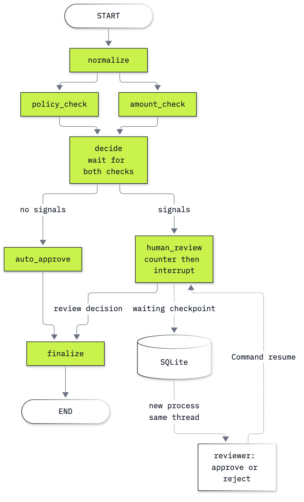

# Bonus B1: How to make a LangGraph workflow survive a restart

**CPU | No API key or account | Practises: workflow state, concurrent updates, durable human review and history**

## Goal

Keep a refund review waiting on disk, restart Python, then approve that same saved request. The counter is the
teaching moment: the review node is entered once before the pause and again after the restart. Workflow
checkpointing does not make an external payment safe to repeat. Every refund here is a simulated record; no money
is sent and the shared Chinook data stays unchanged.

## What you will learn

- Build a `StateGraph` from state, nodes and edges, without a model.
- Merge parallel check updates with a reducer and recognise the error without one.
- Inspect a checkpoint's values, next nodes and waiting interrupt.
- Resume a SQLite-backed thread in a new Python process.
- Fork an earlier checkpoint while retaining the original saved result.

## Run first

From the repository folder, run `uv sync --python 3.13` (or install `requirements.txt` in your own environment).
Open [b1_langgraph_durable_workflows.ipynb](b1_langgraph_durable_workflows.ipynb) in VS Code or JupyterLab
(`uv run jupyter lab`) and select that environment's kernel. No previous lab needs to have run. You need basic
Python dictionaries, functions and lists; the notebook explains the type annotations and graph API where used.

**Part D requires a kernel restart.** Run through its restart instruction, choose Restart Kernel, then continue
from the next cell. Do not rerun Setup or the pause cell after restarting. Run All across that boundary will
intentionally stop at the restart assertion. The full solved notebook follows the same restart sequence.

All runtime files are in the gitignored `outputs/`: the SQLite checkpoint database, a local review-entry counter
and the restart check. The notebook resets its own demonstration counter and `refund-main` thread on a full rerun.
The challenge uses `refund-challenge`. Neither workflow writes to `data/` or calls a model. Use SQLite here for a
local exercise; a multiworker service needs an appropriate database checkpointer and application controls.

## What you will do

| Part | What it teaches |
|---|---|
| Part A: Represent a refund as state and node updates | One small `StateGraph`; a partial update preserves the case ID |
| Part B: Merge updates from parallel checks | A visible concurrent-update error, then the same two checks with `operator.add` |
| Part C: Join refund checks before choosing a route | A fan-out, a fan-in barrier, conditional routing and a completed low-risk case |
| Part D: Resume a waiting approval after a kernel restart | SQLite, a review packet, lost Python state, a guarded resume and a counter that repeats |
| Part E: Fork history to correct an earlier amount | A pre-check checkpoint, `update_state`, rerun checks and the original checkpoint read again |
| Challenge: Reject a request with several review signals | A new thread, three signals, a waiting review and a saved rejection |

The review rules are deliberately simplified examples for physical returns: review an amount of at least $500,
an opened item, or a request beyond 30 days. They are not the complete Chinook policy. For example, the
[returns policy](../../data/corpus/policy_returns.md) treats defective opened media separately. The exercise teaches
execution and recovery, not whether a real customer should receive a refund.

## Checkpoints

| After | You should see |
|---|---|
| Part A | Input amount `45.126` unchanged; graph result `45.13` with the same `case_id` |
| Part B | `InvalidUpdateError` without the reducer; both `opened_item` and `high_amount` after adding it |
| Part C | `45.13`, no signals, `approved`, both check labels in the audit and `next == ()` |
| Part D | A waiting $1,250 request with `high_amount`; old kernel variable absent and new process true; the same request restored and approved; review entries `1 → 2` |
| Part E | A new `update` checkpoint schedules both checks; the $80 fork auto-approves with no signals; the original $1,250 approved checkpoint is still readable; a bare thread lookup selects the newer $80 branch |
| Challenge | Three review signals, waiting `('human_review',)`, final `rejected`, audit ending `final:rejected`, two review-node entries |

**About the saved outputs.** No model ran. These are real outputs from local Python and LangGraph runs, including
a second Python kernel for the resume. The order of parallel check events can vary; compare the signal and audit
membership, not their arrival order. Process IDs and checkpoint IDs are intentionally not printed. Model cost is
$0.00; that does not price production storage or infrastructure.

## Folder contents

| Path | What it is |
|---|---|
| `b1_langgraph_durable_workflows.ipynb` | Guided notebook with saved outputs and an exercise cell |
| `refund_workflow.py` | The same demonstrated graph and node definitions, importable in a new kernel |
| `resources/labB1_refund_workflow.mmd` and `.png` | Diagram source and exported image |
| [solved/b1_langgraph_durable_workflows_solution.ipynb](solved/b1_langgraph_durable_workflows_solution.ipynb) | Standalone full notebook with the challenge solved and saved outputs |

## Resources

- [LangGraph Graph API](https://docs.langchain.com/oss/python/langgraph/graph-api): state, reducers, nodes, edges and super-steps.
- [Checkpointers](https://docs.langchain.com/oss/python/langgraph/checkpointers): snapshots, thread IDs, history, durability modes and integrations.
- [Interrupts](https://docs.langchain.com/oss/python/langgraph/interrupts): review payloads, resume values and node restart behavior.
- [Time travel](https://docs.langchain.com/oss/python/langgraph/use-time-travel): replay and branch from earlier checkpoints.
- [Chinook refunds](../../data/corpus/policy_refunds.md): the shop's actual refund rules.

Back to [the bonus lab list](../README.md).
