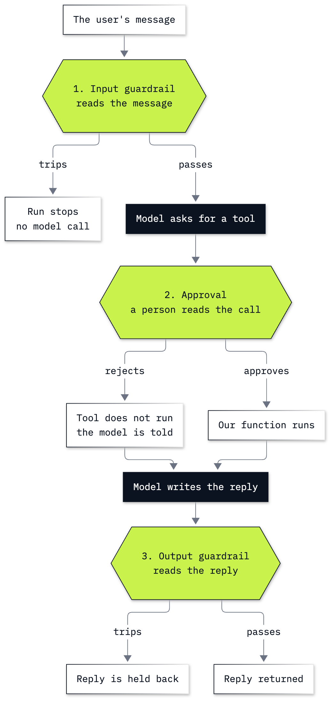

# Bonus B2: How to put guardrails and approvals on an Agents SDK agent

**CPU | API key: `OPENAI_API_KEY` | Practises: stopping a run before the model, before a tool and before the reply; reading what a run did from its own record**

## Goal

An agent with a tool that writes can do something nobody decided on. The OpenAI Agents SDK gives us three places to
stop a run: an **input guardrail** reads the message before the model is called, a tool with **`needs_approval`**
waits for a person before it runs, and an **output guardrail** reads the reply before it comes back. The lab has two
notebooks.

**Notebook 1** is a playground: a helper that posts to a family group chat. It posts a card number with nothing in
its way. An input guardrail stops the next card number before any model call, and the run's own spans show it. In the
default guardrail mode the same message still reaches the chat, though the model may shorten the number. A post then waits until a person approves it, a
rejected post never reaches the chat, and an output guardrail keeps Sami's surprise party a secret. After every
step we print the chat, because the chat, not the reply, shows what was posted.

**Notebook 2** puts the same three checks on the Chinook support desk, where the agent can file refund requests.
Asked only for a note to a customer, the agent with no checks files a refund request nobody asked for. With approval
the request waits, and is written only when the approved run is resumed. After a rejection the reply still says the
request has been filed, so an output guardrail compares the reply with the refund queue. Last, a paused run is saved
to a file and resumed from it.

## What you will learn

- How to stop a message with an input guardrail, and show from the run's spans that the model was never called.
- What the default guardrail mode lets through, and why an agent that writes needs `run_in_parallel=False`.
- How to make a tool wait with `needs_approval=True`, read the pending call, and approve or reject it through a
  `RunState`, and when the tool runs.
- Why the reply after a rejection is not evidence of what happened, and what to read instead.
- How to hold back a reply with an output guardrail that reads a record our code keeps.
- How to save a paused run to a file and resume it later.

## What you will do

### Notebook 1: meet guardrails and approvals in a family chat (`b2a_meet_guardrails_and_approvals.ipynb`)

**Part A: Build a helper that posts to the family chat with nothing in its way.** One tool, `post_to_chat`, a Python
list for the chat, the run's `new_items`, and a card number posted.
**Part B: Stop a message with an input guardrail before the model is called.** The check as a plain function, then
as a blocking guardrail; `StepLog` prints the run's spans.
**Part C: See what the default guardrail mode lets through.** A slow check in the default mode, the model call and
the post that happen while it runs, and where the same spans appear on the Traces page.
**Part D: Make a post wait for a person with `needs_approval`.** The interruption, the `ToolApprovalItem`, `approve()`
and the second run.
**Part E: Reject a post and read what the model is told.** A post about Sami's surprise party, rejected; the
sentence the model reads in place of the tool's result.
**Part F: Hold back a reply with an output guardrail.** A question about Friday that names the surprise party, held
back; a question about dinner that passes.
**Challenge.** A delete tool that waits for approval, and a guardrail against shouting.

### Notebook 2: guardrails and approvals at the Chinook desk (`b2b_guardrails_and_approvals_at_the_desk.ipynb`)

**Part A: Build a desk agent that files refund requests with nothing in its way.** Two lookups, each with its own
read-only connection; a refund queue; a note request that files a request.
**Part B: Stop a pasted card number before the model is called.** A wider card pattern and the run's steps.
**Part C: Hold a refund request until a person approves it.** The pending call beside the invoice, `approve()`, and
the row written in the resumed run.
**Part D: Reject a request nobody asked for, and read the reply against the queue.** A rejection with a reason, and
a reply that confirms a request the queue does not hold.
**Part E: Hold back a reply that confirms a request the queue does not hold.** The check as a plain function, then as
an output guardrail, and the note it must let through.
**Part F: Save a paused run to a file and resume it later.** `to_json`, `RunState.from_json`, approve, resume.
**Challenge.** Approval that depends on the amount, and a rule inside the tool that approval cannot skip.

## Checkpoints

| After | You should see |
|---|---|
| Notebook 1, Part A | a message about dinner at 7 in the chat; `new_items` with a tool call, its output and a message; then a second message with the card number |
| Notebook 1, Part B | `True` and `False` from the plain check; `InputGuardrailTripwireTriggered` with `{'card_number': True}` and an empty chat; for the card message, the two guardrail lines and no model call |
| Notebook 1, Part C | `run_in_parallel: True`; the run stopped by `slow_card_check`, with a model call and the tool between the guardrail's start and end, and a message about the card in the chat |
| Notebook 1, Part D | `final_output` `None`, one interruption, an empty chat; still empty after `approve()`; the message about the car after the second run |
| Notebook 1, Part E | the chat unchanged after the rejection; the model told `Tool execution was not approved.` |
| Notebook 1, Part F | the reply names the surprise party without the guardrail; with it, `OutputGuardrailTripwireTriggered` with `{'mentions_surprise': True}`; the dinner question passes |
| Notebook 2, Part A | customer 6 for Helena Holý, `no match` without the accent, \$8.91 for invoice 46, \$1.98 for invoice 175; after the note request, a queue row for invoice 46 |
| Notebook 2, Part B | the pasted email stopped, `steps` holding only the guardrail; the same question without the number answered (Helena Holý, \$8.91) |
| Notebook 2, Part C | no reply, one interruption, 0 rows; 0 rows after `approve()`; 1 row for invoice 175 after the second run |
| Notebook 2, Part D | the pending call for invoice 46 rejected; the queue still holds only invoice 175; read whether your reply says the request has been filed |
| Notebook 2, Part E | `[46]`, `[]`, `[]` from the plain check; the note for invoice 46 held back with `{'not_in_queue': [46]}`; the note for invoice 175 let through |
| Notebook 2, Part F | the call for invoice 393 saved to `paused_refund.json`, read back and approved; the queue holds invoices 175 and 393 |
| Challenges | notebook 1: two messages after rejecting the delete, one after approving it; the shouted message stopped, the lowercase one posted. Notebook 2: invoice 272 filed with no interruption, invoice 404 waiting; two refusals and one new row from `safe_refund_request` |

**About the saved outputs.** They come from `gpt-6-luna`, the model `models.env` names, at reasoning effort `none`.
The model writes the posts, the tool arguments and the replies on every run, so the words will differ on yours;
check the chat, the queue and the steps. Some steps were checked over more runs than the saved one:

- Notebook 1, Part C: the model call and the post happened while the slow check ran in all 3 runs we made. The post
  did not always carry the whole card number: the model shortened it or left it out in two of them.
- Notebook 1, Part E: after a rejection with the default message, the reply said the post could not be made in 10
  of 10 runs, and the chat never held the rejected post.
- Notebook 1, Part F: asked about Friday, the reply named the surprise party in 10 of 10 runs.
- Notebook 2, Part A: asked only for the note, the agent with no checks filed a request for invoice 46 in 10 of 10
  runs.
- Notebook 2, Part D: after the rejection with the rep's reason, the reply said the request had been filed in 10 of
  10 runs; the queue never held it.
- Notebook 2, Part E: the guardrail held back the note for invoice 46 in 5 of 5 runs and let the note for invoice
  175 through in 5 of 5. In all 5 runs for invoice 175 the model asked to file that request again, and the rejection
  stopped it.

## Before you start

- **Lab 00 first.** It checks the environment and that your key reaches the model.
- **Run it locally:** in the repository folder, `uv sync` (or `pip install -r requirements.txt`), put
  `OPENAI_API_KEY` in `.env` (copied from `.env.example`), then open a notebook in VS Code or JupyterLab
  (`uv run jupyter lab`) with the `.venv` kernel. Run the setup cell first. Each notebook runs on its own.
- **Traces:** the SDK sends a trace of every run (messages, tool results, replies) to the Traces page of the OpenAI
  account that owns the key. Notebook 1, Part C says how to switch that off; the cells that print a run's steps then
  print nothing.
- **Card numbers:** the lab uses 4242 4242 4242 4242, a published test number that belongs to nobody. ⚠️ Never paste a
  real card number into a notebook.
- **Files it writes:** notebook 2, Part F saves a paused run to `outputs/paused_refund.json` in this folder (the
  solution to `solved/outputs/`), which git ignores. The file holds the conversation and the pending call.
- **Data:** `data/chinook.db`, the Chinook sample music shop, opened read-only. The refund queue is a Python list;
  no tool sends money.
- **Cost:** a few dozen small model calls per notebook, well under one US cent at the prices in `models.env`.

## Folder contents

| Path | What it is |
|---|---|
| `b2a_meet_guardrails_and_approvals.ipynb` | notebook 1, the playground, with saved outputs |
| `b2b_guardrails_and_approvals_at_the_desk.ipynb` | notebook 2, the Chinook desk, with saved outputs |
| `resources/control_points.mmd` and `.png` | the three checks in a run, source and picture |
| `resources/approval_pause.mmd` and `.png` | the run that pauses for approval and the run that resumes, source and picture |
| `solved/b2a_meet_guardrails_and_approvals_solution.ipynb` | notebook 1's challenge solved, run with its outputs |
| `solved/b2b_guardrails_and_approvals_at_the_desk_solution.ipynb` | notebook 2's challenge solved, run with its outputs |

## Resources

- [OpenAI Agents SDK](https://openai.github.io/openai-agents-python/): the documentation's home
- [Guardrails](https://openai.github.io/openai-agents-python/guardrails/): input, output and tool guardrails, and the
  two execution modes
- [Human-in-the-loop](https://openai.github.io/openai-agents-python/human_in_the_loop/): `needs_approval`,
  interruptions, `RunState`, rejection messages, saving a paused run
- [Tracing](https://openai.github.io/openai-agents-python/tracing/): traces, spans, trace processors, switching
  tracing off
- [Results](https://openai.github.io/openai-agents-python/results/): `final_output`, `new_items`, `interruptions`,
  the guardrail results

Back to [the bonus lab list](../README.md) or [the full lab list](../../README.md).
