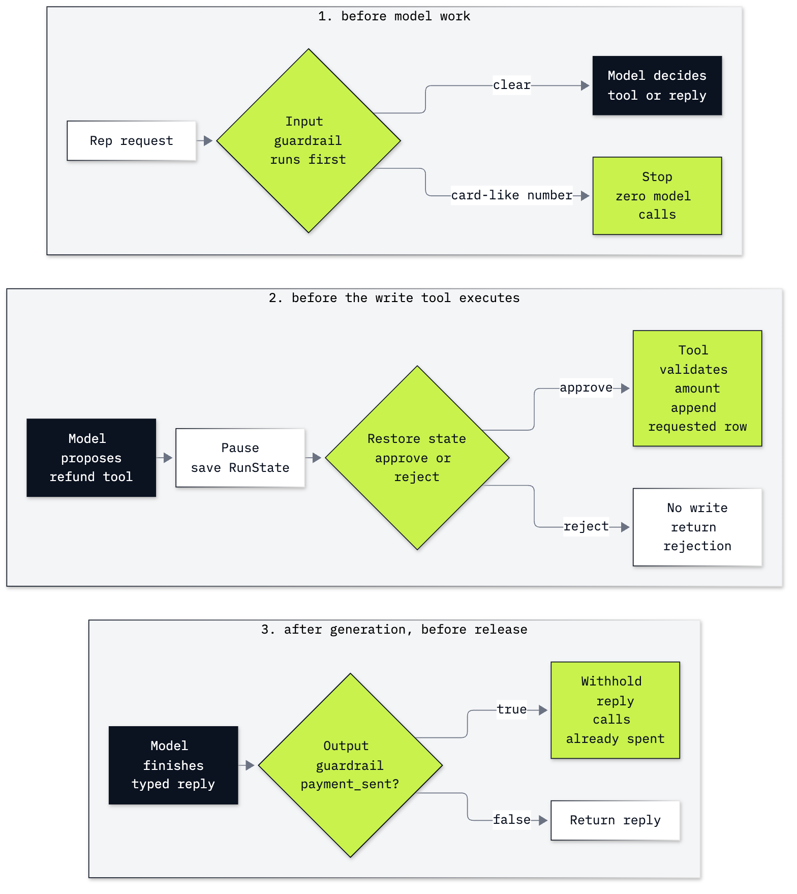

# Bonus B2: How to put guardrails and approvals on an Agents SDK agent

**CPU | API key: `OPENAI_API_KEY` | Practises: controlling the agent loop, reviewing proposed writes and checking execution evidence**

## Goal

We add automatic checks and a human approval pause to the Chinook support desk. A test card number stops the run with
zero model calls; a hand-made reply exposes what an output guardrail rejects; a refund tool waits until we approve
or reject its proposed call. All refund requests are invented and go to a local toy queue. No tool sends money.

## What you will learn

- How to stop card-like input before the agent starts a model call.
- How to check a typed final reply, and why a valid schema does not make the reply true.
- How to put `needs_approval=True` on a write tool and inspect its pending arguments.
- How to save a paused `RunState`, restore it, and resume with an approval or a rejection.
- How to read the queue after each decision, and what approval leaves to the tool.
- When each control is worth adding to the lab 07 agent, and when LangGraph's pause (lab 08) fits better.

## Where this lab starts

An agent chooses tools; our code executes them. Lab 07 introduces the SDK loop, but this notebook defines every
lookup, agent and check again so it runs on its own. Here we control when that loop may start, when a proposed tool
may execute and when a final reply may leave the application.

## What you will do

**Part A: Run the desk before adding controls.** Inspect Helena's customer facts, the tool schema, the agent and a
real lookup run. Add a small lifecycle observer to count model starts and tokens.

**Part B: Stop card-like input before the model.** Try a small digit pattern on a test card and an ordinary invoice
request, then use `input_guardrail(run_in_parallel=False)` and read the exception beside the unchanged call count.

**Part C: Check a typed final reply.** Construct a reply by hand, validate its schema and test the output guardrail
directly. See a contradictory text pass a field check, then exercise the attached guardrail on an actual agent reply.

**Part D: Pause a refund tool before it writes.** Read invoice 46, inspect a toy queue row and validate the amount in
the write function. Wrap it with `needs_approval=True`, then inspect the pending call while the queue remains empty.

**Part E: Save the pause and resume an approved call.** Serialize `RunState`, restore it from a trusted local file,
inspect the same pending call, approve it and resume. Read the resulting request row.

**Part F: Resume a rejection and keep the write checks.** Start a new request, save and restore its pause, reject it
and resume without another write. Test an oversized amount against the function and read the model cost.

**Challenge.** Check two new input formats and reject a serialized request for invoice 175. The solved notebook is a
complete independent run, including its own setup and all six parts.

## Checkpoints

| After | You should see |
|---|---|
| Part A | customer 6, 7 invoices, $49.62 and Steve Johnson; all three lookup tools called; 3 model calls in the saved learner run |
| Part B | test card matches, ordinary invoice request does not; `run_in_parallel=False`; `InputGuardrailTripwireTriggered`; zero new model calls |
| Part C | hand-made `payment_sent=True` trips; contradictory text with `False` passes; the live reply is checked after 3 model calls |
| Part D | invoice 46 belongs to customer 6 and totals $8.91; one pending `file_refund_request`, no queue rows |
| Part E | one pending call restored; approval alone leaves zero rows; resume creates one row with `status='requested'` |
| Part F | rejection adds zero rows and leaves no interruption; $999 is refused by the tool; main path 12 model calls, 4462 input tokens, 426 output tokens, about $0.000659 |
| Challenge | hyphenated test card blocked, ordinary invoice IDs allowed, zero model calls for direct checks; rejecting invoice 175 adds no row |

**About the saved outputs.** They come from `gpt-6-luna` at reasoning effort `none`, configured in `models.env`.
Replies, tool choices, token counts and timings can vary. Check the pending arguments and queue rows as well as the
wording. The card-pattern and hand-made-output checks are deterministic. The field-based output guardrail checks
only `payment_sent`; it does not verify all claims in the answer text.

## When to use it

Lab 07 builds the desk as an Agents SDK `Agent`; this lab adds three controls to it, each at a different point. An
input guardrail with `run_in_parallel=False` finishes before any model work (the test card: 0 model calls). An output
guardrail checks a typed field before the reply leaves, after the tokens are spent (3 model calls in our live check).
`needs_approval=True` with a saved `RunState` holds a write for a person (the queue stayed empty until we resumed the
approved state). If your desk runs on LangGraph, lab 08's `HumanInTheLoopMiddleware` and checkpointer give the same
pause; this version suits a desk built on lab 07, where we store the paused state ourselves.

## Before you start

- Complete [Lab 00](../../00_Environment_Check/README.md), then run `uv sync --python 3.13` from the repository
  folder (or `pip install -r requirements.txt`).
- Copy `.env.example` to `.env` at the repository folder and set `OPENAI_API_KEY`.
- Open [b2_agents_sdk_guardrails.ipynb](b2_agents_sdk_guardrails.ipynb) in VS Code or start `uv run jupyter lab`.
  Select the repository `.venv` kernel and run from the top.
- The lab reads the public Chinook sample database in `data/chinook.db` through a read-only connection. It downloads
  no data and needs no tracing account or server.
- It writes `outputs/refund_requests.json` and paused-state JSON files under this lab folder. Git ignores `outputs/`.
  Running from the top resets this lab's toy queue. A snapshot may contain model history and tool arguments; use
  trusted storage and do not accept an edited snapshot from a client.
- The main path makes about a dozen small model calls and costs much less than one cent at the configured prices.
  Approval runs are resumed using state; do not replay a completed snapshot, which could duplicate this toy write.

## Folder contents

| Path | What it is |
|---|---|
| `b2_agents_sdk_guardrails.ipynb` | guided learner notebook with saved outputs |
| `resources/labB2_controls.mmd` and `.png` | diagram source and exported image |
| `solved/b2_agents_sdk_guardrails_solution.ipynb` | full standalone notebook with worked challenges and saved outputs |

## Resources

- [Guardrails and human review](https://developers.openai.com/api/docs/guides/agents/guardrails-approvals): input,
  output and tool boundaries, approvals and delayed review.
- [Results and state](https://developers.openai.com/api/docs/guides/agents/results): interrupted results and state.
- [Running agents](https://developers.openai.com/api/docs/guides/agents/running-agents): the loop and resumptions.
- [Integrations and observability](https://developers.openai.com/api/docs/guides/agents/integrations-observability):
  tracing controls and SDK integrations.
- [Pydantic models](https://docs.pydantic.dev/latest/concepts/models/): typed objects and validation.

Back to [the bonus lab list](../README.md) or [the full lab list](../../README.md).
