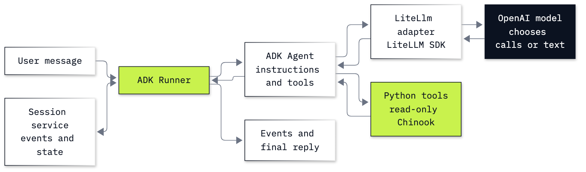

# Lab B3: How to build the desk agent with Google ADK and LiteLLM

**CPU | Key: `OPENAI_API_KEY` | Own environment | Practises: framework choice, tool calling, conversation state and cost**

## Goal

Build the Chinook desk agent with Google ADK while OpenAI remains the model provider. Read a model's tool request beside the Python result, then find the user's input in the stored session. The saved Helena run has three model requests, five yielded events and six stored events: these counts measure different things. A deliberately wrong session ID shows why continuing a conversation requires the right runtime state.

## What you will learn

- Call LiteLLM directly and inspect the normalized reply and usage.
- Construct ADK's `LiteLlm` adapter before giving it to an agent.
- Give an agent three read-only database tools and run it with a session service.
- Read raw function requests, results, final text and state changes before summarizing events.
- Continue one conversation, diagnose a missing session, and measure requests, tokens, time and cost.

## Run first

Start with [Lab 00's setup](../../00_Environment_Check/README.md) for the repository, Python, `uv` and the repository-root `.env` containing your OpenAI key. No Google key or account is needed. This lab uses the in-process LiteLLM SDK; it starts no proxy, browser UI or hosted Google resource.

From the repository root:

```bash
cd bonus/B3_Google_ADK
uv sync --locked --python 3.13
```

In VS Code, select this folder's `.venv/bin/python` for the notebook kernel. The root environment and this environment have different dependency requirements; choose the interpreter inside **B3_Google_ADK**. The notebook installs nothing.

If using `pip`, create a separate virtual environment in this folder, activate it and run:

```bash
python -m pip install -r requirements.txt
```

Open [b3_google_adk.ipynb](b3_google_adk.ipynb) and run top to bottom. Familiarity with Python functions, lists and dictionaries is enough; `await`, ADK content objects and events are explained where used. The notebook defines every tool it needs and reads the bundled [Chinook data](../../data/README.md) in place. No earlier lab must have been run.

## Parts

| Part | What it adds |
|---|---|
| Part A: Read a model call through LiteLLM | One small question, its reply envelope and token fields |
| Part B: Use ADK's model adapter directly | `LiteLlm`, `LlmRequest` and an actual `LlmResponse` before an agent |
| Part C: Give the desk agent three read-only tools | Source row, ordinary Python tools, agent, session and direct runner call |
| Part D: Read events, state and model usage | Raw payloads before the table, stored user message, factual checks and cost |
| Part E: Continue the right session | Missing-session failure, repaired follow-up and the in-memory storage boundary |



Read arrows as requests and results. The ink node chooses tool calls or text; the lime nodes run our code. The session service stores conversation events and selected state.

## Checkpoints

| Check | Saved learner run | What it establishes |
|---|---|---|
| A–B: Small call | Both interfaces answer `5`; each uses 20 input and 4 output tokens | LiteLLM and ADK expose different response objects for the same small task |
| C: Source facts | Helena: customer 6, 7 invoices, $49.62, Steve Johnson | A local answer key exists before the model runs |
| D: Tool path | `find_customer`, then `get_invoices` and `get_support_rep`, then final text | Actual tool results support the reply |
| D: Counts | 3 model requests; 5 yielded events; 6 stored events | The stored user message and Python results are not extra model requests |
| D: Usage | Input 302 + 361 + 464 = 1,127; output 20 + 51 + 24 = 95; no cached input | Usage is counted per model request, including growing history |
| D: Measurement | 3.677 seconds, estimated $0.0001602 | Cost and elapsed time refer to the checked first Helena turn |
| E: Missing ID | `SessionNotFoundError: Session not found: missing` | The runtime needs a created session, before it can call the model |
| E: Correct ID | Follow-up says $49.62; original store has 12 events; a new store returns `None` | History is retained by the original in-memory service only |

Time, token counts and tool grouping may vary. The invoice facts and support-rep names are fixed by the bundled database. The notebook's cost estimate reads prices from `models.env`; the complete demonstrations use eight successful model requests, 2,844 input and 154 output tokens, with an upper cost estimate of $0.000432. This includes the two small calls and the follow-up. The missing-session error makes no model request.

The ADK connector exposes cache reads but does not retain OpenAI's nested cache-write field. Every first-turn Helena request is below the configured model's 1,024-token cache threshold; the baseline estimate uses zero writes. The complete-demo upper estimate prices noncached input at the larger input/write rate. A longer application should retain raw provider usage for accurate cache-write accounting.

## Challenge and solution

Start a separate Puja Srivastava conversation. Verify 6 invoices, $36.64 and Jane Peacock in both raw tool results and final text, check `last_answer`, and measure model usage separately from event count.

The [full standalone solution](solved/b3_google_adk_solution.ipynb) runs all parts and the challenge. Its Puja run used three model requests, five yielded events, six stored events, 1,140 input and 99 output tokens; estimated cost $0.0001635. Its own Helena timing and usage are read against its own saved run.

## Troubleshooting

| Observed error | Repair |
|---|---|
| `SessionNotFoundError: Session not found: missing` | Reuse the created session ID with its original app name, user ID and session service. Part E triggers this error and shows the repair. |

Rerunning the configuration cell does not reset conversation history. For a clean run, restart the kernel and run all cells so the in-memory service starts empty.

## Folder contents

- `b3_google_adk.ipynb`: guided learner notebook with saved outputs.
- `solved/b3_google_adk_solution.ipynb`: complete notebook and worked Puja challenge.
- `resources/labB3_adapter_and_runtime.mmd` and `.png`: diagram source and exported image.
- `pyproject.toml`, `uv.lock`, `requirements.txt`: the isolated environment and pip route.

## About the saved outputs

The saved notebooks use `gpt-6-luna` with reasoning effort `none`, configured through the repository's `models.env`. The model still runs on OpenAI; Google ADK provides the local runtime and LiteLLM translates the model calls. Answers and measurements can vary across runs.

## Resources

- [ADK LiteLLM connector](https://adk.dev/agents/models/litellm/), [agents](https://adk.dev/agents/llm-agents/) and [events](https://adk.dev/events/).
- [ADK sessions](https://adk.dev/sessions/session/) and [state](https://adk.dev/sessions/state/).
- [LiteLLM completion inputs](https://docs.litellm.ai/docs/completion/input) and [outputs](https://docs.litellm.ai/docs/completion/output).
- [OpenAI prompt caching](https://developers.openai.com/api/docs/guides/prompt-caching).
- [Python coroutines and tasks](https://docs.python.org/3/library/asyncio-task.html).

Back to [the bonus lab list](../README.md).
