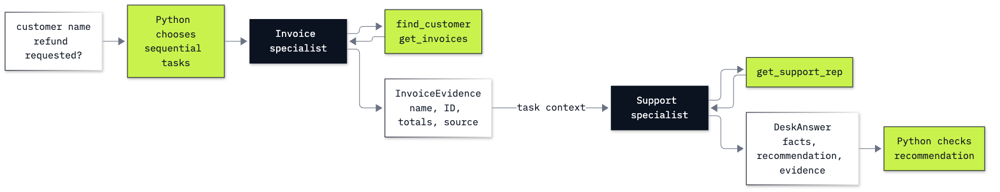

# Bonus B4: How to build the desk as a CrewAI crew

**CPU | API key: `OPENAI_API_KEY` | Own environment | Practises: scoped specialists, task context, typed output and policy checks**

## Goal

We build two specialists whose tools, responsibilities and handoff (the typed result one task passes to the next, not a lab 07 handoff of control) we can inspect. A hand-made refund claim passes its output schema and fails the task guardrail; the live crew then shows why its model-written evidence needs a separate comparison with the actual tool results.

## What you will learn

- How to construct CrewAI's `LLM`, `Agent`, `Task` and `Crew` directly.
- How to give each specialist only the lookups its task needs, and pass customer identity through task context.
- How to read typed task outputs and compare model-written evidence with tool results.
- How to reject a well-typed refund decision with a deterministic task guardrail.
- How to count requests, tokens, seconds and cost across the whole crew.
- When a crew is worth its extra requests, compared with one agent or the specialists of labs 07 and 18.

## What you will do

| Part | What it teaches |
|---|---|
| A: Establish the facts each specialist can retrieve | Call the decorated tools directly and read their JSON strings and generated argument schema. |
| B: Separate output shape from refund policy | Inspect an example before its Pydantic schema, then reject a hand-made, well-typed `paid` recommendation. |
| C: Assign tools and context to two tasks | Call `LLM` directly, construct the two agents and tasks, and inspect the explicit context dependency. |
| D: Read the task handoff and model-written evidence | Run the Helena question once, inspect both typed outputs, and compare evidence with the actual Python tool audit. |
| E: Measure the whole crew and repeat the evidence check | Count every model request, estimate cost, and repeat the same question ten times. |
| Challenge | Reuse the same crew for Puja's fictional refund request and verify that it recommends human review. |



## Checkpoints

| After | You should see |
|---|---|
| Part A | Helena: customer 6, 7 invoices, $49.62 and Steve Johnson. The three tool calls run directly before the crew uses them. |
| Part B | `DeskAnswer` accepts the fixture's shape; the policy function returns `False` for `paid` and accepts the ordinary lookup. |
| Part C | Billing has `find_customer` and `get_invoices`; support has `get_support_rep`. The context identity is `True`, with `InvoiceEvidence` then `DeskAnswer` as the task output types. |
| Part D | Both task outputs, all three tool operations and the guardrail audit are printed. The evidence check distinguishes exact string copies from equal JSON fields. |
| Part E | Saved baseline: 5 model requests, 2,872 input and 214 output tokens, 12.032 seconds, $0.0003942 estimate. All ten repeats have correct facts and exact, matching evidence, at 5 requests each. Counts include both specialists, tool turns and output conversion; timings and tokens vary. |
| Challenge | Customer 59, 6 invoices, $36.64, Jane Peacock, a `human_review` recommendation and matching evidence. No payment is made. |

**About the saved outputs.** They come from `gpt-6-luna` at reasoning effort `none`, as configured in `models.env`. Each notebook saves its own complete run. Replies, evidence formatting, request counts and timings can change. The deterministic fixture checks shape versus policy independently of model behavior; a live run that passes immediately demonstrates no repair. The cost estimate uses configured prices and the usage CrewAI exposes; its native OpenAI summary omits any cache-write premium, so the notebook also shows a conservative baseline bound.

## When to use it

Lab 07 (notebook 2, Part C) splits the desk between specialists in the Agents SDK, and lab 18 measures one agent against
specialists. CrewAI declares the same split as roles, tasks and a context edge: each specialist saw only its own
tools, the result passed from the first task to the second was a typed `InvoiceEvidence` object we could read, and
the task guardrail rejected a well-typed `paid` claim. The cost was 5 model requests for two tasks (about $0.00039
for the Helena baseline), with the evidence holding in 10 of 10 repeats. Choose a crew when responsibilities really
need different tools, objectives or context; for a fixed lookup like this, one agent or plain Python is less work,
and a sequential crew is not a durable approval workflow.

## Before you start

The notebook stands alone. You need the repository's `data/chinook.db`, `models.env` and a repository-root `.env` containing your OpenAI key. [Lab 00](../../00_Environment_Check/README.md) explains the general setup.

CrewAI requires different OpenAI and MCP versions from the core environment. From the repository folder, create this lab's isolated environment:

```bash
cd bonus/B4_CrewAI_Crew
uv sync --locked --python 3.13
```

Open [b4_crewai_crew.ipynb](b4_crewai_crew.ipynb) in VS Code and select `bonus/B4_CrewAI_Crew/.venv/bin/python` as its interpreter. For the pip route, create a Python 3.13 virtual environment in this folder and install its `requirements.txt`. The kernel must use that environment. Packages are installed from the terminal; no notebook cell installs them.

Keep the key at the repository root. The configuration reads the model and prices from `models.env`. The notebook disables CrewAI telemetry and tracing, leaves memory off, and directs local storage to ignored `outputs/`. The crew sends its model requests to OpenAI. The database opens read-only.

The learner notebook makes one tiny model call, one baseline crew run and ten repetitions. The solution repeats that whole notebook and adds one challenge crew run. The cells print usage and an estimated cost from `models.env`; at the saved configuration this is below one US cent per notebook. A task can make several model requests. Iteration and output limits constrain the exercise; they are not a dollar-budget guarantee.

## Folder contents

| Path | What it holds |
|---|---|
| `b4_crewai_crew.ipynb` | Guided notebook with saved outputs. |
| `solved/b4_crewai_crew_solution.ipynb` | Standalone notebook with the challenge solved and run. |
| `resources/labB4_crew.mmd` and `.png` | Diagram source and exported picture. |
| `resources/README.md` | Diagram and data notes. |
| `pyproject.toml`, `uv.lock`, `requirements.txt` | The isolated, pinned environment. |

## Resources

- [CrewAI agents](https://docs.crewai.com/en/concepts/agents): roles, tools and delegation.
- [Tasks](https://docs.crewai.com/en/concepts/tasks): context, typed outputs and function guardrails.
- [Crews](https://docs.crewai.com/en/concepts/crews): execution and usage metrics.
- [LLMs](https://docs.crewai.com/en/concepts/llms): native OpenAI integration and Responses selection.
- [Tools](https://docs.crewai.com/en/concepts/tools): the public decorator and argument schemas.
- [Flows](https://docs.crewai.com/en/concepts/flows): explicit branching and state around model work.
- [OpenAI function calling](https://developers.openai.com/api/docs/guides/function-calling): application code executes proposed calls.
- [Data notes](../../data/README.md): the public Chinook sample and checked fixture facts.

Compare with [lab 18](../../18_Agent_Designs/README.md), which measures one agent against specialists on the same desk,
and with [lab 11](../../11_Choose_A_Framework/README.md), which sets the frameworks' measured runs side by side. Back to
[the bonus lab list](../README.md).
