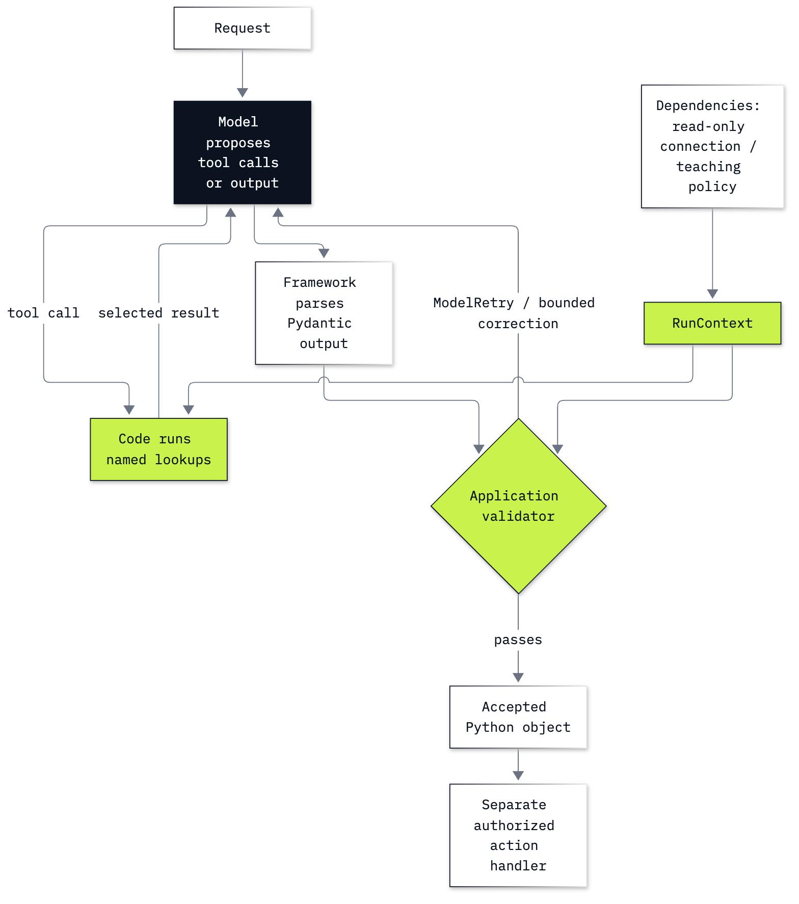

# Bonus B4: How to build a typed desk agent with Pydantic AI

## Goal

Build the Chinook desk agent with typed output, injected dependencies and deterministic validators. The teaching
moment is a well-typed refund proposal that breaks a small teaching policy: code rejects it, and the run's message
history shows the model being asked to repair it.

## What you will learn

- Describe an answer with Pydantic and distinguish field validity from factual validity.
- Construct an agent directly and pass the database through `RunContext`.
- Read the three-tool desk run, typed output, requests, tokens and price.
- Enforce a policy with an output validator and inspect its `ModelRetry` feedback.
- Test tools and repair with `FunctionModel` while live model requests are disabled.

**CPU | API key: `OPENAI_API_KEY` | Environment: repository core | Practises: typed Python boundaries,
dependency injection, factual checks and model-free tests**

## Run first

Complete [Lab 00's setup](../../00_Environment_Check/README.md). From the repository folder, run
`uv sync --python 3.13` or `pip install -r requirements.txt`, put your OpenAI key in the root `.env` (copied from
`.env.example`), then select the repository `.venv` kernel in VS Code or JupyterLab. Open
[b4_pydanticai_typed_agent.ipynb](b4_pydanticai_typed_agent.ipynb) and run from the top.

This bonus uses the **root environment**. Any older local environment in this folder is unnecessary. Python functions,
dictionaries and basic type hints are enough to start; the notebook explains `await`, dataclasses, `RunContext` and
decorator registration where they are used. No other lab needs to have been run.

The notebook reads `data/chinook.db` in place with SQLite's read-only connection. Its invoice dates are historical
sample data, as [the data README](../../data/README.md) explains. The $12 refund and $10 threshold are invented
teaching fixtures, separate from the bundled shop policies. The notebook issues no payments and writes no files.
Live cells use the configured OpenAI model; no hosted tracing account is needed. The no-model tests replace the
provider and disable live model requests.

## Parts

| Part | What it teaches |
|---|---|
| Part A: Describe the answer as a Python object | dictionary first, Pydantic schema, then a type-valid wrong count |
| Part B: Pass the database through dependencies | read-only connection, run-scoped data, three functions called directly |
| Part C: Run and measure the typed desk agent | direct agent construction and run, typed result, protocol and usage |
| Part D: Reject a typed decision that violates a policy | hand-made invalid proposal, output validator, live repairs and repeats |
| Part E: Test the boundary without calling a model | scripted model responses, real tools and validators, disabled provider requests |
| Part F: Follow the boundaries through the loop | where dependencies, parsing, checks and repair sit |
| Challenge | Puja's three facts through the same checked agent, solved independently in `solved/` |

## Checkpoints

| After | You should see |
|---|---|
| Part A | `DeskAnswer`; `int_parsing` for `invoice_count="many"`; count 99 accepted by the schema |
| Part B | customer 6; 7 invoices, $49.62, Steve Johnson from the read-only tools |
| Part C | all three tools executed, `facts_correct=true`; 3 requests, 872 input / 109 output tokens, $0.0001417 in each saved run |
| Part D | the hand-made approval rejected; each saved notebook has 6 live decisions repaired after one rejection, including 5 repeats; retries carry correction text |
| Part E | two no-model tests, each with one retry; the desk test runs all three tools and repairs 99 to 7 |
| Part F | explain the difference between schema, trusted facts, application rule and authorized action |
| Challenge | customer 59; 6 invoices, $36.64, Jane Peacock; all three tools executed |

**About the saved outputs.** They use `gpt-6-luna` at reasoning effort `none`, configured in `models.env`.
Wording, tool order, token counts and time can change. The real policy runs print every candidate, including rejected
ones. Current Pydantic AI records a tool-bound retry as `ToolReturnPart(outcome="retried")`; older examples may use
the deprecated `RetryPromptPart`. The deterministic tests exercise rejection even if a live model's first answer
already passes. The README's customer facts and no-model checks are stable for these bundled fixtures.

## Folder contents

| Path | Purpose |
|---|---|
| `b4_pydanticai_typed_agent.ipynb` | full guided lab with real saved outputs and a challenge |
| `solved/b4_pydanticai_typed_agent_solution.ipynb` | full independent run plus the worked challenge |
| `resources/labB4_typed_boundaries.mmd` and `.png` | source and exported boundary diagram |
| `resources/baseline_measurement.json` | recorded learner and solution baseline measurements for comparison |

## Resources

- [Pydantic models](https://docs.pydantic.dev/latest/concepts/models/)
- [Pydantic AI agents](https://pydantic.dev/docs/ai/core-concepts/agent/)
- [Dependencies and RunContext](https://pydantic.dev/docs/ai/core-concepts/dependencies/)
- [Function tools](https://pydantic.dev/docs/ai/tools-toolsets/tools/)
- [Output validators](https://pydantic.dev/docs/ai/core-concepts/output/#output-validators)
- [Retry messages and limits](https://pydantic.dev/docs/ai/core-concepts/retries/)
- [Unit testing](https://pydantic.dev/docs/ai/guides/testing/)
- [OpenAI model settings](https://pydantic.dev/docs/ai/models/openai/)
- [OpenAI reasoning](https://developers.openai.com/api/docs/guides/reasoning)

Back to [the bonus lab list](../README.md).
