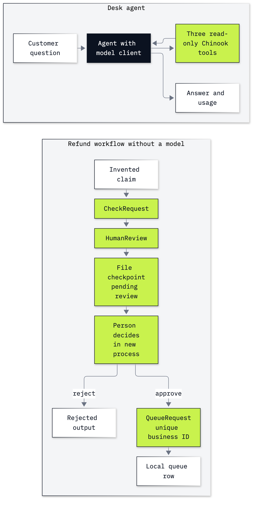

# Lab B6: How to build a desk agent and a resumable approval workflow

**CPU | OpenAI key | Own environment | Practises: framework tool loops, explicit workflow transitions and human approval**

## Goal

Build the Chinook desk with Microsoft Agent Framework, then keep a refund review waiting across a process restart.
The new process restores the pending request; approval adds one local queue row, repeated approval leaves one row,
and rejection adds none. The workflow never sends money.

## What you will learn

- Use the public model client before constructing an `Agent`.
- Inspect three read-only tools, the agent's messages and per-request usage.
- Connect typed executor methods with explicit workflow edges.
- Restore a pending human review with `FileCheckpointStorage` in another process.
- Check approval, rejection and repeated delivery against the stored queue.

## Run first

From the repository folder, create the root `.env` from `.env.example` and set `OPENAI_API_KEY` locally. Model names,
reasoning effort and prices come from `models.env`. Then use this lab's environment:

```bash
cd bonus/B6_Microsoft_Agent_Framework
uv sync --locked --python 3.13
```

In VS Code, open [the notebook](B6_microsoft_agent_framework.ipynb) and select this folder's `.venv/bin/python`
as the notebook kernel. Run every cell from the top. With pip, create and activate a separate Python environment
in this folder and run `pip install -r requirements.txt`; select that interpreter as the kernel. See
[Lab 00's setup](../../00_Environment_Check/README.md) for editor and key setup. No other notebook needs to have run.

The environment pins Microsoft Agent Framework 1.24.0. No Azure account, resources or keys are needed. The client
uses the OpenAI Responses API. We configure no telemetry exporter or observability account. The diagram is bundled;
learners do not need Mermaid or Chrome.

Data comes from the public [Chinook sample](../../data/README.md), opened read-only. Invented duplicate-charge
requests exercise a clearly labelled toy policy. Checkpoints and a SQLite queue are written under this folder's
gitignored `outputs/`, with a fresh directory per notebook execution. Keep those files if you want to inspect or
resume your own run.

## Parts

| Part | What it teaches |
|---|---|
| Part A: Read one model response before using an agent | Construct `OpenAIChatClient`, call it and inspect framework and provider usage |
| Part B: Give the desk agent three read-only tools | Check facts by hand, inspect a generated tool schema, construct `Agent` |
| Part C: Read the agent's calls and cost | Observe each provider request, read function-call/result messages and check the answer |
| Part D: Make the refund transitions explicit | Inspect executor classes and build the public workflow before its factory |
| Part E: Restore the waiting review in a new process | Pause, checkpoint, reconstruct, approve, repeat approval and reject |
| Part F: Map an inherited AutoGen system to this design | Preserve responsibilities while changing APIs; distinguish history from checkpoints |



## Checkpoints

| After | You should see |
|---|---|
| A | `ChatResponse` text `5`; the raw provider result is `Response`, with input/output usage |
| B | Customer 6, 7 invoices, $49.62, Steve Johnson; three registered tool names |
| C | All three tools used and all three facts correct; saved learner run: 3 requests, 912 input / 103 output tokens, $0.0001427; per-call sums match aggregate usage |
| D | `check → review → queue`, with no model inside this workflow |
| E | One pending review and zero rows before approval; one row after approval in a new process; one after replay; unchanged after rejection |
| F | A reasoned mapping of message, tool, human-input and stored-state responsibilities |
| Challenge | $75 is ineligible with no review or write; $12.50 can pause and be rejected without a new queue row |

**About the saved outputs.** Both notebooks use `gpt-6-luna` at reasoning effort `none` from `models.env`. Tool
ordering, wording, timing and token counts may change. The saved learner and solution each have real outputs from
their own complete run. The model is used for one arithmetic response and one desk answer; the refund workflow
and challenge use no model calls. At the configured prices the complete learner run costs about $0.0001469.
These are token charges only, not a production service estimate.

## Folder contents

| Path | Purpose |
|---|---|
| [B6_microsoft_agent_framework.ipynb](B6_microsoft_agent_framework.ipynb) | Guided notebook with saved outputs |
| [solved/B6_microsoft_agent_framework_solution.ipynb](solved/B6_microsoft_agent_framework_solution.ipynb) | Full standalone notebook with both challenge tasks solved and run |
| [refund_workflow.py](refund_workflow.py) | The inspected executor definitions, reconstruction factory and resume operation |
| [resume_refund.py](resume_refund.py) | New-process entry point importing the same executor module |
| [resources/labB6_agent_and_workflow.mmd](resources/labB6_agent_and_workflow.mmd) and `.png` | Diagram source and exported image |
| `pyproject.toml`, `uv.lock`, `requirements.txt` | Isolated dependency environment |

## Resources

- [Microsoft OpenAI provider](https://learn.microsoft.com/en-us/agent-framework/integrations/by-component/model-providers/openai): client choices and configuration.
- [Human input in workflows](https://learn.microsoft.com/en-us/agent-framework/workflows/human-in-the-loop): typed requests and responses.
- [Workflow checkpoints](https://learn.microsoft.com/en-us/agent-framework/workflows/checkpoints): storage, reconstruction and trust boundaries.
- [AutoGen migration guide](https://learn.microsoft.com/en-us/agent-framework/migration-guide/from-autogen/): conceptual and API mappings.
- [OpenAI function calling](https://developers.openai.com/api/docs/guides/function-calling): the request, execution and result loop.
- [Python subprocess](https://docs.python.org/3/library/subprocess.html): launching and checking another process.

Back to [the bonus lab list](../README.md) or [all labs](../../README.md).
