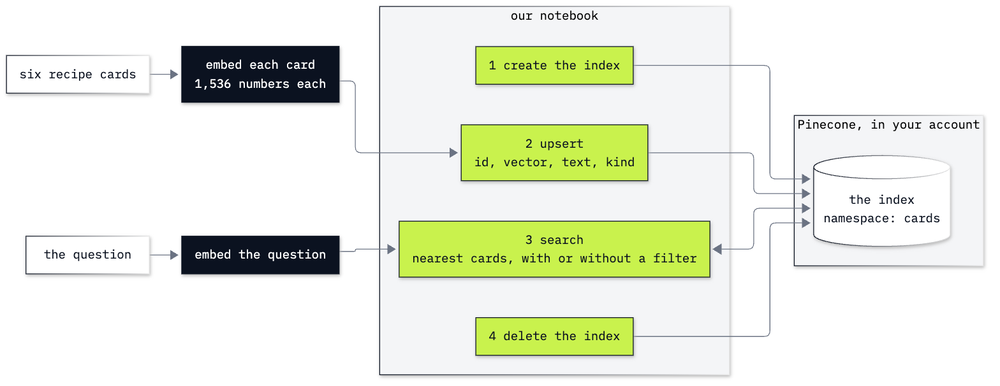
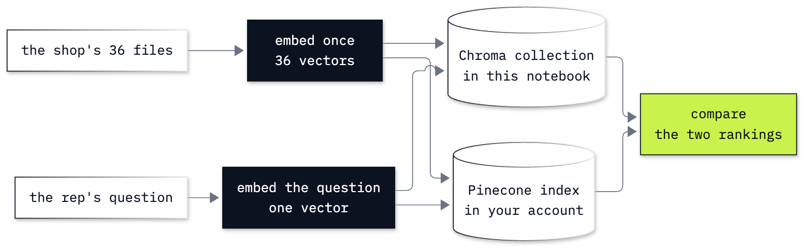

# Bonus B6: How to move retrieval to Pinecone

**CPU | API keys: `OPENAI_API_KEY` and `PINECONE_API_KEY` (a Pinecone account; the free Starter plan is enough) | Practises: storing and searching vectors in a managed vector database, and comparing it with a local one**

This is a bonus lab and it needs a Pinecone account. Retrieval itself needs no account:
[Lab 12](../../12_Retrieval/README.md) teaches it with Chroma, which runs inside the notebook.

## Goal

Keep vectors in Pinecone, a vector database that runs as a service in your account, and find out what moving a
search there changes. The lab has two notebooks.

**Notebook 1** is a playground: a shelf of six recipe cards. A question about a cold, rainy night shares no word
with any card and still finds the two soups. We create an index, write the cards to it, and search it. Then we tell
the search to look only at the desserts, and it returns a dessert even though no dessert suits a cold night: the
better of the two it was allowed to rank, with one of the lowest scores on the shelf. Last we delete the index,
because it stays in the account after the notebook is closed.

**Notebook 2** takes Pinecone to the Chinook music shop's support desk and its 36 policy and ticket files. The same
vectors go to a Chroma collection and to a Pinecone index. A rep asks *When is support staffed?* In Chroma the file
with the hours comes second, behind the file about the support staff. We ask Pinecone, compare the two rankings,
read what the rep gets when only the nearest file reaches the model, and then say what the move changed and what it
left alone.

## What you will learn

- How to create a Pinecone index with a schema, and read what was created.
- How to write records with `upsert` (an id, a vector, a text and a label), check that they arrived, and read one
  back.
- How to search with a question's vector, and read the raw result before a helper wraps it.
- How a metadata filter changes which records are ranked, and why it does not change a score.
- How to give the same vectors to Chroma and to Pinecone, compare their rankings, and tell a search that ranked the
  wrong file first from a problem with the store.
- When a managed store is worth an account, and how to delete an index and check that it is gone.

## What you will do

### Notebook 1: meet Pinecone on a shelf of recipe cards (`b6a_meet_pinecone.ipynb`)

**Part A: Search the recipe cards by meaning, by hand.** Six cards, a word search that finds nothing, the cards
and the question as vectors, and every card scored with one matrix product.
**Part B: Create an index in Pinecone.** The name, the schema and the deployment; what `describe` returns; the
index in the console.
**Part C: Write the cards to the index with upsert.** One document shown, six written, the count checked, one card
read back with `fetch`.
**Part D: Search the index with the question's vector.** The raw result, its scores beside the ones computed by
hand, then `search` as a helper.
**Part E: Limit the search to one kind of card with a filter.** Desserts only for the rainy night, beside the list
of all six.
**Part F: Delete the index and check that it is gone.**
**Challenge.** Two friends' playlists on one index, each in a namespace of their own, and a search in the wrong one.

### Notebook 2: Pinecone at the Chinook support desk (`b6b_pinecone_at_the_desk.ipynb`)

**Part A: Embed the shop's files once.** The 36 files, one of them printed, and one embedding call.
**Part B: Store the same vectors in Chroma and in Pinecone.** A collection, an index, 36 records in each, and one
record read from both.
**Part C: Ask both stores the same question.** The raw results, the two rankings side by side, two helpers that
return the same rows, and five more questions.
**Part D: Read what the rep gets when the nearest file is the wrong one.** The staffing question answered from one
file and from three.
**Part E: Write a Chroma filter as a Pinecone filter.** The policies-only filter in both stores, and the Pinecone
call for each Chroma call.
**Part F: List what the move to Pinecone changed, and delete the index.**
**Challenge.** Choose the filter that keeps the file with the answer, and reword the staffing question so that the
hours file comes first.

In both drawings the black boxes are calls to the embedding model, the lime boxes are our code, and the white
shapes are data and the stores.

## Checkpoints

| After | You should see |
|---|---|
| Notebook 1, Part A | six empty lists from the word search; `D` of shape (6, 1536); `tomato_soup` (0.401) and `lentil_soup` (0.383) first, `chocolate_mousse` (0.211) and `mango_sorbet` (0.205) last |
| Notebook 1, Part B | `exists: True`; the name `ai-agents-b6-cards`, `ready: True`, a schema with `dense_vector`, 1536 and `cosine`, `aws us-east-1` |
| Notebook 1, Part C | the first document with `1536 numbers` in place of its vector; `upserted: 6`; `stored in cards: 6`; the tomato soup card fetched by its id |
| Notebook 1, Part D | a raw result with `matches`, `namespace` and `usage`; `tomato_soup`, `lentil_soup`, `greek_salad` with the scores of Part A; `mango_sorbet` first (0.438) for the hot-day question |
| Notebook 1, Part E | with the dessert filter two cards, `chocolate_mousse` at 0.211 and `mango_sorbet` at 0.205; in the list of six they are fifth and sixth with the same scores |
| Notebook 1, Part F | `exists: False` |
| Notebook 2, Part A | 36 files, 20 policies and 16 tickets; the hours file with its Monday to Friday line; 36 vectors of 1,536 numbers |
| Notebook 2, Part B | `in Chroma: 36`, `exists: True`, `upserted: 36`, `in Pinecone: 36`; the same kind and hours line from both stores |
| Notebook 2, Part C | `policy_support_reps.md` first (0.528) and `policy_support_hours.md` second (0.474) in both stores; five ✅ lines |
| Notebook 2, Part D | with the nearest file only, a reply with no hours and `policy_support_reps.md` as the file used; with three files, Monday to Friday, 09:00 to 17:00 |
| Notebook 2, Part E | without a filter `ticket_02_puja_download_expired.md` first (0.545) in both stores; with the policies-only filter `policy_digital_downloads.md` first in both at the cosine it had before (0.504) |
| Notebook 2, Part F | `exists: False` |
| Challenges | notebook 1: `night_bus` (0.548) from `layla` and `long_road` (0.644) from `omar` for the sad song, `static` at 0.235 from `layla` for the gym track, then `exists: False`; notebook 2: the date 2012-07-20 with the tickets-only filter and "I don't know" with the policies-only one, and `policy_support_hours.md` first (0.612) in both stores for *What hours is support open?* |

**About the saved outputs.** They come from `text-embedding-3-small`, the embedding model `models.env` names, and
in notebook 2 from `gpt-6-luna`, its chat model; notebook 1 makes no chat call. The same text embedded twice can
differ in the third or fourth decimal, so check the order of the cards and files, not the last digits. Chat replies
change wording from run to run: check what a reply says, not its words. The two stores returned the same top three
files in the same order for each of ten questions we tried outside the notebooks, with cosines that differed by at
most 0.0003. With only the nearest file, the staffing question got no hours in 11 of 11 runs: 9 replies opened
with "I don't know", and 2, the saved one among them, said that the documents do not say. With three files it got
the hours in 6 of 6. Every upsert we made was visible at the first look; Pinecone's documentation says that this is
not promised, so the notebooks check the count before they search.

## Before you start

- **Lab 00 first.** It checks the environment and that your OpenAI key reaches the model.
- **A Pinecone account and key.** Sign up at [app.pinecone.io](https://app.pinecone.io/), create an API key in the
  console, and add it to `.env` at the repository folder as `PINECONE_API_KEY=...` (if your `.env` is a copy of `.env.example`, the line is already there, commented out: remove the `#` and paste the key after the `=`). The free Starter plan is enough: it allows five indexes, all in the `us-east-1` region of AWS, which is the
  region the notebooks ask for.
- **Run it locally:** in the repository folder, `uv sync` (or `pip install -r requirements.txt`), put both keys in
  `.env`, then open a notebook in VS Code or JupyterLab (`uv run jupyter lab`) with the `.venv` kernel. Run the
  setup cell first. Each notebook runs on its own.
- **What it creates in your account:** one index at a time, with a fixed name: `ai-agents-b6-cards` (notebook 1),
  `ai-agents-b6-shop` (notebook 2 and its solution) and `ai-agents-b6-playlists` (notebook 1's solution). Each
  notebook deletes its index in its last part. Run that part: an index stays in the account until it is deleted,
  also after the kernel stops. If several people share one Pinecone project, run the notebooks one person at a
  time, or give `INDEX_NAME` an ending of your own.
- **What leaves your machine:** the recipe cards and the shop's 36 files are sent to OpenAI to be embedded, and
  their texts and vectors are stored in Pinecone until the index is deleted.
- **Data:** notebook 1 uses six cards typed into the notebook. Notebook 2 reads the 36 files of `data/corpus/` in
  place. Nothing is written to `data/` or to the lab folder.
- **Cost:** five chat calls and 21 embedding calls, solutions included. Two of the embedding calls embed the 36
  files (2,551 tokens each); the others embed one line or a few. Together: well under one US cent at OpenAI.
  Pinecone's Starter plan costs nothing.

## Folder contents

| Path | What it is |
|---|---|
| `b6a_meet_pinecone.ipynb` | notebook 1, the recipe cards, with saved outputs |
| `b6b_pinecone_at_the_desk.ipynb` | notebook 2, the Chinook support desk, with saved outputs |
| `resources/labB6_index_lifecycle.png` and `.mmd` | the four calls to an index, and the drawing's source |
| `resources/labB6_same_vectors_two_stores.png` and `.mmd` | the same vectors in two stores, and the drawing's source |
| `solved/b6a_meet_pinecone_solution.ipynb` | notebook 1's challenge solved, run with its outputs |
| `solved/b6b_pinecone_at_the_desk_solution.ipynb` | notebook 2's challenge solved, run with its outputs |

## Resources

- [Pinecone Python SDK: quickstart](https://sdk.pinecone.io/python/getting-started/quickstart.html): create, upsert,
  search and delete in one page, and which calls go with which kind of index.
- [Pinecone Python SDK: declare a schema and upsert documents](https://sdk.pinecone.io/python/how-to/documents/schema-and-upsert.html)
  and [search documents](https://sdk.pinecone.io/python/how-to/documents/search.html): the field types, `score_by`,
  `top_k`, `include_fields` and `filter`.
- [Pinecone: filter by metadata](https://docs.pinecone.io/guides/search/filter-by-metadata): the filter operators.
- [Pinecone: check data freshness](https://docs.pinecone.io/guides/data/check-data-freshness): why a write is not
  visible to a search at once.
- [Pinecone Python SDK: working with namespaces](https://sdk.pinecone.io/python/how-to/vectors/namespaces.html):
  what a namespace separates.
- [Pinecone: limits by plan](https://docs.pinecone.io/reference/api/database-limits/object-limits) and
  [understand cost](https://docs.pinecone.io/guides/cost/understand-cost): what the Starter plan allows, and how
  reads, writes and storage are counted.
- [Chroma: query and get](https://docs.trychroma.com/docs/querying-collections/query-and-get) and
  [configure a collection](https://docs.trychroma.com/docs/collections/configure): `query`, `get`, and the `cosine`
  space.
- [OpenAI: vector embeddings](https://developers.openai.com/api/docs/guides/embeddings): the embedding models and
  their sizes.

Back to [the bonus lab list](../README.md) or [the full lab list](../../README.md).
