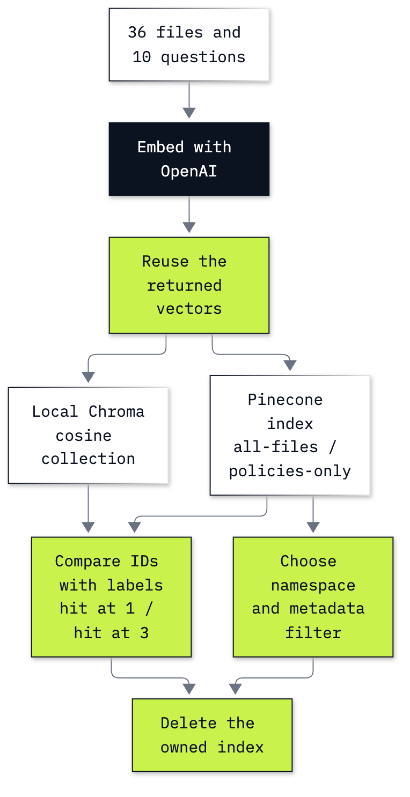

# Bonus B6: How to move retrieval to Pinecone

**CPU | Optional account lab | Keys: `OPENAI_API_KEY`, `PINECONE_API_KEY` | Practises: managed retrieval, relevance measurement and candidate selection**

## Goal

We store and search the Chinook shop's policies and tickets in Pinecone, then decide what changed by comparing it with local Chroma. Both stores receive the same vectors and ten labelled questions. The staffing rule remains second in both stores: moving storage to a managed service does not by itself fix retrieval relevance.

## What you will learn

- How to embed the supplied files and keep each vector attached to its file name and metadata.
- How to create a uniquely named Pinecone index with its current raw Python SDK and read its readiness.
- How to upsert and search documents directly, reading IDs, cosine scores, text and metadata before using a helper.
- How to compare two stores on the same vectors with hit@1 and hit@3.
- How to narrow a search with metadata and keep datasets separate with namespaces.
- How to delete only the index this notebook created and verify it is gone.
- When a managed vector store is worth an account, compared with lab 12's local Chroma.

## What you will do

| Part | What it adds |
|---|---|
| Part A: Keep the files, vectors and labels aligned | Inspect a policy and one embedding, then build aligned matrices and the answer key |
| Part B: Create an index that belongs to this run | List existing indexes, record ownership, create the schema and read readiness |
| Part C: Upsert and search documents directly | Upsert one record, fetch it, upsert all files, inspect a raw search and then define the helper |
| Part D: Compare the same vectors in local Chroma | Select cosine explicitly, compare scores for shared IDs and score ten labelled questions |
| Part E: Restrict the search with metadata | Exclude tickets and see the download policy become first with its score unchanged |
| Part F: Separate datasets with namespaces | Compare a policy partition with a filter, then see the wrong partition exclude a ticket's shipment date |
| Challenge | Apply a tickets-only filter in both namespaces and compare policy selection in three ways |
| Clean up | Verify the owned name is absent and pre-existing index names remain |

The diagram focuses on the ten labelled comparison questions. Part F adds one shipment-date question, so the batch contains 11 question vectors. The notebook also makes a separate one-question embedding call first to expose that API's result.

## Checkpoints

| After | Saved result and meaning |
|---|---|
| Part A | 36 × 1,536 file matrix and 11 × 1,536 question matrix; eight answerable questions, two unanswerable; 2,666 embedding tokens including the single-question example |
| Part B | One owned managed index in AWS `us-east-1`, dimension 1,536, cosine metric, `ready = True` |
| Part C | One write/fetch, then 36 records in `all-files`; returns policy first at cosine 0.613277 in the learner notebook |
| Part D | Both stores: hit@1 **4/8 = 0.500**, hit@3 **6/8 = 0.750**; identical ordered top-three lists **10/10**; largest shared-ID score gap **0.00000082** in the learner run and **0.00000078** in the solution |
| Part E | Only policy records; downloads policy moves from second to first, retaining cosine **0.504425** in the learner run |
| Part F | Namespace counts 36 and 20; policy filter and namespace return the same download IDs; ticket 06 is included in `all-files` and excluded from `policies-only` |
| Challenge | Solution: ticket filter finds ticket 06 in `all-files` and zero matches in `policies-only`; Chroma filter, Pinecone filter and Pinecone namespace agree on the three download policy IDs |
| Clean up | Owned index deleted and absent; pre-existing index names still present; clients closed |

**About the saved outputs.** Embeddings come from `text-embedding-3-small`, selected in `models.env`; the standard configuration also reports `gpt-6-luna`, but this lab makes no chat-model call. Each notebook has its own complete cloud run and cleanup. Scores can vary slightly across embedding calls. The ten-case comparisons have no repeated IDs; both notebooks' later unfiltered shipment response prints ticket 06 twice. That is one observed SDK response with unknown service-versus-client origin, preserved without deduplication; two returned slots are not evidence of two stored records. Inspect actual IDs and scores when your output differs. These small fixtures do not measure general recall, scale or latency.

## When to use it

Lab 12 keeps the same corpus in local Chroma with only the OpenAI key. With the same vectors, both stores scored
hit@1 4/8 and hit@3 6/8 and returned identical ordered top-three lists for 10 of 10 questions: the managed store did
not change relevance (that is retrieval work, labs 12 and 13). It changed who runs the database, and in return we
needed an account, an index lifecycle, writes polled until visible and an owned-index cleanup. Choose Pinecone when
the corpus or traffic outgrows one machine, several services share one index, or each customer needs its own
partition and you would rather not operate the database; for a corpus this size, Chroma is enough.

## Before you start

Use [Lab 00's setup](../../00_Environment_Check/README.md) to prepare the repository environment. From the repository root, run `uv sync --python 3.13` (or `pip install -r requirements.txt`). Copy `.env.example` to `.env` if needed and add your two keys there. Keep that file private. Open [b6_pinecone_retrieval.ipynb](b6_pinecone_retrieval.ipynb) in VS Code or JupyterLab with the repository's `.venv` kernel and run from the top. No previous lab execution is needed.

For Pinecone, sign in to [the console](https://app.pinecone.io/), choose your project, and create a project API key permitted to create/delete indexes and read/write documents. Check your plan and remaining usage before running. [Pinecone pricing](https://www.pinecone.io/pricing/) lists (checked 5 November 2026) Starter with included usage in AWS `us-east-1`; this lab requests that deployment. Availability and quotas depend on your account. If creation is refused, stop and inspect the quota; preserve every existing index. The teaching design requires no plan upgrade or purchase.

⚠️ These cells send the supplied teaching texts to OpenAI for embeddings and store them in Pinecone. Each full notebook uses two embedding calls, 2,666 input tokens and **$0.00005332** at the configured embedding price. It makes no chat-generation call. Pinecone database writes, reads and storage are separate service usage governed by your plan; the lab requests no Pinecone embedding inference. Deletion does not undo billed usage.

The notebook creates one randomly named `b7-chinook-...` index, records its name and ownership tag in ignored `outputs/ownership.json`, and deletes it in **Clean up**. Run cleanup before restarting the notebook. If the kernel is lost, use that saved name and tag to identify and delete only your resource in the console. Keep existing indexes intact.

[Lab 12](../../12_Retrieval/README.md) is the open-source Chroma route. This lab restates its inputs and embeds the supplied corpus itself; it reads the 36 files in `data/corpus/` without changing them. See [the data note](../../data/README.md) for their source and terms.

## Folder contents

| Path | What it is |
|---|---|
| `b6_pinecone_retrieval.ipynb` | Guided notebook with saved outputs |
| `solved/b6_pinecone_retrieval_solution.ipynb` | Standalone worked challenge with its own saved run |
| `resources/labB6_managed_store.mmd` and `.png` | Diagram source and exported image |
| `resources/README.md` | Data provenance and API reference notes |
| `outputs/ownership.json` | Created at runtime, ignored by git; the non-secret name and run ID for cleanup |

## Resources

- [Pinecone Python quickstart](https://sdk.pinecone.io/python/getting-started/quickstart.html): raw client, schema, index and document lifecycle.
- [Schema and upsert](https://sdk.pinecone.io/python/how-to/documents/schema-and-upsert.html) and [document search](https://sdk.pinecone.io/python/how-to/documents/search.html): vector fields, returned fields and filters.
- [Namespaces](https://sdk.pinecone.io/python/how-to/vectors/namespaces.html): partition isolation; the notebook uses this concept through the documents API.
- [V10 migration](https://sdk.pinecone.io/python/migration/v10-migration.html): current schema/documents APIs and compatibility calls.
- [Pinecone pricing](https://www.pinecone.io/pricing/): account plans, included usage and charges.
- [OpenAI embeddings](https://developers.openai.com/api/docs/guides/embeddings): vector objects and token usage.
- [Chroma configuration](https://docs.trychroma.com/docs/collections/configure) and [metadata filters](https://docs.trychroma.com/docs/querying-collections/metadata-filtering): cosine space and the local `where` argument.

Back to [the bonus lab list](../README.md) or [the full lab list](../../README.md).
