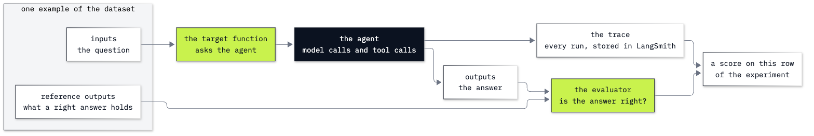

# Bonus B7: How to trace and evaluate an agent with LangSmith

**CPU | Keys: `OPENAI_API_KEY` and `LANGSMITH_API_KEY` (a free LangSmith account) | Practises: reading what an agent did from its trace; testing it with a dataset and evaluators**

## Goal

Record what an agent does in LangSmith, then test it against answers written down in advance. The lab has two
notebooks, and both need a LangSmith account: LangSmith is a hosted service, so every traced question, tool result
and answer is sent to it. The free Developer plan is enough. Lab 20 does the same work on your own machine with
MLflow and no account.

**Notebook 1** is a playground: a helper that splits a restaurant bill with one tool, `split_bill`. Asked to add a
15 *dollar* tip, it answers, and the reply does not say whether the tool ran or what it was given. The trace does:
the tool was given 15 as a percentage, and in our saved run the right amount in the reply came from the model, not
from the tool. Then three questions with reference answers go through `evaluate`. The limerick question fails, and
its trace is complete, with every step a success.

**Notebook 2** takes the same steps to the Chinook support desk: the agent with six tools, the eight test cases of
Lab 20 stored as a LangSmith dataset, and two evaluators, one for the answer and one for the tools that ran. Two rows
fail. For the name typed without its accent, the trace shows the cause: the lookup found nobody. For the poem about
Saturn, the trace is complete and the path check passes; only the answer check fails.

## What you will learn

- How to record a Python function as a run with `traceable`, and switch tracing on for a LangChain agent with
  `ls.configure`.
- How to read a trace as a tree of model and tool runs, on the LangSmith page and from code with `client.runs.query`.
- How to find out from a trace what a tool was given and what it returned, when the reply does not say.
- How to store test questions and their reference answers as a LangSmith dataset.
- How to write evaluators in plain Python, one for the answer and one for the path, and run them with `evaluate`.
- How to read a failing row from its scores and its trace, and tell a cause the trace shows from one it cannot show.
- How to delete what a notebook stored in your LangSmith account, and check that it is gone.

## What you will do

### Notebook 1: meet LangSmith on a restaurant bill (`b7a_meet_langsmith.ipynb`)

**Part A: Ask the helper two questions and look only at its replies.** `split_bill` by hand, the helper built with
`create_agent`, a 15% tip and a 15 dollar tip, and the two questions a reply leaves open.
**Part B: Record each run in LangSmith and read it back as a tree.** A project of our own, tracing switched on,
one function call recorded with `traceable` and read back field by field, then the helper's two questions as
traces, printed as a tree, and the arguments each tool run was given.
**Part C: Test the helper with a dataset and `evaluate`.** Three questions with reference answers, a target and an
evaluator tried by hand, the experiment, and the trace of the failed row.
**Challenge.** A second helper that says what it does with other requests, and a second experiment on the same
dataset.

### Notebook 2: LangSmith at the Chinook desk (`b7b_langsmith_at_the_desk.ipynb`)

**Part A: Build the desk agent and trace one question.** Six read-only tools called by hand, the agent, and the trace
of the Helena question with the arguments and results of its three lookups.
**Part B: Store the eight test cases as a LangSmith dataset.** One case field by field, the reason for each case,
and the eight examples with the question as input and the answer key as reference.
**Part C: Run the cases with two evaluators and read the failing rows.** `facts_in_reply` and `right_tools`, tried
on one run, then `evaluate` on all eight, the two failing rows, and their traces.
**LangSmith or MLflow for the same eight cases.** What each tool asks of you and where the data goes.
**Challenge.** One sentence for requests outside the shop, a lookup that offers close spellings, and a second
experiment.

In the drawing the dark box is the agent's model calls and tool calls, the green boxes are our code, and the white
boxes are data. It draws one row of notebook 1: one evaluator, and an answer as the only output. In notebook 2 the
target also returns the tools that ran, and a second evaluator, `right_tools`, scores them.

## Checkpoints

| After | You should see |
|---|---|
| Notebook 1, Part A | `split_bill(84.50, 4, 15)` returns 24.29; the helper says 24.29 for the 15% tip; for the 15 dollar tip the right answer is 24.88, and our saved reply said 24.29 |
| Notebook 1, Part B | one `split_bill` run, `success`, output 24.29; a tree of three traces, each `bill_helper` trace with a `split_bill` run between two `ChatOpenAI` runs; for the 15 dollar question the tool was given `tip_percent` 15 and returned 24.29 |
| Notebook 1, Part C | three examples stored; two ✅ rows and one ❌, the limerick; its trace is one `ChatOpenAI` run, no tool run, every status `success`; three `True` lines after the clean-up |
| Notebook 2, Part A | Helena: 7 invoices, $49.62, Steve Johnson; `find_customer` given `Helena Holý` returned customer 6, then `get_invoices` and `get_support_rep` with `customer_id` 6 |
| Notebook 2, Part B | `examples stored: 8` |
| Notebook 2, Part C | six ✅ rows; `accent` ❌ (facts `False`, tools `False`) with one `find_customer` run that returned no match; `out_of_scope` ❌ (facts `False`, tools `True`) with one `ChatOpenAI` run and every status `success`; three `True` lines after the clean-up |
| Challenges | notebook 1: in the second experiment the limerick is refused (✅) and the 15% row is ✅; the 15 dollar row may be ✅ or ❌ in either experiment (its reply was wrong in 9 of 15 runs, see below); notebook 2: eight ✅ rows, the accent row found after two `find_customer` calls, the poem refused |

**About the saved outputs.** They come from `gpt-6-luna`, the model `models.env` names, at reasoning effort `none`.
The model writes its replies and chooses its tool arguments on every run, so check the tools, the arguments and
the scores, not the words. Some steps vary more than others:

- **The 15 dollar tip.** In 15 runs of the two questions outside the notebooks, the tool was given `tip_percent` 15
  every time; the reply said the wrong 24.29 in 9 and the right 24.88 in 6. The saved runs show both: Part A's
  reply was wrong, Part B's was right while the tool returned 24.29, the experiment's row passed, and the first
  experiment of notebook 1's solution failed it.
- **The limerick.** With the notebook's instructions the helper wrote the limerick in 10 runs out of 10. With a
  sentence telling it to decline anything that is not about splitting a bill, it declined in 10 out of 10.
- **The two red desk rows.** With the notebook's instructions the accent row failed both checks in 10 runs out of
  10, and the poem was written in 14 out of 14; the other six rows passed every time. With the sentence the
  challenge adds, the poem was declined in 14 out of 14.

Every traced run is stored in a project whose name starts with `ai-agents-b7-` and ends with random characters, so
your names differ from ours. Each notebook and solution deletes its project, dataset and experiments at the end.

## Before you start

- **Lab 00 first.** It checks the environment and that your key reaches the model.
- **A LangSmith account.** Sign up at [smith.langchain.com](https://smith.langchain.com). The free Developer plan has
  one seat and up to 5,000 base traces a month; the two notebooks together store fewer than 20 traces, and the two
  solutions about 20 more. Create an API key under **Settings**, **API Keys**, and add `LANGSMITH_API_KEY=...` to
  `.env` beside `OPENAI_API_KEY`. The notebooks read it the way they read the OpenAI key and never print it.
- **Run it locally:** in the repository folder, `uv sync` (or `pip install -r requirements.txt`), then open a
  notebook in VS Code or JupyterLab (`uv run jupyter lab`) with the `.venv` kernel. Run the setup cell first. Each
  notebook runs on its own; neither needs Lab 20 to have been run.
- **What leaves your machine:** with tracing on, the questions, the tool results and the answers go to LangSmith.
  In notebook 2 they include customer names from the sample database. The notebooks switch tracing on with
  `ls.configure` and off again before the clean-up.
- **What stays in your account:** nothing, once the last cell of a notebook has run. If you stop halfway, run the
  last cell anyway; it deletes the project and the dataset the notebook made.
- **Region:** the notebooks use LangSmith's US address. For an account in another region, set
  `os.environ["LANGSMITH_ENDPOINT"]` to that region's address before `Client()`.
- **Data:** `data/chinook.db`, the Chinook sample music shop, opened read-only, and the shop's files in
  `data/corpus/`. The eight cases are in `resources/golden_cases.json`, the same file as Lab 20's.
- **Cost:** about 15 model calls in notebook 1 and 25 in notebook 2, under one US cent together at the prices in
  `models.env`. LangSmith charges nothing on the free plan at this volume.

## Folder contents

| Path | What it is |
|---|---|
| `b7a_meet_langsmith.ipynb` | notebook 1, the playground, with saved outputs |
| `b7b_langsmith_at_the_desk.ipynb` | notebook 2, the Chinook desk, with saved outputs |
| `resources/golden_cases.json` | the eight desk cases, the same file as Lab 20's |
| `resources/labB7_evaluate_row.png` | the drawing of one example going through `evaluate` (source: `labB7_evaluate_row.mmd`) |
| `solved/b7a_meet_langsmith_solution.ipynb` | notebook 1's challenge solved, run with its outputs |
| `solved/b7b_langsmith_at_the_desk_solution.ipynb` | notebook 2's challenge solved, run with its outputs |

## Resources

- [LangSmith Observability](https://docs.langchain.com/langsmith/home): where the documentation on tracing starts
- [Trace LangChain agents](https://docs.langchain.com/langsmith/trace-with-langchain): what LangChain sends when
  tracing is on
- [Annotate code for tracing](https://docs.langchain.com/langsmith/annotate-code): `traceable` and the other ways to
  record your own functions
- [Tracing quickstart](https://docs.langchain.com/langsmith/observability-quickstart): the setup, with the API
  addresses of the regions
- [Migrate run queries](https://docs.langchain.com/langsmith/smithdb-sdk-migration-query-runs): `client.runs.query`
  and its `selects`
- [Evaluation quickstart](https://docs.langchain.com/langsmith/evaluation-quickstart): a dataset, a target, an
  evaluator and `evaluate`
- [How to define a code evaluator](https://docs.langchain.com/langsmith/code-evaluator-sdk): the arguments an
  evaluator can ask for
- [Compare experiment results](https://docs.langchain.com/langsmith/compare-experiment-results): two experiments of
  one dataset, row by row
- [LangSmith pricing](https://www.langchain.com/pricing): what the free Developer plan includes

Back to [the bonus labs](../README.md).
