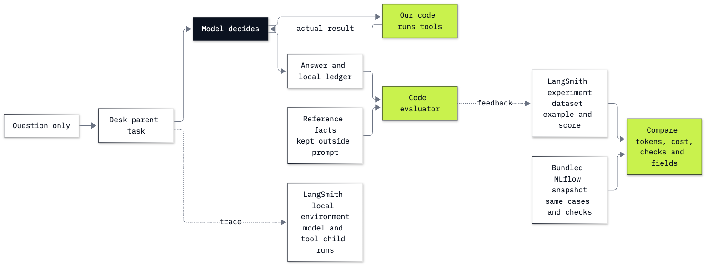

# Lab B8: How to trace and evaluate an agent with LangSmith

## Goal

Trace the Chinook support agent in LangSmith and evaluate fixed questions whose reference answers stay outside its prompt. Inspect a row whose tool path passes while its reply fails: the trace and the answer check establish different things.

## What you will learn

- Register a teaching agent and select its local tracing environment.
- Wrap an OpenAI call and add tool and parent runs with `traceable`.
- Retrieve current SDK run records, including nested operations and their token usage.
- Create a dataset with separate questions and references, then score it with `evaluate`.
- Read failed replies beside their costs, compare with local MLflow, and remove owned resources.

**CPU | Keys: `OPENAI_API_KEY`, `LANGSMITH_API_KEY` | Optional account lab | Practises: tracing, evaluation and cost accounting**

## Run first

Use the [environment setup](../../00_Environment_Check/README.md), then run `uv sync` from the repository folder (or `pip install -r requirements.txt`) and select its `.venv` kernel. Put the existing OpenAI and LangSmith keys in the repository `.env`. The notebook loads them without displaying them. Use an existing authorized workspace; no subscription purchase is needed by these instructions.

The executed route uses an **agent-based LangSmith Cloud workspace** and a key allowed to register an external agent (`projects:create`), create a dataset and experiment, and delete those teaching resources. An agent record organizes traces; it does not deploy or host the Python agent. See [registration and permissions](https://docs.langchain.com/langsmith/create-an-agent). A project-based or self-hosted workspace uses the [project compatibility route](https://docs.langchain.com/langsmith/observability-quickstart); its setup differs from the registration cells here.

Open [the guided notebook](B8_langsmith_tracing_and_evals.ipynb) and run from the top. It defines the desk, database tools, policy fixtures, loop and evaluator itself. You do not need to execute [Lab 18](../../18_Evals_And_Tracing/README.md) first. The [worked notebook](solved/B8_langsmith_tracing_and_evals_solution.ipynb) also runs independently and adds a held-out customer and an altered-answer check.

LangSmith receives prompts, tool results, replies, reference outputs and scores for the public Chinook sample and handmade fixtures. Keep private customer data out of this exercise. Model requests use only the configured OpenAI client. The notebook stops further model calls once its successful-call ledger reaches $2; a request already in progress can cross that threshold. Output and turn limits bound each task too.

## What you will do

**Part A: Register a tracing destination.** Create a uniquely named external-agent record, inspect its four environment sessions and select `local`.

**Part B: Wrap one model call.** Inspect the OpenAI reply, retrieve its LangSmith `llm` record through the current asynchronous API, and price actual usage from the configured rates.

**Part C: Build the desk from visible tools.** Inspect read-only customer records, the spelling suggestion, policy and billing fixture before combining a manual tool request and execution into a loop.

**Part D: Read model and tool runs under one parent.** Trace a tool directly, then trace the whole desk; retrieve children and compare model-run counts with ledger rows.

**Part E: Separate dataset inputs from reference outputs.** Inspect one golden case, upload eight examples and apply the code rubric to the real Helena output.

**Part F: Evaluate every case and read the failures.** Use `evaluate` with the unchanged cases and rubric, join rows by case ID and print each failed reply with its actual tool results.

**Part G: Compare the same measurement fields.** Aggregate every task, including failures, and compare token, cost and correctness fields with the bundled MLflow snapshot.

**Part H: Remove the resources this notebook created.** Save the local report, delete only owned cloud resources and query their IDs to verify absence.

**Challenge.** Add one held-out customer question, then change the total in a copy of a real answer and explain why facts fail while tool evidence survives. Run cleanup afterwards.

## Checkpoints

| After | You should see in the saved learner run |
|---|---|
| Part A | One owned agent with four environments; `local` selected |
| Part B | `ready`, a retrieved `llm` run and $0.00000320 configured model-token cost |
| Part C | Helena: 7 invoices, $49.62, Steve Johnson; a spelling suggestion for `Helena Holy`; billing status `requested`, no payment date |
| Part D | 3 model children match 3 ledger rows; 1382 input and 100 output tokens |
| Part E | Eight examples; only the question reaches the target, references reach the evaluator |
| Part F | 7/8 pass; failed IDs: out_of_scope; actual failed replies printed |
| Part G | 20 evaluation calls; 9,048 input and 572 output tokens; $0.00014885 per task, including failures |
| Part H | Zero owned projects, datasets and agents remain |

The recorded MLflow comparison uses the same eight questions, close-name lookup and code checks: 7/8, 20 calls, 9,048 input tokens, 581 output tokens and $0.0001494125 per task. Runs taken at different times cannot establish platform overhead. The eight-case pass rate describes these checks on these inputs; it is not a production error probability.

**About the saved outputs.** The learner and worked notebooks each use `gpt-6-luna` at reasoning effort `none`, selected through `models.env`. Each describes its own run. Replies, call paths, tokens and elapsed time vary. Keep a different live result; do not repeat runs until they match the saved score. Both saved runs removed their own cloud resources, so their printed SDK records and local snapshots are the evidence to read.

## Files and cleanup

| Path | Purpose |
|---|---|
| `B8_langsmith_tracing_and_evals.ipynb` | Guided notebook with real outputs |
| `solved/B8_langsmith_tracing_and_evals_solution.ipynb` | Independently executed worked challenge |
| `resources/golden_cases.json` | Byte-for-byte copy of Lab 18's eight cases |
| `resources/mlflow_run_summary.json` | Byte-for-byte copy of Lab 18's recorded baseline and changed runs |
| `resources/langsmith_run_summary.json`, `resources/langsmith_solution_run_summary.json` | Each saved notebook's evaluation, usage and cleanup evidence |
| `resources/README.md` | Data fields, source and licence notes |
| `resources/labB8_same_cases_two_tools.mmd`, `.png` | Diagram source and export |

Live runs write `outputs/owned.json` and `outputs/run_summary.json`, both gitignored. The first records IDs as resources are created, so an interrupted run can be cleaned up without a broad workspace search. Remove only those exact IDs. If deletion is denied, retain that file and ask the workspace administrator to remove the recorded resources. Never delete another user's project to make room for this exercise.

## Resources

- [Create an agent](https://docs.langchain.com/langsmith/create-an-agent): registration, environments and permissions.
- [Send traces to an agent](https://docs.langchain.com/langsmith/log-traces-to-agent): explicit tracing addresses and environment variables.
- [Retrieve runs and trace children](https://docs.langchain.com/langsmith/smithdb-sdk-migration-runs): `runs.retrieve`, `traces.list_runs` and selected fields.
- [Evaluate a target](https://docs.langchain.com/langsmith/evaluate-llm-application): datasets, target functions and code evaluators.
- [OpenAI function calling](https://developers.openai.com/api/docs/guides/function-calling): the model requests a tool; your code executes it.

Back to [bonus labs](../README.md) or [all labs](../../README.md).
